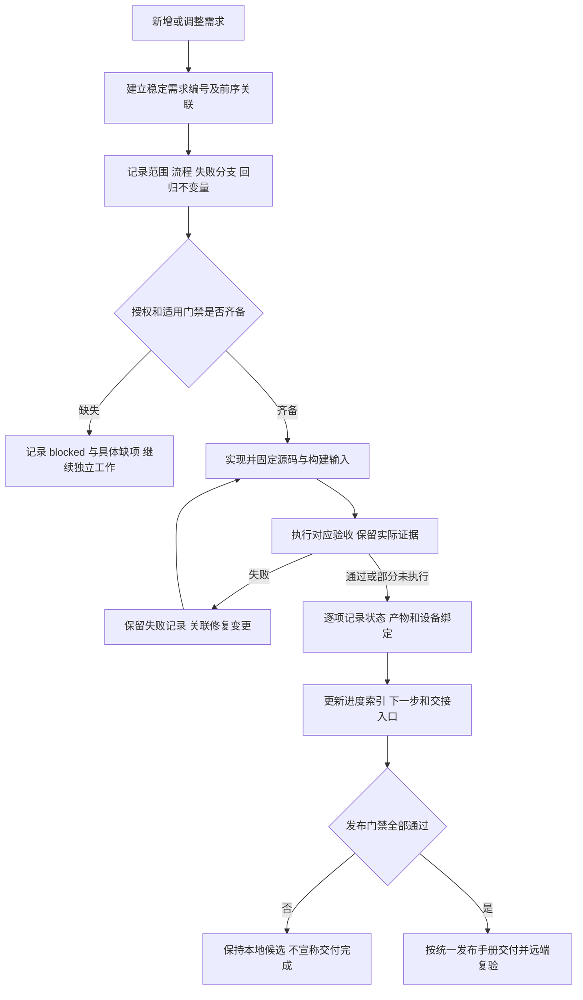

# 全变更门禁与上下文接续

规则编号：MIMI-TRACE-001。用户确认日期：2026-10-14。
本规则补充 MIMI-UPDATE-001，适用于 UI、后端、接口、构建、打包、运维工具、配置、测试与文档。既有签名、兼容性及上传门禁不放宽。

每项变更必须做到“需求 → 业务流程 → 不变量 → 实现 → 验收证据 → 剩余工作”可追溯。代码提交、截图或测试总数不能独自代表完成。

回归不变量：记录先于新功能实施；验证按实际输入/提交/包/设备归属；失败记录不删改为成功；未执行不记 passed；新产物重跑受影响验证；代码和文档的修改同样关联需求；敏感信息不得进入公开记录。已经实施的历史工作只能注明补记时间和证据来源，不伪造事前记录。

## 每条记录必须包含

| 项目 | 内容 |
| --- | --- |
| 稳定编号与关联 | REQ-MIMI-类别-序号，关联前序需求、变更、门禁 |
| 背景与范围 | 用户意图、当前行为、目标行为、本次不覆盖的具体部分 |
| 流程与失败分支 | 输入、状态变化、执行结果、错误/取消/恢复；复杂流程用 Mermaid |
| 回归不变量 | 哪些既有行为、边界、安全或兼容条件不能被破坏 |
| 实现位置 | 真实相对文件路径、源提交；未提交时明确标注 |
| 验收条件与结果 | 每项分别 passed / failed / not_run / blocked；区分主机、模拟输入、实体设备与人工确认 |
| 证据绑定 | 证据路径、提交、版本、包哈希、SDK/系统基线、目标设备；不适用写明 |
| 接续信息 | 未完成原因、下一步、所需输入、依赖与替代/失效的历史结论 |

状态只属于具体检查项；不能用一个总 passed 遮盖下游未执行。需求本身可标计划中、实施中、已实现待验收、已验收，交付完成仍服从全部发布门禁。

## 保存与维护

- 本文件是规则及索引，详细记录存于 docs/change-gates/，随源码提交。
- CURRENT_PROGRESS.md 保存最近事实及下一步，必须引用详细门禁和外部证据；不能代替详细门禁。
- output/ 中保存原始日志和证据，绑定源提交/产物，并将关键证据归档到开发路径 .delivery/critical-source-*。仅保留必要恢复依赖，不复制整个构建缓存。
- 公共源码记录使用项目内相对路径及脱敏结论。私有凭据、终端敏感载荷、设备秘密和签名私钥不写进记录；私有原始材料不随公开包发布。
- 修复或范围改变追加日期及变更条目；若重写当前摘要，保留旧证据链接和失败/替代关系。
- 不在源码提交前写入尚不存在的提交哈希。提交后由 progress/evidence 绑定实际提交，下一次记录可引用它。

## 索引

| 需求 | 记录 | 当前状态 |
| --- | --- | --- |
| REQ-MIMI-PAIR-071 权威配对状态与真实有效期 | [记录](change-gates/REQ-MIMI-PAIR-071.md) | 客户端与实际双profile后端主机通过；真实绑定/部署未执行 |
| REQ-MIMI-TRACE-001 全变更可追溯规则 | 本文件 | 已记录，人工语义复核 + 本地自动覆盖检查；远端CI执行 not_run |
| REQ-MIMI-UI-016 首页图标与内嵌分页 | [首页门禁](change-gates/REQ-MIMI-UI-016.md) | 已实现；整机稳定性 failed |
| REQ-MIMI-BUILD-017 Ubuntu 原生编译基础 | [Ubuntu 门禁](change-gates/REQ-MIMI-BUILD-017.md) | 原生编译/窗口通过；服务状态投影 failed，deb 未验收 |
| REQ-MIMI-UI-018 缺失 HDMI 能力 | [HDMI 能力门禁](change-gates/REQ-MIMI-UI-018.md) | 主机能力分支/两平台编译 passed；真机新产物及 deb not_run |
| REQ-MIMI-UPDATE-019 在线检查网络复验 | [在线检查门禁](change-gates/REQ-MIMI-UPDATE-019.md) | 网络就绪时真实检查 passed；冷启动问题未定位 |
| REQ-MIMI-TRACE-021 自动变更覆盖 | [覆盖门禁](change-gates/REQ-MIMI-TRACE-021.md) | 74主机测试及实际差异 passed；远端CI not_run |
| REQ-MIMI-PAIR-020 配对入口统一 | [配对入口门禁](change-gates/REQ-MIMI-PAIR-020.md) | rc17 入口/单次刷新/返回实机回放 passed；账号归属 not_run |

既有系统发布、配对、IoT、语音、SDK 拆分仍以统一门禁及现存进度为准；后续修改这些模块时先补入对应详细门禁。此处尚未完成全部历史工作的追溯补录，不宣称历史覆盖率已达 100%。

## 自动覆盖检查（REQ-MIMI-TRACE-021，已实现）
详细门禁见[自动覆盖](change-gates/REQ-MIMI-TRACE-021.md)。每批在 change-gates/batches/ 新增JSON，列明需求、详细记录、实际文件列表、验证状态/范围/证据和剩余项；历史批次不改写。提交后运行 `python3 scripts/check_change_gates.py --base <本批开始提交> --head HEAD`。比较基准必须由操作者/CI固定，不能用无关空差异冒充覆盖。自动检查只验证记录存在及文件覆盖，语义、秘密隔离、证据真实性和产品验收继续人工/专用门禁。远端CI尚未运行。

REQ-MIMI-UBUNTU-022：[Ubuntu独立服务基础](change-gates/REQ-MIMI-UBUNTU-022.md)，编译/真实服务窗口passed；完整平台与deb未验收。

REQ-MIMI-STABILITY-023：[A133空闲失联与恢复](change-gates/REQ-MIMI-STABILITY-023.md)，失联failed，原rc17恢复passed；根因未解决。

REQ-MIMI-UBUNTU-024：[Ubuntu V2 查询](change-gates/REQ-MIMI-UBUNTU-024.md)，查询/进程回归及构建已通过；一次窗口发现超时未定位，两次复测通过；完整平台与 deb 未验收。

REQ-MIMI-SDK-025：[Ubuntu x86_64 SDK与deb配对](change-gates/REQ-MIMI-SDK-025.md)，真实SDK/Ubuntu完整应用和A133回归编译通过；签名deb安装未验收。

REQ-MIMI-SESSION-026：[Ubuntu会话启动与健康](change-gates/REQ-MIMI-SESSION-026.md)，完整构建与5组真实进程生命周期passed；签名deb激活not_run。

REQ-MIMI-ENROLL-027：[Ubuntu受控主机登记](change-gates/REQ-MIMI-ENROLL-027.md)，真实主机登记及4类拒绝passed；运行依赖与签名激活未完成。

REQ-MIMI-RUNTIME-028：[Ubuntu运行依赖基线](change-gates/REQ-MIMI-RUNTIME-028.md)，86库真实基线/签名rc19及amd64 deb实际安装读回卸载passed；桌面激活/升级回退not_run。

REQ-MIMI-ACTIVATE-029：[Ubuntu可信会话与升级事务](change-gates/REQ-MIMI-ACTIVATE-029.md)，可信factory启动、rc20真实签名升级、rc21故障回退/重放拒绝和重启passed；物理断电/完整deb激活闭环not_run。

REQ-MIMI-DEBACTIVATE-030：[已安装deb载荷激活](change-gates/REQ-MIMI-DEBACTIVATE-030.md)，rc22真实deb安装载荷激活、purge后健康/重启和设置保留passed；图形登录/整机断电not_run。

REQ-MIMI-STABILITY-031：[网络省电受控对照](change-gates/REQ-MIMI-STABILITY-031.md)，省电on时传输前空闲失联failed；off的4MiB限速下载passed，省电off观察18分34秒失联failed，授权恢复原on与rc17健康passed，根因未确认。

REQ-MIMI-SDK-032：[恢复输入干净产品重建](change-gates/REQ-MIMI-SDK-032.md)，实施前门禁已记录，复现固定系统/factory；实际完整重建运行中，最终镜像门禁not_run。

REQ-MIMI-DELIVERY-033：[发布主线与流程精简](change-gates/REQ-MIMI-DELIVERY-033.md)，用户授权优化顺序；冻结候选/影响范围复测，现有续跑已更新为每15分钟，避免重复job，候选冻结规则生效。

REQ-MIMI-STABILITY-034：[桌面进程隔离](change-gates/REQ-MIMI-STABILITY-034.md)，已记录单变量测试/自动恢复约束，实际not_run。

REQ-MIMI-STABILITY-035：[A133自行重启被动追踪](change-gates/REQ-MIMI-STABILITY-035.md)，事前门禁，实际追踪not_run。

REQ-MIMI-SDK-036：[内核空缓存重放](change-gates/REQ-MIMI-SDK-036.md)，032范围纠正后事前门禁，工具和重放未执行。

- [REQ-MIMI-STABILITY-037](change-gates/REQ-MIMI-STABILITY-037.md)：固定SWU传输与全程被动UART取证，未更改候选或运行设置。

- [REQ-MIMI-SDK-038](change-gates/REQ-MIMI-SDK-038.md)：空输出SDK的64位工具链初始化与应用构建提前拒绝。

- [REQ-MIMI-SYSTEM-039](change-gates/REQ-MIMI-SYSTEM-039.md)：真正干净内核后的镜像门禁及绑定安装通道复核。

- [REQ-MIMI-SYSTEM-040](change-gates/REQ-MIMI-SYSTEM-040.md)：当前rc17小型关键数据刷新和严格PID恢复。

- [REQ-MIMI-SYSTEM-041](change-gates/REQ-MIMI-SYSTEM-041.md)：已验签第一系统基线、同布局保留数据分区模式安装。

- [REQ-MIMI-SYSTEM-042](change-gates/REQ-MIMI-SYSTEM-042.md)：实际持久数据范围、精简恢复备份及写入前边界。

- [REQ-MIMI-SYSTEM-043](change-gates/REQ-MIMI-SYSTEM-043.md)：FES加载器重连和原生同guard串口取证。

- [REQ-MIMI-STABILITY-044](change-gates/REQ-MIMI-STABILITY-044.md)：显示扫描关闭与网络/内存写入隔离，结束恢复显示。

- [REQ-MIMI-STABILITY-045](change-gates/REQ-MIMI-STABILITY-045.md)：原SWU/原runtime受限HTTP传输对照，不安装。

- [REQ-MIMI-STABILITY-046](change-gates/REQ-MIMI-STABILITY-046.md)：真实内存与显示接口核查，先证据后单变量对照。

- [REQ-MIMI-SDK-047](change-gates/REQ-MIMI-SDK-047.md)：实际设备树面板选择、内核配置和编译符号闭环，避免未接入驱动仍生成可用声明。

- [REQ-MIMI-SYSTEM-048](change-gates/REQ-MIMI-SYSTEM-048.md)：新driver内核后的应用/系统版本配对、可信factory及完整产物验收。

- [REQ-MIMI-SYSTEM-049](change-gates/REQ-MIMI-SYSTEM-049.md)：系统metadata外部make与固定生成型索引缓存刷新；真实SDK五包和3回归通过，完整产品/真机待验。

- [REQ-MIMI-SYSTEM-050](change-gates/REQ-MIMI-SYSTEM-050.md)：新618首装FES失败后的固定Windows USB缓存取证；只读metadata及原rc17/GPT/private恢复通过，FES/新系统未验收。

- [REQ-MIMI-SYSTEM-051](change-gates/REQ-MIMI-SYSTEM-051.md)：现有authorizedUSB临时bind/认证和复原、可信OTA接续；未知key unauthorized及原配置/HID恢复通过，MCPADB绑定待用户，正向认证/实机OTA未验收。

- [REQ-MIMI-LOGIN-052](change-gates/REQ-MIMI-LOGIN-052.md)：Ubuntu固定用户真实图形登录桥接，事前记录，未实施/未验收。

LOGIN052更新：独立root平台服务/保留签名deb已部署、真实无X11等待及greeter拒绝passed；CLI空投影缺陷修复，失败历史保留；真实用户X11登录/完整数据not_run，外部登录输入pending。

- [REQ-MIMI-SPLIT-053](change-gates/REQ-MIMI-SPLIT-053.md)：A133后端独立源码和构建，事前记录；正式SDK接入/公共旧源移除仍待完成。

SPLIT053更新：66文件/32TU独立真实编译及与旧后端字节相同passed；SDK配方接入与公共旧源移除not_run，迁移仍未完成。

SPLIT053更新：private32/public30组件、4248/95标准overlay重放、私有SDK958上传独立远端读回及实际SDKprivate编译passed；系统入口/公共旧源移除仍not_run，整套迁移未完成。

- [REQ-MIMI-SPLIT-054](change-gates/REQ-MIMI-SPLIT-054.md)：SDK独立Provider系统入口，实施前记录，实际检查not_run。

SPLIT054更新：系统SDK后端入口已实现，private32/public30实际编译字节对照和A133桌面672源归属passed；完整归集整链/系统重建/真机not_run，公共旧源未移除。

- [REQ-MIMI-SPLIT-055](change-gates/REQ-MIMI-SPLIT-055.md)：移除23个SDK已保存的上层旧后端C副本，事前门禁，实际not_run。

SPLIT055更新：23个旧后端C已从上层移除、SDK原字节核对/24接口头不变/134主机检查（配置实际SDK，0skip）及A133上层重编passed；其余系统源归属/完整镜像与真机not_run，整体未完成。

SPLIT054整链接续更新：首轮npm PATH失败保留；新增node/npm早拒绝，19主机回归passed；固定前三段收据/源码与相同tail后只续跑后两段/更新器，passed_recovered。SDK配置和旧冻结产物SHA均不变；全镜像/真机仍not_run。

- [REQ-MIMI-SPLIT-056](change-gates/REQ-MIMI-SPLIT-056.md)：五平台服务来源迁入SDK，实施前记录，实际not_run。

SPLIT056更新：五系统兼容服务8源/许可证迁SDKd9、4260/95标准重放和独立回读passed；上层旧源移除/新stage3同字节与ABI/136主机回归0skip passed。混合业务和其他源边界仍待收尾，未新建镜像或操作设备，真机not_run。

- [REQ-MIMI-SPLIT-057](change-gates/REQ-MIMI-SPLIT-057.md)：HDMI平台源归属，实施前门禁，实际not_run。

- [REQ-MIMI-DELIVERY-058](change-gates/REQ-MIMI-DELIVERY-058.md)：用户授权先同步源码/产物，A133物理验收后置，草稿/远端复核not_run。

SPLIT057完成受影响主机验证：171项0skip、实际stage2同字节、SDK7ed标准4267/95及独立读回passed；物理按058后置，整体未完成。

- [REQ-MIMI-TRACE-059](change-gates/REQ-MIMI-TRACE-059.md)：首次远端全区间212路径历史覆盖补记，保留初次覆盖失败，不冒充历史事前记录或功能验收。

- [REQ-MIMI-CI-060](change-gates/REQ-MIMI-CI-060.md)：远端失败后的发布YAML/现有UI清单修复，5 YAML/11应用58源和11回归本地passed，真实远端待验，未改产物。

DELIVERY058本轮完成：两类型25附件完整远端下载/原签名/版本绑定passed；CI060代码2af远端三CI passed；TRACE059历史覆盖补记后通过，旧失败保留。物理后置/整个项目未完成，交付记录见docs/delivery/20261015-snapshot.md。

- [REQ-MIMI-SPLIT-061](change-gates/REQ-MIMI-SPLIT-061.md)：共享采集/编码源归属，事前门禁，待源/编译对照。

- [REQ-MIMI-EDITION-062](change-gates/REQ-MIMI-EDITION-062.md)：公共桌面/私有一机一码边界及产品镜像命名，用户要求已记录，实际拆分/新镜像未执行。

SPLIT061系统入口完成：原5上层源已退休，实际video目标/原ELF/ABI/保护哈希、180唯一主机项0skip passed。EDITION062实际源清单已提供，私有产品隔离仍未实施；下一步新镜像命名。

- [REQ-MIMI-IMAGE-063](change-gates/REQ-MIMI-IMAGE-063.md)：未来产品名镜像生成/版本锁/发布链，事前门禁，待实现。

- REQ-MIMI-PRIVATE-064：私有生产工具独立来源，实际构建/回读与公共退休逐项核对。

- REQ-MIMI-PRIVATE-065：100ask产品私有适配独立来源和显式组合，公共Provider保持禁用。

- REQ-MIMI-PRIVATE-066：Tuya产品授权适配、公共提前禁用及暂存源/构建核对。

REQ-MIMI-EDITION-067：[产品来源锁与共享更新保留边界](change-gates/REQ-MIMI-EDITION-067.md)，实施前记录；组件来源和主机数据保留待验证，最终镜像/实机未完成。

REQ-MIMI-EDITION-068：[系统产品版本准入](change-gates/REQ-MIMI-EDITION-068.md)，实施前已记录；系统清单/受控基线/固定标记配对，当前not_run。

REQ-MIMI-SDK-069：[最终产品SDK输入核对](change-gates/REQ-MIMI-SDK-069.md)，实施前已记录，只读闭包核对不等于完整镜像构建或实机验收。

REQ-MIMI-SYSTEM-070：[共用工厂应用和产品基线](change-gates/REQ-MIMI-SYSTEM-070.md)，实施前记录，新包/完整镜像尚未构建，物理验收后置。

REQ-MIMI-RELEASE-072：[相同硬件不同runtime发布证据](change-gates/REQ-MIMI-RELEASE-072.md)，实施前记录，实际候选草稿拒绝已保留，作用域修正及验证not_run。

2026-10-15 最新交付入口：[受控交付快照](delivery/CONTROLLED-SNAPSHOTS-20261015.md)及[56附件元数据](delivery/controlled-snapshots-20261015.json)，对应RELEASE072；三份完整远端复验已通过，原固定产物不变。STABILITY023补充用户Logo后黑屏与只读面板登记分析，原板仍rc17、实体修复和持续健康未通过。历史PAIR071后台“只读未实施”已被用户扩权和独立补丁分支取代，但未部署、桌面消费者未接。

PAIR071/RELEASE072最新候选：共享rc26、公开系统rc5、私有系统rc6及59附件下载复验passed；全产品仍未完成。见[新草稿交接](delivery/PAIR071-SNAPSHOTS-20261015.md)。旧阶段未接客户端/只读服务器描述仅为历史。

REQ-MIMI-UI-075：[组件主页、顶栏与控制中心](change-gates/REQ-MIMI-UI-075.md)，四图已批准，实施中；视觉/目标验收 not_run。

UI075批次二接续：编辑栏/组件库/真实指针验证，见[实际证据](validation/ui075-editor-refinement.json)。需求仍实施中，物理与最终视觉未通过。

UI075批次三：环境详情、新鲜度、系统OTA通知，见[状态与验证](validation/ui075-state-details.json)。不代表实机或完整通知源验收。

- UI075 批次四 IoT摘要：`docs/validation/ui075-iot-summary.json`；主机 passed，真实设备/最终视觉 not_run。

- UI075批次五：`docs/validation/ui075-visual-polish.json`；视觉缺陷/小屏滚动修复，主机passed，最终对齐及实机not_run。
