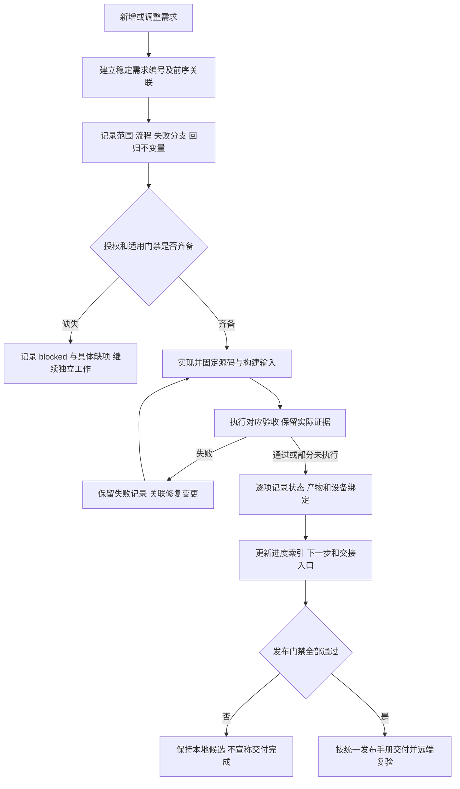

# 全变更门禁与上下文接续

规则编号：MIMI-TRACE-001。用户确认日期：2026-10-14。
本规则补充 MIMI-UPDATE-001，适用于 UI、后端、接口、构建、打包、运维工具、配置、测试与文档。既有签名、兼容性及上传门禁不放宽。

每项变更必须做到“需求 → 业务流程 → 不变量 → 实现 → 验收证据 → 剩余工作”可追溯。代码提交、截图或测试总数不能独自代表完成。

回归不变量：记录先于新功能实施；验证按实际输入/提交/包/设备归属；失败记录不删改为成功；未执行不记 passed；新产物重跑受影响验证；代码和文档的修改同样关联需求；敏感信息不得进入公开记录。已经实施的历史工作只能注明补记时间和证据来源，不伪造事前记录。

## 每条记录必须包含

| 项目 | 内容 |
| --- | --- |
| 稳定编号与关联 | REQ-MIMI-类别-序号，关联前序需求、变更、门禁 |
| 背景与范围 | 用户意图、当前行为、目标行为、本次不覆盖的具体部分 |
| 流程与失败分支 | 输入、状态变化、执行结果、错误/取消/恢复；复杂流程用 Mermaid |
| 回归不变量 | 哪些既有行为、边界、安全或兼容条件不能被破坏 |
| 实现位置 | 真实相对文件路径、源提交；未提交时明确标注 |
| 验收条件与结果 | 每项分别 passed / failed / not_run / blocked；区分主机、模拟输入、实体设备与人工确认 |
| 证据绑定 | 证据路径、提交、版本、包哈希、SDK/系统基线、目标设备；不适用写明 |
| 接续信息 | 未完成原因、下一步、所需输入、依赖与替代/失效的历史结论 |

状态只属于具体检查项；不能用一个总 passed 遮盖下游未执行。需求本身可标计划中、实施中、已实现待验收、已验收，交付完成仍服从全部发布门禁。

## 保存与维护

- 本文件是规则及索引，详细记录存于 docs/change-gates/，随源码提交。
- CURRENT_PROGRESS.md 保存最近事实及下一步，必须引用详细门禁和外部证据；不能代替详细门禁。
- output/ 中保存原始日志和证据，绑定源提交/产物，并将关键证据归档到开发路径 .delivery/critical-source-*。仅保留必要恢复依赖，不复制整个构建缓存。
- 公共源码记录使用项目内相对路径及脱敏结论。私有凭据、终端敏感载荷、设备秘密和签名私钥不写进记录；私有原始材料不随公开包发布。
- 修复或范围改变追加日期及变更条目；若重写当前摘要，保留旧证据链接和失败/替代关系。
- 不在源码提交前写入尚不存在的提交哈希。提交后由 progress/evidence 绑定实际提交，下一次记录可引用它。

## 索引

| 需求 | 记录 | 当前状态 |
| --- | --- | --- |
| REQ-MIMI-TRACE-001 全变更可追溯规则 | 本文件 | 已记录，人工语义复核 + 本地自动覆盖检查；远端CI执行 not_run |
| REQ-MIMI-UI-016 首页图标与内嵌分页 | [首页门禁](change-gates/REQ-MIMI-UI-016.md) | 已实现；整机稳定性 failed |
| REQ-MIMI-BUILD-017 Ubuntu 原生编译基础 | [Ubuntu 门禁](change-gates/REQ-MIMI-BUILD-017.md) | 原生编译/窗口通过；服务状态投影 failed，deb 未验收 |
| REQ-MIMI-UI-018 缺失 HDMI 能力 | [HDMI 能力门禁](change-gates/REQ-MIMI-UI-018.md) | 主机能力分支/两平台编译 passed；真机新产物及 deb not_run |
| REQ-MIMI-UPDATE-019 在线检查网络复验 | [在线检查门禁](change-gates/REQ-MIMI-UPDATE-019.md) | 网络就绪时真实检查 passed；冷启动问题未定位 |
| REQ-MIMI-TRACE-021 自动变更覆盖 | [覆盖门禁](change-gates/REQ-MIMI-TRACE-021.md) | 74主机测试及实际差异 passed；远端CI not_run |
| REQ-MIMI-PAIR-020 配对入口统一 | [配对入口门禁](change-gates/REQ-MIMI-PAIR-020.md) | rc17 入口/单次刷新/返回实机回放 passed；账号归属 not_run |

既有系统发布、配对、IoT、语音、SDK 拆分仍以统一门禁及现存进度为准；后续修改这些模块时先补入对应详细门禁。此处尚未完成全部历史工作的追溯补录，不宣称历史覆盖率已达 100%。

## 自动覆盖检查（REQ-MIMI-TRACE-021，已实现）
详细门禁见[自动覆盖](change-gates/REQ-MIMI-TRACE-021.md)。每批在 change-gates/batches/ 新增JSON，列明需求、详细记录、实际文件列表、验证状态/范围/证据和剩余项；历史批次不改写。提交后运行 `python3 scripts/check_change_gates.py --base <本批开始提交> --head HEAD`。比较基准必须由操作者/CI固定，不能用无关空差异冒充覆盖。自动检查只验证记录存在及文件覆盖，语义、秘密隔离、证据真实性和产品验收继续人工/专用门禁。远端CI尚未运行。

REQ-MIMI-UBUNTU-022：[Ubuntu独立服务基础](change-gates/REQ-MIMI-UBUNTU-022.md)，编译/真实服务窗口passed；完整平台与deb未验收。

REQ-MIMI-STABILITY-023：[A133空闲失联与恢复](change-gates/REQ-MIMI-STABILITY-023.md)，失联failed，原rc17恢复passed；根因未解决。

REQ-MIMI-UBUNTU-024：[Ubuntu V2 查询](change-gates/REQ-MIMI-UBUNTU-024.md)，查询/进程回归及构建已通过；一次窗口发现超时未定位，两次复测通过；完整平台与 deb 未验收。

REQ-MIMI-SDK-025：[Ubuntu x86_64 SDK与deb配对](change-gates/REQ-MIMI-SDK-025.md)，真实SDK/Ubuntu完整应用和A133回归编译通过；签名deb安装未验收。

REQ-MIMI-SESSION-026：[Ubuntu会话启动与健康](change-gates/REQ-MIMI-SESSION-026.md)，完整构建与5组真实进程生命周期passed；签名deb激活not_run。

REQ-MIMI-ENROLL-027：[Ubuntu受控主机登记](change-gates/REQ-MIMI-ENROLL-027.md)，真实主机登记及4类拒绝passed；运行依赖与签名激活未完成。

REQ-MIMI-RUNTIME-028：[Ubuntu运行依赖基线](change-gates/REQ-MIMI-RUNTIME-028.md)，86库真实基线/签名rc19及amd64 deb实际安装读回卸载passed；桌面激活/升级回退not_run。

REQ-MIMI-ACTIVATE-029：[Ubuntu可信会话与升级事务](change-gates/REQ-MIMI-ACTIVATE-029.md)，可信factory启动、rc20真实签名升级、rc21故障回退/重放拒绝和重启passed；物理断电/完整deb激活闭环not_run。

REQ-MIMI-DEBACTIVATE-030：[已安装deb载荷激活](change-gates/REQ-MIMI-DEBACTIVATE-030.md)，rc22真实deb安装载荷激活、purge后健康/重启和设置保留passed；图形登录/整机断电not_run。

REQ-MIMI-STABILITY-031：[网络省电受控对照](change-gates/REQ-MIMI-STABILITY-031.md)，省电on时传输前空闲失联failed；off的4MiB限速下载passed，43分钟对照运行中/最终恢复not_run，根因未确认。

REQ-MIMI-SDK-032：[恢复输入干净产品重建](change-gates/REQ-MIMI-SDK-032.md)，实施前门禁已记录，复现固定系统/factory；实际构建not_run。

REQ-MIMI-DELIVERY-033：[发布主线与流程精简](change-gates/REQ-MIMI-DELIVERY-033.md)，用户授权优化顺序；冻结候选/影响范围复测，调度更新待实际结果。
