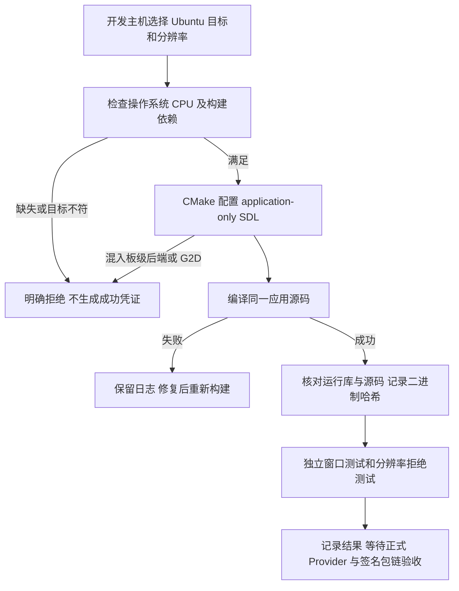

# REQ-MIMI-BUILD-017 Ubuntu 原生编译基础

背景：用户于2026-10-14明确 deb 首个验收目标是 Ubuntu 开发主机桌面，A133 保持 Tina 包。当前 SDK/发布链仅接受 A133 aarch64，不能把其产物改名为 amd64.deb。关联 MIMI-TRACE-001、MIMI-UPDATE-001、D02、docs/next-phase-ai-desktop-requirements.md。

本轮范围：新增 ubuntu-host 原生 x86_64 SDL 应用编译入口、依赖预检、开发者屏幕列表选择、真实构建和运行库哈希记录；隔离 A133 显示和固定音量/背光调用。正式 Ubuntu Provider、身份登记/更新器、可信 deb 安装与升级验收仍另需完成，不把开发目标声明为已交付平台。

回归不变量：Ubuntu 不链接或调用 A133 专用驱动；不把固定 ALSA numid 用于主机声卡；暂不支持的背光/音量返回 ENOTSUP，不伪造成功；A133 原硬件实现和冻结接口不改；编译选择只在开发主机；测试后端仅用于窗口验证，不冒充真实服务；开发构建记录不是 SDK 闭环/签名发布记录；既有发行门禁不放宽。

实现位置：apps/lv_port_linux/CMakeLists.txt、configs/ubuntu-host.defaults、src/platform/ubuntu/desktop_controls.c；tools/sdkbuild/native_ubuntu.py。新增边界源码必须纳入 docs/update/source-ownership.json。

## 2026-10-14 首轮

起始源码 8529f98a01a65831860a4bc60fe4eb1a83455450；本轮新增代码尚未提交，最终提交由进度与证据绑定，禁止虚构哈希。执行主机 Ubuntu20.04 x86_64。记录是在新增通用追溯规则时补入，不能表述为本轮全部修改之前已有。

| 验收条件 | 状态 | 证据或剩余工作 |
| --- | --- | --- |
| 原生依赖可用 | passed | output/ubuntu-desktop-20261014/preflight.json 为安装前；dependencies.log 与 native_ubuntu.py --check 为安装后 |
| 原生 CMake 配置与应用编译 | passed | 首轮工作树；native-build-result.json；不是最终提交构建 |
| 最终源码构建记录与运行库绑定 | not_run | 提交后执行正式开发入口 |
| 窗口运行、输入、关闭及不支持分辨率拒绝 | not_run | 计划独立 X 会话；不操作已有用户会话 |
| 原A133编译与边界回归 | not_run | CMake共享修改需复核 |
| Ubuntu正式平台服务与签名deb安装升级 | not_run | 不能仅以窗口测试或dpkg成功判通过 |
| 上传 | not_run | 全量真机门禁未通过 |

下一步：完成独立窗口测试及A133构建回归，固定本轮源码与关键证据；再接入真实Ubuntu服务、应用/系统身份和现有签名更新链，处理amd64打包及安装升级/数据保留。T527/RK3576仍待SDK和板卡，不因增加Ubuntu目标声明支持。

### 本轮窗口验证与已发现限制
2026-10-14 工作树首次原生编译后，独立 Xvfb 会话下 1024x768、480x800、800x480 的真实主程序窗口、标准关闭消息和 640x480 未选择分辨率拒绝 passed。测试仅使用 tests/sdkbuild/ubuntu_window_smoke.py 的 IPC 接收夹具，不提供服务响应，不能算正式 Ubuntu Provider 通过。截图发现原UI会在无真实HDMI服务时显示默认“Ready”/开关选中：Ubuntu能力投影仍未接入，功能状态验收 failed，必须在正式打包前修复，不能把窗口已渲染当作功能正常。证据 output/ubuntu-desktop-20261014/window-r1。

开发入口：`python3 tools/sdkbuild/native_ubuntu.py --check` 检查依赖；`python3 tools/sdkbuild/native_ubuntu.py --interactive --output <开发目录下的新构建路径>` 选择屏幕并编译。必须为干净源码，记录编译器、运行库、源码和二进制哈希；原生开发凭证不被现有正式SDK/应用包门禁接受。此入口不安装、激活或上传任何东西。

补充本轮门禁：三个原生目标错误组合（混入板级后端、G2D、错误显示配置）配置拒绝 passed；不支持的音量/背光控制返回 ENOTSUP 且不改输出值 passed。证据 native-gates.json；既有 SDK/deb 工具测试结果见 sdkbuild-tests.log。以上仍不替代真实 Ubuntu Provider 和 deb 安装验收。
