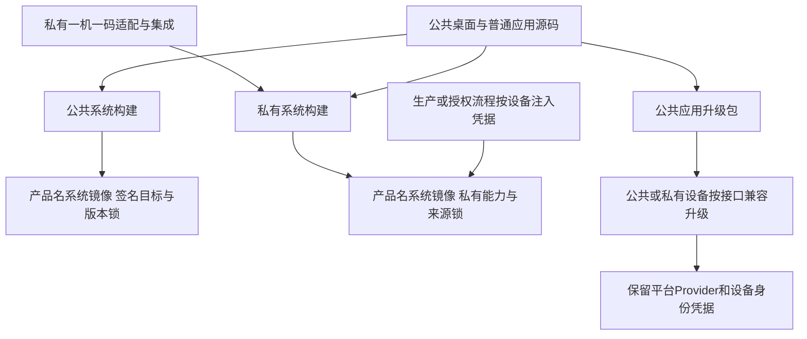

# REQ-MIMI-EDITION-062 公共桌面与一机一码私有扩展
2026-10-15 用户最新要求，实施前记录。关联UPDATE001、DELIVERY058、SPLIT053—061、MIMI-TRACE-001。

## 用户意图与边界
系统镜像对外文件名为`SmartDesktopMimi-SystemImage-v<版本>.img.gz`，不含A133芯片代号。芯片/架构/板型/硬件修订仍保留在内部签名清单、构建锁与安装兼容检查中，不因展示改名放松匹配。
产品软件分为公共仓库dshanpi/SmartDesktopMimi和用户指定私有仓库dshanpi/SmartDesktopMimi-Private。公共仓库保存桌面主体、普通软件、通用接口、更新机制与公开构建发布工具；开源版本不提供涂鸦一机一码配对或100ask.net一机一码自动配对。私有仓库提供这两项专有接入/授权适配及私有构建集成。普通桌面/其他软件升级继续可公开分发，不为这些通用升级复制整套私有版本。
涂鸦“一机一码接入”与通用IoT应用不是同一层；既有用户要求的通用设备列表/控制业务保持共享，专有设备凭据/授权适配隔离。公共/私有产品通过固定Provider接口与能力声明组合，不把“删掉明文密钥但保留启用的专有配对”当成开源隔离完成。

## 目标流程

失败分支：无私有组件/能力的公共产品不得调用专有注册/自动配对，不以空凭据重试；错误硬件/ABI/版本/签名仍在安装前拒绝。公共更新不得覆盖私有平台组件或清除设备绑定。私有功能/接口不兼容时明确拒绝或保留旧版，不能因同一桌面版本强装。

## 回归不变量与迁移规则
共享桌面单一源码，不复制双份维护；私有仓库不能变成密钥仓库。真实Tuya UUID/authkey、100ask设备secret、签名私钥不得进入任何Git仓库、公开源码或通用镜像，按设备在生产/受控登记时注入并独立持久化。原可信密钥/账号绑定不替换或重置。
原100askTeam/A133-AIDesktop-Tina5板级SDK标准overlay保留，产品专有接入与板级SDK归属分别核对，不擅自合并/删除原仓库。SPLIT061当前只保存共享采集源，不涉及配对行为，新产品边界不改变其硬件源闭包。
已上传rc2/rc23快照保留真实原名/标签/哈希，不移动历史标签或覆盖附件；新镜像生成/新版本才采用产品名文件名。系统标签与硬件内部标识的具体迁移另行实施，不把本次文件名要求当成删除内部平台标识的授权。公共应用/系统发布入口维持SmartDesktopMimi；私有产物可见性和具体发布落点需在拆分配方中明确，尚未执行，不将专有输入自动公开。

## 验收、证据与接续
计划实现：公开/私有构建profile及能力契约、专有接入的源码/依赖迁移、打包白名单、公共包反向泄漏/功能拒绝检查、两类设备消费同一公共更新包的数据与接口验证、系统镜像命名生成器/发布工具和文档。
当前本批只记录用户边界/梳理设计，迁移代码/新镜像命名落地/双产品实测均not_run；私有仓库目标访问与现有内容先只读核对，不初始化覆盖。实际证据output/edition-split-20261015，源码起点见本批Git记录。下一步列出公共共享、私有专有及板级SDK三种归属，核对当前100ask/Tuya实现和包依赖，再在不改变旧候选的前提下落实。
A133安装/失联/升级/断电验收继续按用户要求后置到新SDK Ubuntu环境，不能用本设计记录或主机编译判为通过。整套交付未完成。
