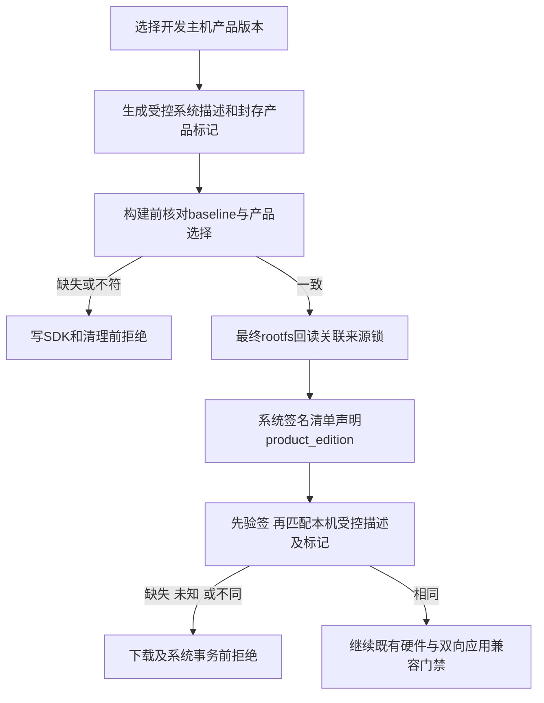

# REQ-MIMI-EDITION-068 系统升级产品版本准入
2026-10-15 实施前记录。关联EDITION062、PRIVATE066、EDITION067和MIMI-UPDATE-001。

## 背景与范围
共享应用升级保留平台能力；完整系统会覆盖平台程序，因此公开/私有产品必须独立配对。当前系统签名清单和受控system-device尚无产品版本字段，不能仅依赖相同硬件或未签名来源摘要。基线包与aitvbox同时安装product-edition时也必须纳入同一封存内容，不能将其当多余配置或只在末端失败。

## 回归不变量
只给SystemManifest和SystemDevice增加可选product_edition，取值public/private；仅两边都未声明时保留旧系统档案的历史校验。任一声明后缺失、未知或跨版拒绝，不提供自动转版。线上本机固定只读rootfs标记须与受控系统描述一致，缺标记不默认为公开。系统发布来源锁声明新产品时，签名清单必须声明同版；普通应用Device/Targets、应用签名包和共用更新不增加产品版本限制。历史rc2/rc23及附件不重签、不覆盖；旧更新器严格字段拒绝新清单，不能绕过验签。SDK97全量来源、完整新镜像、真实升级/回退/断电和私有能力运行仍独立未验收。

实施位置：services/mimi-update/update/system.go、system_install.go及主机测试；tools/update/baseline.py、build_provenance.py与相关测试；scripts/build_release.sh、build_firmware.sh的基线预检。来源锁生成器不因文档变更重编程序；本批只编译受影响更新器，不构建或安装完整镜像，不操作设备/HDMI/可信钥或绑定。

验收：签名公开/私有系统同版通过，错版/缺版/未知/篡改均拒绝，线上候选跳过错版；受控基线两版标记封存、描述一致、错误在构建变更前拒绝；签名来源字段不一致在完整prepare拒绝；旧双空档案回归、共享应用完整race回归。实际结果当前not_run，证据output/system-edition-20261015，完成后追加真实提交和范围。

实施前补充执行边：系统事务journal同时保存签名product_edition；重启健康提交在取消Bootloader回退之前重新核对固定标记/受控系统描述与事务版本。错误版本即使系统版本号相同也不能被确认为启动成功。历史空版本journal只允许无产品标记的旧系统；已完成idle/committed不重做旧硬件任务。

## 本批实际结果
3项新增Go race用例通过（签名16组合、候选筛选/下载前拒绝、固定标记及事务提交边界）；完整Go vet/race通过。223项更新检查和75架构0skip通过，旧双方均空的系统档案及共享应用回归保留。真实A133静态更新器和本机检查器已编译，不等于安装验收。

两版使用原c22c01签名工厂应用、当前可信公钥、实际新A133更新器生成封存基线，原生检查器实际验签/解包；身份仅为明确host fixture，模拟enrollment清除后才进入通用基线。新marker与system-device被同一baseline封存，原应用包SHA未改。两版分别构造/提取ext4和SquashFS，4组文件内容/模式/原始镜像root归属复核passed。它们仅包含工厂基线和必要启动脚本，是主机夹具，不是完整SDK镜像、设备登记或启动测试。

失败历史：最初隔离CLI夹具未提供前置显示门禁stub，两个场景在该处提前失败；补齐明确stub并去除TestCase导入造成的重复发现后5项通过，初始日志保留。真实签名基线的首个64MiB ext4夹具创建失败（初始stderr未捕获，不能宣称具体Tina/驱动故障）；记录原镜像SHA，按实际文件量预留空间后4组通过，未覆盖初始文件。

证据output/system-edition-20261015/：system-edition-race.log、product-baseline-tests.log与product-baseline-fixed.log、all-update.log、architecture.log、go-race.log、actual-signed-baseline-readback.json、initial-filesystem-fixture-failure.json。后续记录实际提交、更新器SHA、GitHub源码回读/CI和关键增量备份。

未完成：新完整SDK产品镜像/来源总锁、真实系统安装/升级回退/断电及私有能力运行/数据保留；这些不因主机正例被标passed。公共与私有同一系统版本的正式资产集合设计/实际发布另核对，历史tag/25资产仍不覆盖。
