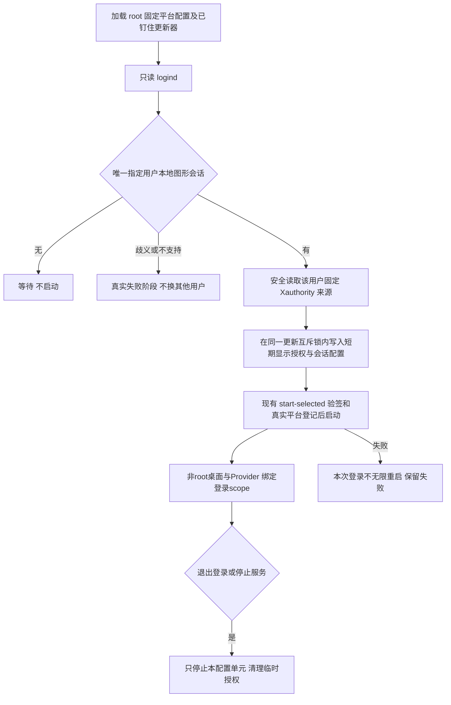

# REQ-MIMI-LOGIN-052 Ubuntu 正式图形登录启动

前序：SESSION026 / ACTIVATE029 / DEBACTIVATE030；MIMI-UPDATE-001、TRACE001。2026-10-15实施前记录。
用户已授权开发主机 Ubuntu 桌面安装、图形登录启动及数据验收。当前只有 GDM greeter，先前 Xvfb 结果不能代替普通用户图形登录。

## 范围与流程
平台提供独立 root 管理登录桥接服务，只面向受控登记的固定 UID/GID。通过真实 logind 选择 seat0、active、local、class=user、type=x11 的唯一会话；SSH、greeter、远程、Wayland、歧义均不能触发桌面。暂不声明 Wayland 支持。

## 回归不变量
- .deb仍仅搬运签名应用载荷，不增加 maintainer scripts，不修改信任/身份/硬件/Provider；登录桥接是平台安装内容，不能混入应用包。
- 不修改GDM自动登录、密码、账号绑定、用户主桌面配置或其他会话；不读取/记录 Xauthority 正文，不把SSH/Xvfb/greeter当图形登录通过。
- 只采用根控固定配置；允许字段严格校验，动态输入仅来自 logind/固定用户授权文件。Xauthority链接/硬链接/权限/owner变化拒绝；不使用任意调用方路径。
- 模式变更与应用/系统更新共享事务锁；start-selected保持原验签/登记/恢复语义。登录会话消失时systemd scope绑定结束桌面，不无穷重启。
- A133路径不受影响；原 rc23/sysrc2候选不因独立Ubuntu平台工具变化重建，可信密钥不变。

## 实现位置（计划）
services/mimi-ubuntu-provider/login.py；packaging/mimi-ubuntu-login/mimi-ubuntu-login.service；services/mimi-update/update/ubuntu_session.go及测试；tests/sdkbuild/test_ubuntu_login.py；Provider README；本记录/索引/进度/批次。

## 验收条件与当前结果
实现、边界回归与原Ubuntu启动回归：not_run（待实现）。实际平台systemd安装/无普通图形登录时等待、拒绝greeter/SSH：not_run。真实普通用户图形登录、退出/再次登录、升级后的启动及完整用户数据：not_run，需实际登录会话。不得用虚拟夹具提升为真机 passed。

## 输入、版本与接续
基准 source fbcba42f19655b32b8bcfd294de2f60f4f404a2b，Ubuntu20.04/x86_64已登记；当前签名rc22包616065f1acfe1f75f0672e9502056de5e2b88dc5b728a81876b0242c8cc3d06e。本轮仅独立平台工具，不发新应用号、不上传。证据保存 output/ubuntu-login-20261015，关键增量进入 .delivery。
ADBbinding尚缺，A133主线保留；可独立实施Ubuntu。外部云设备/语音/账号和全部发布门禁继续保留。

## 实现与第一次回归（2026-10-15）
独立登录桥接与 systemd 模板已实现；Go UbuntuSession 增加可选 login_session，旧显式显示配置保持兼容，新增入口独立检查 logind 并 BindsTo/After 对应登录 scope。桥接对短期配置写入/停止使用共享更新锁，启动仍由 start-selected 重新验签；不混入应用包。
Python边界第一次 failed：测试夹具在group-writable开发目录内，祖先检查真实拒绝；未放宽守卫，改为安全用户home临时fixture，第二次13项（含旧会话6项）passed。Go Ubuntu/StartSelected scope及事务锁回归passed。源码尚未正式平台安装；真实登录/数据/升级仍not_run。日志 output/ubuntu-login-20261015，失败日志保留。
