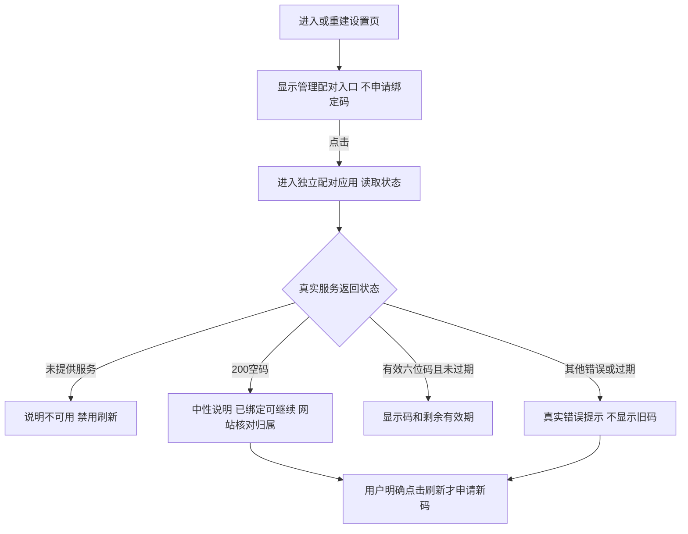

# REQ-MIMI-PAIR-020 设置页与独立配对入口统一

2026-10-14，实施前记录；关联已批准 D02 配对/开源凭据隔离、MIMI-TRACE-001、MIMI-UPDATE-001。前序：rc14 空绑定码中性提示、REQ-MIMI-UI-018。

## 背景与范围
用户确认设备在后台已绑定，不能因 HTTP 200 空 bindToken 就称绑定丢失或后台坏。检查发现旧设置页仍有第二套逻辑：每次打开/重建设置自动刷新绑定码、原样显示状态里的码、将所有非零 bind_token_error（包括200）显示为失败重试。独立配对应用已有格式/过期处理和中性说明，两条路径不一致。

修正为设置页保留 100ask.net 入口，点击进入现有独立配对应用；设置页不申请码、不显示码、不解释 HTTP/绑定归属。保持现有页面布局及已批准配对页，不增加新的账户/解绑业务。

回归不变量：不会重置 deviceId/secret、重新登记或解绑；云连接不证明账户归属；不在设置页复制临时码/秘密；不自动重试获取新码；平台后端与 IPC 契约不改。完整配对真机流程尚未通过，不能将客户端入口修正称为后台绑定验收完成。

## 实现与验收
计划修改 apps/lv_port_linux/src/apps/setting/setting_app.c、src/ui/ui_i18n.*；tests/architecture/fixtures/native_ui_review.c 与 test_desktop_home.py 更新旧自动刷新断言，新增真实控件行为测试。
- not_run：反复打开/重建设置不刷新；收到有效、错误、空码均不在设置显示码/误报失败。
- not_run：点击入口路由到 APP_ID_PAIRING；独立配对格式/过期/HTTP200语义及明确刷新回归。
- not_run：中英文深浅主题、多分辨率；Ubuntu/A133 构建；真机新产物回归。

基准源码2541ed95a05214bd914d391a0189cff45cb31454，当前设备rc16；修改后另建可追溯候选。证据 output/pairing-entry-20261014/；仍等硬件通道空闲才能做相应真机操作，不绕过其他烧录任务。只保存关键增量源码/证据，不上传。

### 候选准备范围追加
主机架构50项已通过。将本轮配对入口与已验证的HDMI能力修复汇入本地 rc17 候选，VERSION 从 rc16 递增；完成完整应用构建、现有产品密钥签名、目标验签后再按通道空闲/版本/备份检查决定实机验收。签名不替代真机验收，候选不上传。构建和验签证据放 output/pairing-entry-20261014；旧 rc16 和前序关键备份保留。
