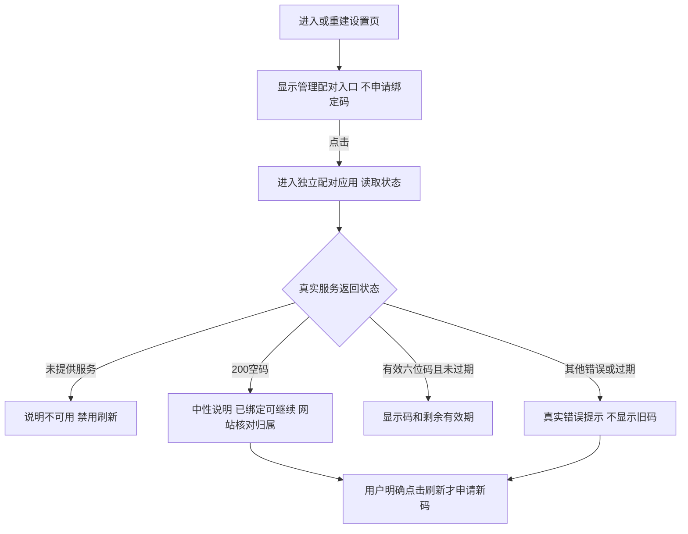

# REQ-MIMI-PAIR-020 设置页与独立配对入口统一

2026-10-14，实施前记录；关联已批准 D02 配对/开源凭据隔离、MIMI-TRACE-001、MIMI-UPDATE-001。前序：rc14 空绑定码中性提示、REQ-MIMI-UI-018。

## 背景与范围
用户确认设备在后台已绑定，不能因 HTTP 200 空 bindToken 就称绑定丢失或后台坏。检查发现旧设置页仍有第二套逻辑：每次打开/重建设置自动刷新绑定码、原样显示状态里的码、将所有非零 bind_token_error（包括200）显示为失败重试。独立配对应用已有格式/过期处理和中性说明，两条路径不一致。

修正为设置页保留 100ask.net 入口，点击进入现有独立配对应用；设置页不申请码、不显示码、不解释 HTTP/绑定归属。保持现有页面布局及已批准配对页，不增加新的账户/解绑业务。

回归不变量：不会重置 deviceId/secret、重新登记或解绑；云连接不证明账户归属；不在设置页复制临时码/秘密；不自动重试获取新码；平台后端与 IPC 契约不改。完整配对真机流程尚未通过，不能将客户端入口修正称为后台绑定验收完成。

## 实现与验收
计划修改 apps/lv_port_linux/src/apps/setting/setting_app.c、src/ui/ui_i18n.*；tests/architecture/fixtures/native_ui_review.c 与 test_desktop_home.py 更新旧自动刷新断言，新增真实控件行为测试。
- not_run：反复打开/重建设置不刷新；收到有效、错误、空码均不在设置显示码/误报失败。
- not_run：点击入口路由到 APP_ID_PAIRING；独立配对格式/过期/HTTP200语义及明确刷新回归。
- not_run：中英文深浅主题、多分辨率；Ubuntu/A133 构建；真机新产物回归。

基准源码2541ed95a05214bd914d391a0189cff45cb31454，当前设备rc16；修改后另建可追溯候选。证据 output/pairing-entry-20261014/；仍等硬件通道空闲才能做相应真机操作，不绕过其他烧录任务。只保存关键增量源码/证据，不上传。

### 候选准备范围追加
主机架构50项已通过。将本轮配对入口与已验证的HDMI能力修复汇入本地 rc17 候选，VERSION 从 rc16 递增；完成完整应用构建、现有产品密钥签名、目标验签后再按通道空闲/版本/备份检查决定实机验收。签名不替代真机验收，候选不上传。构建和验签证据放 output/pairing-entry-20261014；旧 rc16 和前序关键备份保留。

### 实施及真机结果（2026-10-14）
代码 `fe58653135118be74f3ea4da01a787f4ceccbea3`，rc17 签名包 SHA256 `34fc809a45a93661bee74cab2bc1c5093d8d9f103fa8c334d393e80577fbeed8`，A133 桌面 `79b064fbe6f7f6bc62aa774176d530780b472a5b0f376bac753e42b11aee4b75`，Ubuntu 桌面 `4e3307e99bd5bca0200400611ba8b31a1aacd4a3521724800fc7a02decaa71ba`；构建后才追加本段记录，不将文档追加提交冒充编译源码。

- passed：50 项架构测试；固定源码24张渲染及控件测试（3尺寸×中英文×深浅主题×设置入口/配对页），重复进入设置不申请码、不显示原始码/错误；真实 app-manager 导航正常。Ubuntu 原生构建/实际SDL窗口及不支持尺寸拒绝通过；窗口仅 IPC 测试桩。
- passed：A133 完整应用构建、公开源码审计、冻结契约、现有产品钥签名及目标核对；512KiB/s传输与设备哈希匹配，正式安装器安装并提交 rc17，previous=rc16。UI/后端 ready、idle，ext4 p7错误0。
- passed（限定范围）：实体板 evdev 输入回放、framebuffer截图确认首页→设置→独立配对页；管理配对入口存在，初始配对页等待明确刷新，不冒充绑定结果。
- failed/blocked：计划一次刷新后抓取配对结果，实际截图变成涂鸦助手；应用日志还有未计划的返回/开启助手，backend记录两次 HTTP200 空码刷新。尚不能归因外部输入或程序错误；已向用户核对操作来源，完整刷新验收不通过，不把异常截图记为配对成功。
- 数据：23项文件哈希22项不变（包括100ask身份/secret、网络配置），Tuya运行数据库不同，没有缺失；仅文件比较，语义/断电保留 not_run。
- 清理 passed：临时SSH授权卸载，原authorized_keys仍0字节，serial-6关闭。没有上传。

证据：output/pairing-entry-20261014/result.json、两份构建回执、签名与安装日志、settings-rc17-device.png、pairing-enter-rc17-device.png、pairing-refresh-rc17-device.png、unexpected-navigation.log。首次以logread计数0不能证明无刷新（实际后端写/tmp/lv_backend.log），已排除该错误观察方法；5秒只读event4观察无事件不能证明此前无外部输入。timeout工具缺失的首次观察失败也保留。

接续：先核实输入归属，使用实际后台日志计数和连续短时输入记录重做单次刷新及返回；必要时修复自己的事件路由。后台绑定未重置；设备当前rc17，配对整体/长稳/系统更新及deb最终验收仍未完成。
