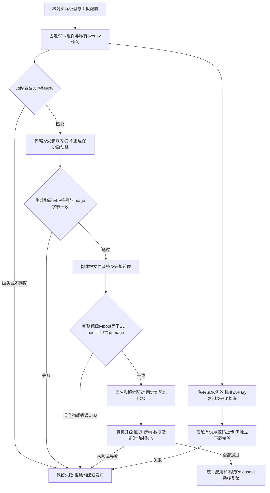

# REQ-MIMI-SDK-047 设备树面板与内核驱动闭环

2026-10-15事前门禁，接续SDK032/036/038、SYSTEM041/043和STABILITY046。目标A133 MainBoard V1.2、现有B6编译输入及固定1024x768显示，公开入口/独立应用与系统版本保持。

问题与证据：046实际临时LCD runtime暂停后，resume日志cfg_open_flow/close_flow=NULL，active/health0却IRQ368停在25865；之后网络/UART失联，无法把resume调用成功当画面恢复。只读SDK实际sunxi.dtb的/soc/lcd0@01c0c000 used1/driver d320fpc2403/x1024/y768/if4；对应Kconfig驱动存在且默认n，生成.config未启用、实际vmlinux符号不存在。这是候选实际构建输入缺口，失联根因仍未证明。

流程：恢复原rc17并核对实际板上DT面板/内核配置、IRQ持续增长与显示→固定原私有overlay5e947与97组件/8启动保护输入→面板匹配门禁必须在完整构建前及打包前检查，使用实际有效DTB/config以及编译后vmlinux符号，不仅检查源文件存在→缺少/未编译/不匹配立即拒绝并保留原镜像不可发布状态→实际硬件配置与SDK匹配后，在私有repo overlay标准目录修正有效openwrt_linux_defconfig的驱动选择，同步manifest/hash；不更改面板命令/时序/Bootloader或上层业务→记录新的私有提交/配置输入、重建受影响内核及系统产物并更新签名/配对证据，真机LCD恢复/正常显示和原失联路径仍必须重验。没有真机证据不能称修复根因，不把r2原编译passed改写成已支持恢复。

回归不变量：不启用无关面板、不将同分辨率当同面板，不改保护boot0/uboot/scp/bl31/DTB，不替换可信钥/设备绑定，不使用裸flasher或随意register操作；应用独立版本/接口不变，SDK选择只开发工具。保留旧overlay/input/cache和失败历史，单项输入变更应对新hash实际重跑，不能沿用r2验收。私有SDK继续repo overlay入口，新增下载/固件/未追踪源按用户规则处理，排除缓存且不排除openwrt/target。私有raw/凭据不进公开源，记录仅脱敏。

实施范围：公开构建检查器/脚本与需求记录、私有overlay/device/config/chips/a133/configs/b6/linux-4.9/openwrt_linux_defconfig及meta摘要；具体文件在实现提交中列明。当前代码变更未执行，板端匹配与恢复not_run，构建候选驱动缺口failed且已固定事实。验收覆盖真实坏config/DTB/缺symbol拒绝、正确输入及真实内核编译、保护输入无改、SDK/overlay重放与新镜像锁、板端新内核/驱动回调/持续IRQ/显示/传输稳定，逐项绑定passed/failed/not_run/blocked。系统更新回退/真实断电/数据和全功能矩阵仍必需，应用/Release不得提前上传；私有SDK既有受控上传例外保持但未测产品明确not_run。

2026-10-15实际匹配与实现：原板/sys/firmware/devicetree/base/soc@03000000/lcd0@01c0c000实际driver=d320fpc2403，/proc/config.gz该项not set；冷启动恢复后IRQ368在2秒3014→3072，原rc17 health0/auth0/runtime0/临时工具消失，serial36最终关闭。第一次恢复后未取得可用shell/网络，失败保留；第二次正常读回不能当永久修复。SDK pack实际DTB是pack_out/sunxi.fex（e788b822…ff9c），不同于未打包out/sunxi.dtb，工具检查最终pack节点soc@03000000并调用既有受保护bootchain门禁绑定实际image，不错误用中间DTB。
新增tools/update/a133_display_gate.py三个阶段：inputs核对固定SDK目标及源defconfig唯一=y；kernel核对实际output/.config、真实AArch64 vmlinux已定义面板symbol，按实际arm64 Makefile objcopy生成Image与bImage逐SHA对应，拒绝源码改了但增量产物未改；packed追加已保护bootchain核对、最终DTB的used/driver/1024x768/DSI4及Android boot.img实际kernel字节哈希匹配。接入build_release的check-only/长编译前、build_firmware修改前/内核后/pack后、build_swu签包前，缺项拒绝。它是离线一致性检查，不替代显示/稳定性实机验收。
实际旧SDK输入被拒绝passed（原source无=y），旧candidate可编译不等于面板恢复可用；私有标准overlay源defconfig只增加匹配driver=y，old7e3b33…f06→newae0e6d…395d，实际SDK对应源文件同步，原生成.config完整备份并只增加同项以免vendor忽略新defconfig。panel命令/DTB/Bootloader未改；新驱动构建/新镜像/实机not_run。4114文件package integrity/95被包含repo HEAD一致passed；verify_overlay非apply模式没有完整target readback，不能称完整replay通过。私有未追踪sdk-inputs和delivery-inputs保持，不自动提交。
17个新增主机拒绝/字段/产物关联单元与133项update回归passed、3个shell脚本syntax passed。首轮完整测试因Go PATH缺项及SWU旧fixture未复制新依赖失败保留；修复测试环境为既有/usr/local/go/bin，fixture仅在临时非bootable包内接受独立display前置，并另验display前置失败码19阻止真实shell签包，无生产旁路。测试不冒充真实kernel/设备。

2026-10-15真实编译passed：应用工具source467a5e8ad559858c9325be0ed39af72bf22f5af5，private overlay1fb03f3828dd1f8e8cf5756781f73ec034798031。单个kernel supervisor799056/child801922实际return0，终态且进程均结束；当前fixed defconfig ae0e6d…395d，生成kernel cfg=y、真实定义面板symbol及objcopy/Image逐SHA gate passed，新ImageSHA8bdace0ab67f3456372f943c18cd432537d76adc3708f2faee36dd59f90bddc2。97源组件HEAD/diff构建前后无新增变化，8保护boot输入无变化。这是SDK038真clean基础上的受影响kernel增量编译，非再次empty clean，未打包/未装板/未验收系统。
私有上传下一步事前范围：遵循用户既有SDK例外，只上传同私有仓库新overlay1fb，先在本开发路径临时验证区按95个纳入overlay的实际Git baseline创建共享对象/no-checkout worktree，再运行原scripts/apply_overlay.sh、核对4114文件/模式/链接；该验证只证明overlay完整复制，未修改的SDK文件未checkout，不能称全SDK可构建。完整97来源仍沿用已验证恢复基础和本次kernel源守卫。仅400MB临时验证输入，成功后清理自己的验证目录，不当备份重复保存。新diff仅单配置项/摘要，无凭据/私钥/新厂商二进制；对远端master先核对原5e947，非预期提交则拒绝push而不force。上传后沿用已有独立readback克隆获取新commit并再次验package所有hash，普通证据只source/hash/status，私有日志不得进公开。应用/Release禁止上传不变。

2026-10-15实际packed检查范围缺口：kernel重编实际更新SDK boot.img为c3556706…a55a，但完整.img仍冻结552971…01ec。首次当前checker packed输出passed只证明SDK boot.img匹配新Image、boot-package DTB/启动代码正确；没有证明完整.img内kernel同步，是本需求范围缺口，记录保留在panel-gate-stale-packed-rejection.json（里面实际是passed，不改成failed）。下一步实现前追加：沿用已reviewed SDK parser_img，只读取固定RFSFAT16/BOOT_FEX00000000条目至SDK内部受限临时目录，用与SDK boot.img逐SHA一致及Android header/Image对应共同拒绝旧完整.img。parser不支持绝对输出，cwd固定SDK且只传relative固定路径；无任意selector/路径/硬件写入；普通执行移除A133_ALLOW_BOOTCHAIN_*环境旁路，使既有保护门禁不能被环境跳过。需真实当前旧img被拒绝、匹配fixture与故意同大小旧payload被拒绝，源码改动后重跑受影响测试。
overlay复制首试failed：95共享clone的第4个buildroot组件因60秒clone超时终止，实际worker839400及相关git/helper均已确认不再运行；仅3个baseline就绪，未执行apply。partial保留。为避免扫描巨大对象库，下次在新受限test-r2目录git init并通过原SDK实际git objects alternates引用相同95个真实commit，再git update-ref/rev-parse验证实际commit存在，不制造commit/伪造HEAD；仍不checkout未修改源，只测试标准apply_overlay全4114文件复制/模式/链接。相同400MB输入范围，失败不重写，SDK根/用户数据不动。

修正后实际新完整image关联检查：源码gate增加SDK parser_img固定BOOT_FEX读取、cwd/relative路径约束、屏蔽bootchain环境override。135项update回归passed（19新增display关联/拒绝fixture）；当前真实旧完整img552…01ec的boot分区与新SDK boot.img不一致，实际packed gate失败“final firmware boot payload differs from checked SDK boot image”符合预期，不能使用旧完整img宣称含新driver。kernel编译无需因只读checker扩充而重复。
源码传输验证首clone失败历史保留；r2使用实际源object-store引用95个真实commit，标准scripts/apply_overlay.sh完整4114文件/模式/链接copy+readback passed，约31秒，仅证明overlay复制，不冒充未checkout的完整SDK重建。私有新1fb已经按SDK既有例外push到原master（remote原5e947→1fb，fast-forward，无force）。独立远端源码readback仍待执行；应用/Release未上传。

回归不变量：私有SDK上传例外不授权提前应用或Release发布；离线符号/哈希通过不等于实际画面或失联修复；原始失败与前次范围不足均可追溯。
