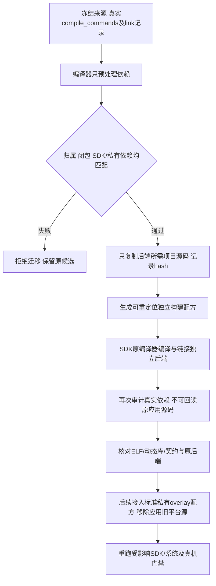

# REQ-MIMI-SPLIT-053 A133平台后端独立源码和构建

2026-10-15事前记录；关联SOURCE-OWNERSHIP、SDK032/036/047、SYSTEM048/049、TRACE001和MIMI-UPDATE-001。
用户要求上层独立发布、固定底层接口，平台源码及SDK衔接收尾。当前lv_backend平台服务仍在公开工作候选的混合目录，migration_complete=false；不能以应用only编译守卫或文件归属清单替代物理拆分。

## 本轮流程
从已完成sysrc2冻结source d7c8572b0f02ff02f6cc2ce8ba3ea79c06db306b的真实32后端TU、编译/链接记录出发，预处理生成真实依赖闭包，只提取项目内所需源码/头文件。第三方100ask私有依赖仍外置并绑定哈希，不复制秘密。独立组件在开发目录.delivery下作为私有SDK overlay待集成内容；先验证独立构建和闭包，再把系统构建接到私有源码并删除应用端旧平台源。

## 回归不变量
- 只做源码归属/构建，不能更改V1/V2消息、设备节点、Provider行为、账号/设备登记、可信密钥或既有硬件接口。
- 系统基础服务不进入应用更新payload；Tina/Ubuntu provider可分别构建，未验平台不宣称支持。
- 独立组件真实依赖不得回读原应用目录；源、编译器、SDK、私有依赖逐字节固定，链接不能偷用旧对象。私有SDK/厂商源码/秘密不进入公开源码包。
- 新输出目录不得覆盖冻结rc2镜像/应用、旧build或恢复资料；只备份关键增量。内核/启动输入不改，不重建整SDK。
- 标准SDK入口仍overlay/meta/scripts/apply_overlay.sh；本轮独立component是私有SDK待集成材料，不冒充已应用到SDK或已推送。系统配方接入、旧源实际删除/公开隔离、最终独立应用SDK、真机旧后端兼容仍必须完成。

## 实现与验收计划
新增tools/update/platform_provider.py及依赖/路径回归，独立源码/配方/私有输入摘要保存.delivery/a133-provider-split-20261015；输出证据output/a133-provider-split-20261015。迁移工具只执行明确SDK编译器argv，不执行CMake记录中的任意shell命令。
独立预处理/实际编译/链接与后置源闭包审计not_run；最终SDK-overlay正式接入、删除旧公共平台源、最终镜像真机回归not_run。不能把新组件编译当整个源码迁移完成。若独立二进制hash不同，核对原因/ABI并保留，不能复用旧物理验收。

## 输入与剩余范围
原后端来自sysrc2/source d7c8572、SDK97基线/overlay1fb03f3；私有100ask SDK仍在开发主机既有外置目录，运行数据/凭据不接触。当前应用rc23/sysrc2候选hash保持冻结。MCP ADB保存binding空、Ubuntu普通Xorg登录未到位，已请求不重复提问；此任务可独立推进。

工具已实现（尚未运行实际SDK构建）：仅执行CLI指定且位于SDK的compiler，原generated wrapper不执行；从32TU真实预处理结果复制项目文件，私有SDK/系统头只hash外置；独立配方重写新源码与新对象路径，编译前后实际-M审计拒绝旧应用目录回读。使用显式SDK sysroot/staging，不接受host include覆盖或shell/response/plugin参数。保留__FILE__旧诊断字符串仅用macro-prefix-map，不读取旧源。11项边界与原归属回归passed，actualstage/build仍not_run。

实际stage首轮failed于编译器canonical检查，未创建输出：固定OpenWrt gcc是SDK内wrapper符号链接，wrapper按argv0分派；不能简单使用resolved文件名执行。修复为只允许SDK内固定aarch64-openwrt-linux-gcc logical入口，同时绑定SDK内resolved目标路径及SHA，SDK外别名拒绝；不放宽项目/私有源别名。不改变既有SDK文件。

stage-r2实际failed于正常C相对include `backend/../platform/...h` 的过严canonical比较；未完成组件，部分目录保留。修复只做词法归一化后仍与resolve比较，允许真实../include但不允许项目/私有源symlink别名或越界。新增实际路径边界回归，输出使用新r3目录。

## 2026-10-15 实际独立构建与回读
stage-r3实际passed，复制66个项目源码/头文件、32TU（31项目C+1外置私有C）；299个SDK依赖文件和2个私有依赖文件仅记录hash，未复制。独立编译与链接passed；后置真实-M依赖闭包与原闭包相同，不回读原应用目录，所有项目/SDK/私有输入编译后hash保持不变。
独立lv_backend407240B/hash8a8b3a45cc8eb17f212288b149157e529891e7fd045dfe2a7c7979191514c3f3与原冻结sysrc2后端逐字节相同；实际ELF64 little/AArch64/loader /lib/ld-linux-aarch64.so.1及20项NEEDED已读回。__FILE__仅用已记录macro映射保持诊断字符串，不借用旧对象或旧源。
配方43df8a8b5ecf45b96b9e49ceabaa94b2819ec7933810b216bfe9fad3b205f277、工具6f5740386a53df35aed713d3120c8b1f12ba8b43748a15da09fe2dfab23fc81f、原始source d7c8572。两次实际输入拒绝保留failed（gcc SDK内合法wrapper、正常../include）；修复分别绑定原argv0+目标hash、词法归一化且拒绝source symlink，12项边界/既有归属回归passed。
证据 output/a133-provider-split-20261015/{stage-r1,stage-r2,stage-r3,build-r3}.log、actual-build-readback.json、build-result.json、boundaries-r3.log。输出.delivery/a133-provider-split-r3-20261015与独立build-r3；旧空partial目录保留，不冒充组件。
本次只完成独立组件和真实构建，不声明migration_complete：尚需支持现有私有cloud ON及公开stub OFF两种系统配方、接入标准私有SDK overlay并实际重放、系统入口改用该平台源码、移除公开应用旧平台实现和完成最终应用SDK交付。旧sysrc2/app23产物及源码工作树不改，正式SDKHEAD仍1fb03f3未加入本组件，私有repo本轮未push。不能将SDK已上传的面板修复与本组件混记。
接续：在不重建整SDK的前提下完成公开stub profile独立构建、SDK源码/配方衔接及公共源移除；A133新的内核/失联/升级回退断电数据验收依赖保存ADBbinding，Ubuntu真实登录输入仍pending，整套发布未完成。冻结候选保持，源码/Release不上传。
