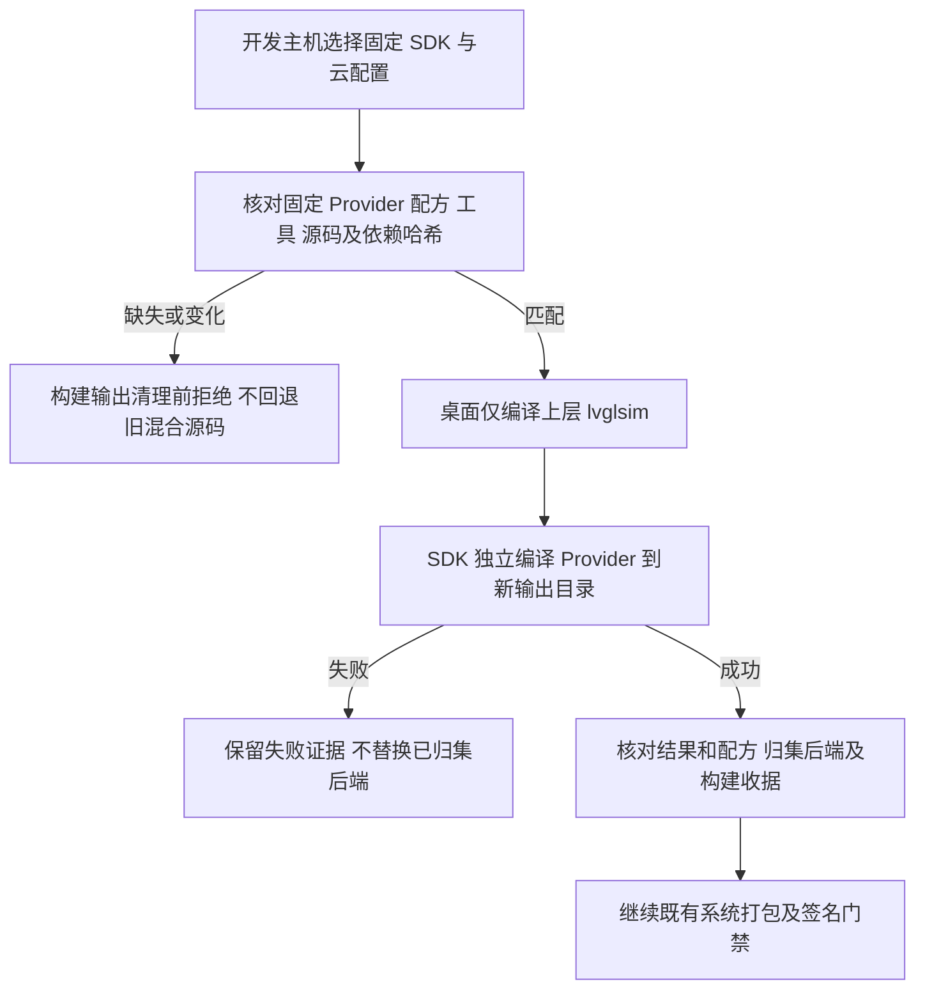

# REQ-MIMI-SPLIT-054 系统入口使用 SDK 独立 Provider

关联：MIMI-UPDATE-001、MIMI-TRACE-001、REQ-MIMI-SPLIT-053、REQ-MIMI-DELIVERY-033。2026-10-15 实施前记录。

## 背景与范围
053已将 private32/public30 后端闭包推送私有SDK958并标准overlay重放，产品build_apps仍从桌面混合源码构建后端。本轮改为固定SDK组件构建后端，桌面入口仅构建lvglsim；先保留旧源码，验证通过后再单独评估移除，不宣称整个源码迁移完成。

## 流程与失败分支

## 回归不变量
硬件V1消息/行为不变；原system rc2/app rc23产物、可信密钥、设备绑定不变。公有profile不读取私有SDK，私有实现不复制进公开仓库。缺少SDK组件不得回退旧源码。SDK依赖检查发生在清理产物和补编依赖之前，保留64位视频工具链前置守卫。后端独立构建新目录；不以旧对象或旧后端冒充通过。版本与正式镜像不因门禁记录变化重建；不操作硬件/上传应用或Release。

## 实现位置与验收
计划：scripts/build_a133_provider.py、scripts/build_apps.sh、apps/lv_port_linux/build_openwrt.sh、tests/update/test_product_provider.py。基准9c8c56e1a5ee9313b398f8c71c5f73923fe4046c。
- SDK前置缺失/篡改/错误profile拒绝及输出保留：not_run。
- 实际SDK private/public入口编译与原后端字节对照：not_run。
- 实际A133仅上层编译及compile_commands归属检查：not_run。
- 全系统重建、新产物真机/升级/断电/数据：not_run，本轮不沿用旧通过。
证据目标output/product-provider-20261015；目标开发主机Ubuntu20.04/实际SDK，物理A133无改动。后续完成公共旧源移除和完整迁移；既有ADB绑定/Ubuntu登录待用户输入不重复询问。
