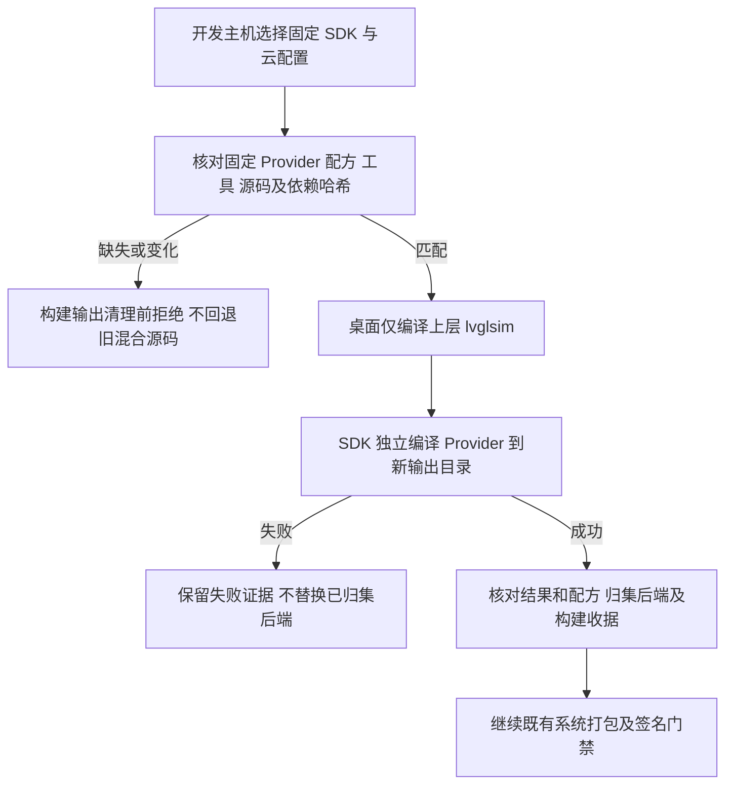

# REQ-MIMI-SPLIT-054 系统入口使用 SDK 独立 Provider

关联：MIMI-UPDATE-001、MIMI-TRACE-001、REQ-MIMI-SPLIT-053、REQ-MIMI-DELIVERY-033。2026-10-15 实施前记录。

## 背景与范围
053已将 private32/public30 后端闭包推送私有SDK958并标准overlay重放，产品build_apps仍从桌面混合源码构建后端。本轮改为固定SDK组件构建后端，桌面入口仅构建lvglsim；先保留旧源码，验证通过后再单独评估移除，不宣称整个源码迁移完成。

## 流程与失败分支

## 回归不变量
硬件V1消息/行为不变；原system rc2/app rc23产物、可信密钥、设备绑定不变。公有profile不读取私有SDK，私有实现不复制进公开仓库。缺少SDK组件不得回退旧源码。SDK依赖检查发生在清理产物和补编依赖之前，保留64位视频工具链前置守卫。后端独立构建新目录；不以旧对象或旧后端冒充通过。版本与正式镜像不因门禁记录变化重建；不操作硬件/上传应用或Release。

## 实现位置与验收
计划：scripts/build_a133_provider.py、scripts/build_apps.sh、apps/lv_port_linux/build_openwrt.sh、tests/update/test_product_provider.py。基准9c8c56e1a5ee9313b398f8c71c5f73923fe4046c。
- SDK前置缺失/篡改/错误profile拒绝及输出保留：not_run。
- 实际SDK private/public入口编译与原后端字节对照：not_run。
- 实际A133仅上层编译及compile_commands归属检查：not_run。
- 全系统重建、新产物真机/升级/断电/数据：not_run，本轮不沿用旧通过。
证据目标output/product-provider-20261015；目标开发主机Ubuntu20.04/实际SDK，物理A133无改动。后续完成公共旧源移除和完整迁移；既有ADB绑定/Ubuntu登录待用户输入不重复询问。

## 入口实现与主机拒绝回归
已实现固定SDK工具/双配方哈希预检、源码/外部依赖/编译器关联核查；系统入口先check再清理和补依赖，后端使用SDK helper新输出；桌面仅lvglsim并检查compile_commands归属。后端成功且字节/收据一致才归集。SDK配方当前固定d7，不接受任意调用方覆盖来源。未修改VERSION、旧rc2/rc23和私有SDK源。
17项主机回归passed（4新产品边界+13既有独立闭包/归属）：实际运行build_apps --clean缺组件分支且旧输出原字节保留；源码/SDK输入/工具/配方/编译器修改与外部同内容符号链接被拒绝；缺私有SDK/错误profile被拒绝。Bash语法passed。证据output/product-provider-20261015/regression.log。实际A133编译与真机仍not_run。

## 实际编译结果（source 60b0b132efa3687722694f0581e30a8b50d5bf7e）
产品入口wrapper在实际SDK重编private32/public30均passed，private后端8a8b3a45cc8eb17f212288b149157e529891e7fd045dfe2a7c7979191514c3f3/public后端84af521753b943908838a03db64ed53c1c755bc5f292144df621d50094119701，分别与053及原后端逐字节一致；输入闭包审计无旧应用源码依赖，公有profile无privateSDK读取。
实际build_openwrt.sh --target lvglsim AArch64编译passed，672编译源归属检查passed，无platform service TU；ELF4878416B/hash4891196a5e3134ddda967f2823ffe54111d8f97e3aa2588272d4e17c4e673045；临时LVGL patch已复原，源clean。17边界回归及33架构回归passed。
证据output/product-provider-20261015/verified-result.json、build-result.json、public-build.log、private-build.log、frontend-build.log、architecture.log。新开发输出不覆盖原rc2/rc23；未重新签名或安装。完整build_apps其余阶段/归集正向整链、全系统重建、真机接口与升级验收均not_run，未以组件检查冒充整链通过。旧平台源码尚保留，完整拆分未完成。

## 完整应用构建正向接续（实施前，2026-10-15）
055退休23源后组件/前端已passed，完整build_apps正向归集仍not_run。接下来以当前源8e092d1之后的门禁提交、实际SDK958独立组件、外部原100ask SDK与原Tuya vendor执行build_apps（不--clean其他未变组件，已准备Tuya工作副本跳过重复prepare）。本命令仍会按既有入口重编前端及独立SDK后端，以验证整个stage/归集；不构建镜像、不签名、不安装、不上传。临时SDK配置依旧由原trap逐字节恢复；保护前后SDK配置与冻结候选哈希；失败日志单独保留，不借旧对象冒充后端通过。结果output/product-pipeline-20261015，现not_run。其他未变模块增量构建如实记录，不称完整SDK空缓存重建。

## 完整入口失败与受控接续计划（变更前）
第一次实际全入口source d5e5411在第四阶段IPKVM的npm命令缺失返回1；前三阶段已实际完成，SDK三配置和原镜像/SWU/签名包前后SHA不变、源clean。output/product-pipeline-20261015/result.json/build.log保留failed。已有Node22工具链在主机缓存，不是源码或SDK缺失，不安装新软件。
追加修复：build_apps在任何清理/编译前显式检查node/npm，缺失提前给出真实原因；增加缺网页工具链时旧输出不动的实际Shell分支回归。接续前核对前三阶段归集产物/Provider收据、全部相关C/构建输入和当前源与d5仅前置检查/测试/文档差异；只在新进程PATH载入已有固定Node工具链，执行与原脚本逐字相同的第四阶段及后续tail，不重复编译已通过阶段。原failed不改，续跑写result-r2.json；配置与冻结候选继续前后保护。既有未改模块复用不叫空缓存重建。镜像/签名/安装/上传仍not_run。

网页工具链早拒绝已实现：node/npm缺失在源码审计/清理/编译前失败；真实隔离PATH的Shell回归确认旧产物原字节保留，既有缺SDK分支仍验证不被环境缺失遮蔽。19主机边界回归及Bash语法passed，证据output/product-pipeline-20261015/preflight-regression.log。环境恢复和分段整链仍not_run。
