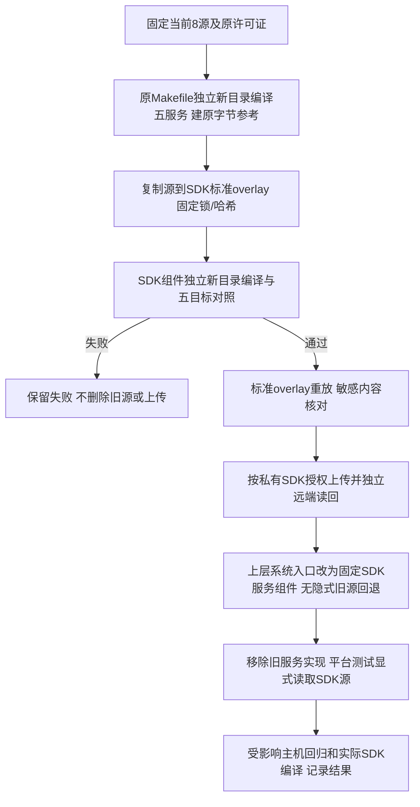

# REQ-MIMI-SPLIT-056 平台服务源与构建归属迁入 SDK
2026-10-15 实施前记录；关联SPLIT053/054/055、MIMI-UPDATE-001、MIMI-TRACE-001。

## 背景与范围
桌面后端已移出上层，apps/platform_services五个系统服务仍由上层源码构建。它们负责MCP/Gateway、AI代理、电脑控制和应用权限，属于平台系统生命周期，应用升级不得覆盖。本轮迁移该目录8个已追踪源码/Makefile及原许可证到SDK标准overlay独立smartdesktopmimi-a133-services组件，固定来源/编译器/配置和原目标字节；不改服务业务与硬件接口。其他hdmi_preview/ipkvm/Tuya和24旧接口头/冻结客户端仍后续收尾，不宣称整套拆仓完成。

## 流程与失败分支

## 回归不变量
五服务名/ABI/协议/权限/持久数据路径与行为不变，实际二进制逐字节对照；接口与原可信钥/绑定不变。SDK源闭包无私钥/凭据/第三方SDK体，原许可证保留；新组件不放在sync会删除的aitvbox-*目录。仅新组件加入真实SDK，不全量overlay覆盖已审核内核/配置补充输入。缺少或篡改组件在清理/补依赖前拒绝。原rc2镜像/rc23签名包冻结，不签名/安装/上传应用或Release；私有SDK源仅门禁通过才上传。测试不恢复删除副本绕过SDK；缺SDK明确not_run，配置坏失败。

## 实现位置、验收及接续
计划：scripts/build_a133_services.py、scripts/build_apps.sh；apps/platform_services/*；tests/sdk_source.py和tests/platform/test_host_integration.py及专用边界回归；docs/update/source-ownership.json/tools/update/source_ownership.py防止退休路径回归；私有SDKoverlay/meta/scripts.apply_overlay既有入口。
应用起点621fd46（实际SHA见证据），私有SDK父958c62f739c86fcc1128fb2d838faa25c550aaa9。证据output/platform-services-split-20261015；目标开发主机Ubuntu/实际SDK，物理A133不动。
原/迁移五服务新目录编译对照、标准overlay重放、敏感筛查、SDK上传读回、上层新入口/边界回归：not_run。完整新镜像/真机：not_run。旧源删除前必须先完成SDK保存和重编；文档/流程调整不重建已冻结候选，失败逐条保留。下一步按本流程核对，ADB/Xorg输入到位即优先接续物理验收。
