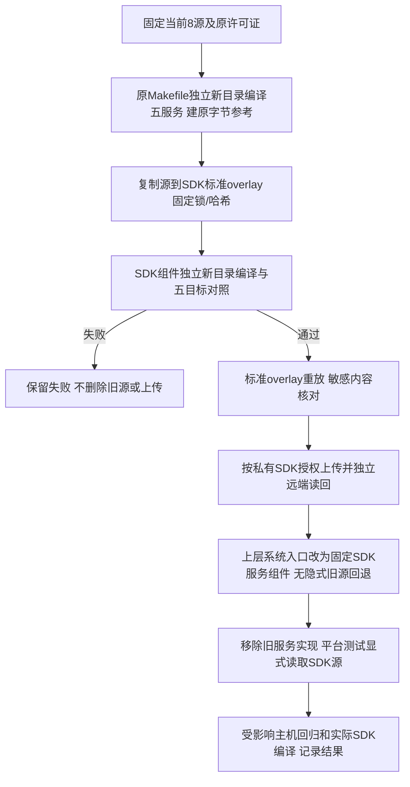

# REQ-MIMI-SPLIT-056 平台服务源与构建归属迁入 SDK
2026-10-15 实施前记录；关联SPLIT053/054/055、MIMI-UPDATE-001、MIMI-TRACE-001。

## 背景与范围
桌面后端已移出上层，apps/platform_services五个系统服务仍由上层源码构建。它们负责MCP/Gateway、AI代理、电脑控制和应用权限，属于平台系统生命周期，应用升级不得覆盖。本轮迁移该目录8个已追踪源码/Makefile及原许可证到SDK标准overlay独立smartdesktopmimi-a133-services组件，固定来源/编译器/配置和原目标字节；不改服务业务与硬件接口。其他hdmi_preview/ipkvm/Tuya和24旧接口头/冻结客户端仍后续收尾，不宣称整套拆仓完成。

## 流程与失败分支

## 回归不变量
五服务名/ABI/协议/权限/持久数据路径与行为不变，实际二进制逐字节对照；接口与原可信钥/绑定不变。SDK源闭包无私钥/凭据/第三方SDK体，原许可证保留；新组件不放在sync会删除的aitvbox-*目录。仅新组件加入真实SDK，不全量overlay覆盖已审核内核/配置补充输入。缺少或篡改组件在清理/补依赖前拒绝。原rc2镜像/rc23签名包冻结，不签名/安装/上传应用或Release；私有SDK源仅门禁通过才上传。测试不恢复删除副本绕过SDK；缺SDK明确not_run，配置坏失败。

## 实现位置、验收及接续
计划：scripts/build_a133_services.py、scripts/build_apps.sh；apps/platform_services/*；tests/sdk_source.py和tests/platform/test_host_integration.py及专用边界回归；docs/update/source-ownership.json/tools/update/source_ownership.py防止退休路径回归；私有SDKoverlay/meta/scripts.apply_overlay既有入口。
应用起点621fd46（实际SHA见证据），私有SDK父958c62f739c86fcc1128fb2d838faa25c550aaa9。证据output/platform-services-split-20261015；目标开发主机Ubuntu/实际SDK，物理A133不动。
原/迁移五服务新目录编译对照、标准overlay重放、敏感筛查、SDK上传读回、上层新入口/边界回归：not_run。完整新镜像/真机：not_run。旧源删除前必须先完成SDK保存和重编；文档/流程调整不重建已冻结候选，失败逐条保留。下一步按本流程核对，ADB/Xorg输入到位即优先接续物理验收。

## SDK保存、独立编译及上层切换实际进度
原8文件/许可证已保存到SDK自含组件；Makefile唯一改动为去掉.config导入式工具链选择、固定原实际GCC11编译器，C/H原字节不变。固定203真实SDK头依赖、编译器、2链接库及别名目标，6TU产生5服务与原fresh reference逐字节一致。原staged/replayed通过后补强链接别名守卫，r2重新标准overlay重放4260文件/95真实HEAD和五目标构建全部passed，先前检查记录保留。
私有SDK已正常推送d9eca3dcebd3f4e869161699661f3db980d644da，独立fetch/ff与官方verify_overlay全4260字节、目标精确mode/95基线passed，旧4248payload不变。只新增组件12文件到真实SDK，不全量覆写已有内核/配置补充输入。新12文件类型/既有凭据签名筛查0finding；不是完整历史安全审计。
自写首次读回脚本误将Git工作树POSIX组权限等同SDK目标mode，在boost归档处failed；后续诊断又假设每项都必须有size而KeyError，误疑LFS未物化的解释保留并纠正。实际首失败在mode，bodySHA匹配（Git checkout0664/目标0644）；官方验证按Git可表示位与SDK目标精确mode处理。未证明LFS丢失或源码损坏，未放松字节门禁。见remote-readback-failed/diagnosis/remote-verify和remote-readback.json。
在SDK保存/读回/重编通过后，上层旧8文件移除，系统入口预检固定source-lock再用SDK helper新目录编译归集；不再引用/clean旧源目录。退休路径及作用域防止旧/改名实现重新混入。测试保留，五服务fixture从显式MIMI_A133_SERVICES_ROOT解析固定SDK源，未提供时明确not_run；配置坏失败。
30项边界/应用收据回归passed（含固定源/工具篡改无执行且旧输出不变、同字节错误链接目标拒绝、SDK头篡改拒绝、退休目录新源拒绝），Bash语法和实际SDK wrapper preflight passed。实际新上层第三阶段归集及平台106回归尚not_run；物理未操作。全部源迁移仍false，hdmi/ipkvm/Tuya/接口头和冻结客户端待收尾。
