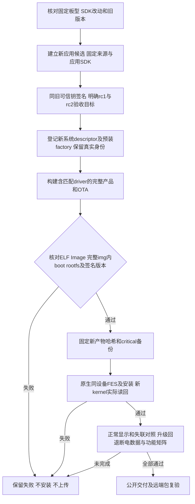

# REQ-MIMI-SYSTEM-048 修正内核后的应用与系统验收基线

2026-10-15实施前，接续SDK047/System041/043，仍是用户既有全交付目标。首个平台A133 MainBoard V1.2，当前已装rc17/sourcefe58653135118be74f3ea4da01a787f4ceccbea3/pkg34fc809a45a93661bee74cab2bc1c5093d8d9f103fa8c334d393e80577fbeed8，原kernel4.9.191#137；新的private SDK1fb03f3828dd1f8e8cf5756781f73ec034798031只修正匹配d320面板编译选择，源码/重编及远端4114载荷已校验，新内核未装板。旧完整img552不含新kernel，禁止继续作为修复产物。

版本配对事实：旧签名rc17 targets.runtime.system=[1.0.0-rc.1,1.0.0-rc.2)，会拒绝新系统rc2。新候选应用v1.0.8-rc.23与系统system-a133-v1.0.0-rc.2独立编号、共享dshanpi/SmartDesktopMimi入口；历史版本/包/标签不改。这里是构建和实机验收用的testing本地候选，兼容字段待真实两端矩阵，不宣称已支持新系统，也不公开/上传应用或Release。

回归不变量：不换/增信签名钥、不重置设备绑定；不以系统版本代替平台接口，不改变冻结V1消息编号/布局/硬件行为。兼容旧rc1+新rc2为本地待验目标，其他系统版本/平台仍严格拒绝；硬件修订/CPU/运行库/Provider/Ports/数据约束不放宽。VERSION变化是新candidate对应新兼容输入，不因文档变化重建。应用包只含应用，SDK/平台服务/凭据不进入公开包。HDMI采集默认off。旧产物与失败记录保留，新产物重跑受影响验证；不新建循环或重复live构建，不裸CLI或保护bootchainoverride，不盲改Bootloader。

FES只读复核新增事实：已装exe与保存Windows artifact同SHA a57725…fd0a，Rustroot bfa82；对应openixcli.d与exe同时段，实际依赖源码指向lynx-t113-fes-selector/src-tauri/libs/libefex，不直接等同当前Cargo.toml的ae33 pin。该依赖所在父源码HEAD2389a146…de1/clean，未修改。板端“set address … ok”匹配SDK U-Boot drivers/sunxi_usb代码，因此缩小为USB枚举/握手阶段，不能声称UBoot未执行。主机VerifyDevice请求和板端支持legacy/new命令，当前未证实业务逻辑缺陷，不替换immutable flasher或随意换loader。

实施位置：VERSION、docs/change-gates本条与batch，候选/SDK描述与签名factory材料放本开发路径.delivery/application-rc23-*及system-rc2-*，原keys在源码树外。当前新candidate/build/sign/factory/fullimage/安装/双方兼容/真机均not_run；实际result绑定真实commit/hash/device，设备恢复只属于恢复项目，不当稳定性修复。外部Tuya、配对归属、语音资源和Ubuntu其余要求保留，全目标不缩减。

## 2026-10-15 SYSTEM048 新候选及工厂基线实际结果
应用source a37a63db5ca145c9ae700b2c0a1356d2e70b5439/version1.0.8-rc.23已构建和原钥签名，包27292543B/hashc22c01e10424dc76323af621ffee0d1c9ae8ce9d580a3cb786638f88ba802f78。首轮npm缺PATH failed，成功desktop收据和SHA核对后只接续Web/资源阶段passed，没有重编已成功desktop。
主机真实验签/归档及硬件兼容passed：接受rc1和主机rc2目标夹具，实际拒绝rc2.1、rc3和错误V1.1修订。第一次错误未登记factory夹具及两次错误identity关联核对不当作边界验收通过；最终r4按冻结硬件7字段与实际040备份enrollment关联通过，不改变板卡登记。
独立冻结系统source worktree .delivery/system-rc2-source-20261015与AArch64当前更新器、签名rc23工厂基线准备passed，factory lock89d2908dd9fe9c76f7f83e2f23612d7db040b74d5bbe82c7d15b76ac4d9dcd5d；系统版本1.0.0-rc.2是构建目标，非已装系统。首轮未知baseline_id字段被严格拒绝，历史failed保留，r2改用已定义system_baseline字段，受控硬件其余约束/原信任不变，通用镜像不含单机enrollment_id。
完整rc2产品supervisor968196开始输入/环境核对；实际最终状态读取output/system-baseline-rc2-20261015/product-build-result.json，尚不得写镜像或实机passed。新产品必须核对面板配置/ELF/Image/实际完整img boot payload、文件系统、签名factory和版本，旧552镜像不能冒充新修复。SDK047私有overlay1fb已远端回读，应用与Release仍未上传。
当前首要未完：完整新镜像与系统升级包、原生FES握手及新内核装板、显示修复对照和失联根因、升级回退/断电/数据/功能矩阵；其余Ubuntu真实登录数据、源码拆分收尾、配对归属/新绑定、真实语音/Tuya资源和统一发布远端复验保留。证据范围严格区分host/physical，整套交付未完成。

恢复/失败补充：准备脚本首次相对SFTP上传路径不存在，未上传任何文件；改本开发目录绝对路径后成功。实际scope与失败日志分别在application-build-private.log/application-sign-verify.json及r4、factory-prepare-result.json及r2，旧记录不覆盖。SDK047内核不是再次empty-clean，Sys048产品复用新依赖并检查受影响完整镜像；文档追加不换候选版本、冻结a37不重建。

SYSTEM048产品输入核对追加：首次supervisor968196已failed且未启动实际release构建，原因是新诊断代码用了full-index差异序列化而SDK047旧收据使用git diff HEAD --binary，21个组件文字index行长度不同造成SHA错配。逐组件用原命令重读均匹配历史SHA，提交均相同；实际源码未变化，不是SDK被外部修改，也没有放松内容门禁。input-diff-review.json保留failed、input-diff-correlation.json记录21组件关联passed。改用已固定旧序列化的r2 supervisor971798接续输入核对，输出product-build-result-r2.json，原result不覆盖；完整构建/实机仍待实际结果。
