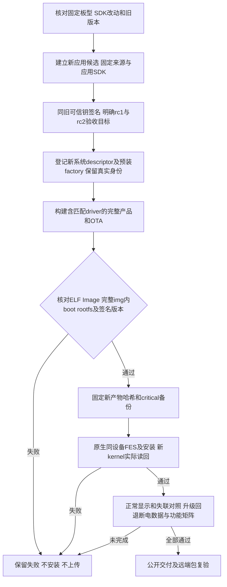

# REQ-MIMI-SYSTEM-048 修正内核后的应用与系统验收基线

2026-10-15实施前，接续SDK047/System041/043，仍是用户既有全交付目标。首个平台A133 MainBoard V1.2，当前已装rc17/sourcefe58653135118be74f3ea4da01a787f4ceccbea3/pkg34fc809a45a93661bee74cab2bc1c5093d8d9f103fa8c334d393e80577fbeed8，原kernel4.9.191#137；新的private SDK1fb03f3828dd1f8e8cf5756781f73ec034798031只修正匹配d320面板编译选择，源码/重编及远端4114载荷已校验，新内核未装板。旧完整img552不含新kernel，禁止继续作为修复产物。

版本配对事实：旧签名rc17 targets.runtime.system=[1.0.0-rc.1,1.0.0-rc.2)，会拒绝新系统rc2。新候选应用v1.0.8-rc.23与系统system-a133-v1.0.0-rc.2独立编号、共享dshanpi/SmartDesktopMimi入口；历史版本/包/标签不改。这里是构建和实机验收用的testing本地候选，兼容字段待真实两端矩阵，不宣称已支持新系统，也不公开/上传应用或Release。

回归不变量：不换/增信签名钥、不重置设备绑定；不以系统版本代替平台接口，不改变冻结V1消息编号/布局/硬件行为。兼容旧rc1+新rc2为本地待验目标，其他系统版本/平台仍严格拒绝；硬件修订/CPU/运行库/Provider/Ports/数据约束不放宽。VERSION变化是新candidate对应新兼容输入，不因文档变化重建。应用包只含应用，SDK/平台服务/凭据不进入公开包。HDMI采集默认off。旧产物与失败记录保留，新产物重跑受影响验证；不新建循环或重复live构建，不裸CLI或保护bootchainoverride，不盲改Bootloader。

FES只读复核新增事实：已装exe与保存Windows artifact同SHA a57725…fd0a，Rustroot bfa82；对应openixcli.d与exe同时段，实际依赖源码指向lynx-t113-fes-selector/src-tauri/libs/libefex，不直接等同当前Cargo.toml的ae33 pin。该依赖所在父源码HEAD2389a146…de1/clean，未修改。板端“set address … ok”匹配SDK U-Boot drivers/sunxi_usb代码，因此缩小为USB枚举/握手阶段，不能声称UBoot未执行。主机VerifyDevice请求和板端支持legacy/new命令，当前未证实业务逻辑缺陷，不替换immutable flasher或随意换loader。

实施位置：VERSION、docs/change-gates本条与batch，候选/SDK描述与签名factory材料放本开发路径.delivery/application-rc23-*及system-rc2-*，原keys在源码树外。当前新candidate/build/sign/factory/fullimage/安装/双方兼容/真机均not_run；实际result绑定真实commit/hash/device，设备恢复只属于恢复项目，不当稳定性修复。外部Tuya、配对归属、语音资源和Ubuntu其余要求保留，全目标不缩减。
