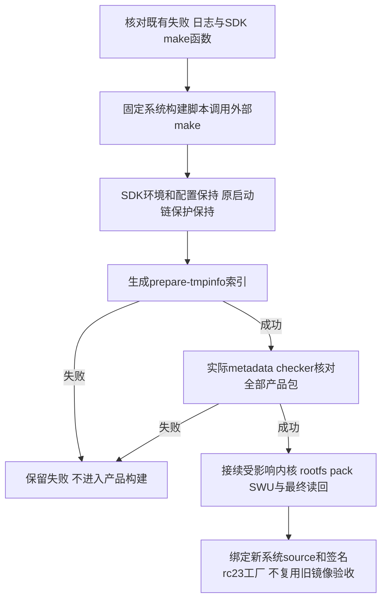

# REQ-MIMI-SYSTEM-049 元数据构建绕过SDK Shell同名函数

2026-10-15事前，接续SYS048。新rc2实际product跑完desktop/IPKVM/Web后，在build_firmware.sh准备软件包索引时failed：source build/envsetup.sh定义make Shell函数，把make -C OpenWrt -j1 prepare-tmpinfo变成build.sh action并触发tina启动链保护。此失败不说明镜像/应用源码已通过，介质写入not_run。目标仍A133 MainBoard V1.2/project4/device4；signedfactory sourcea37/versionrc23/包c22不变，修复仅system构建脚本，不把文档变化当重编理由。

回归不变量：command make按PATH执行主机make，禁止进入SDK同名函数；不设置A133_ALLOW_BOOTCHAIN_*、不改SDK脚本/Bootloader/8保护输入、不更换工具。相同signed应用/可信钥/身份和兼容范围保留；无需重编应用业务代码，只有系统build input改变需重跑受影响固件阶段和最终整个镜像门禁。原候选目录/失败和已成功阶段日志保留，不重复live进程；真实镜像、安装、稳定性和升级/断电/数据/功能矩阵未验收不上传。

实施位置scripts/build_firmware.sh元数据调用、tests/update的真实Shell影子函数回归、本REQ与批次。测试必须在make函数会失败的环境调用实际脚本metadata片段，检查外部make收到-C与prepare-tmpinfo、不调用函数；随后运行真实SDK索引及包名checker。记录实际commit/hash/device、host与physical范围。当前修复/验证/完整镜像均not_run，下一步先确认旧任务terminal，再改一处调用并受限接续。

实施前追加真实缓存因素：externalmake调用修复后，先前非产品环境scanner缓存的四个aitvbox .packageinfo条目仅Source-Makefile无Package定义；重新传正确product-root/vendor环境仍因scan.mk只按Makefile时间戳命中空缓存，不重扫。真实checker明确拒绝，是有效拦截，不能称全部索引passed。改动增加仅删除五个固定产品包的生成型tmp/info缓存条目，然后运行prepare-tmpinfo和既有完整性checker；不清SDK源码或其他包缓存、不touch源Makefile、不取消错误检测。首次诊断checker传目录错误、r2/r3缺项失败继续保留；完整产品尚未启动重试。必须以真实产品环境重生后的Package定义和8Boot输入不变核验。
