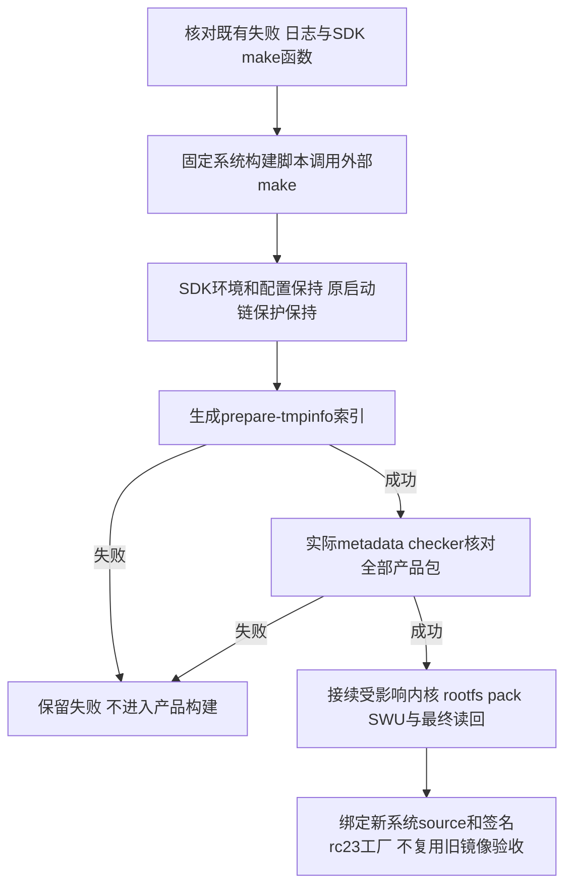

# REQ-MIMI-SYSTEM-049 元数据构建绕过SDK Shell同名函数

2026-10-15事前，接续SYS048。新rc2实际product跑完desktop/IPKVM/Web后，在build_firmware.sh准备软件包索引时failed：source build/envsetup.sh定义make Shell函数，把make -C OpenWrt -j1 prepare-tmpinfo变成build.sh action并触发tina启动链保护。此失败不说明镜像/应用源码已通过，介质写入not_run。目标仍A133 MainBoard V1.2/project4/device4；signedfactory sourcea37/versionrc23/包c22不变，修复仅system构建脚本，不把文档变化当重编理由。

回归不变量：command make按PATH执行主机make，禁止进入SDK同名函数；不设置A133_ALLOW_BOOTCHAIN_*、不改SDK脚本/Bootloader/8保护输入、不更换工具。相同signed应用/可信钥/身份和兼容范围保留；无需重编应用业务代码，只有系统build input改变需重跑受影响固件阶段和最终整个镜像门禁。原候选目录/失败和已成功阶段日志保留，不重复live进程；真实镜像、安装、稳定性和升级/断电/数据/功能矩阵未验收不上传。

实施位置scripts/build_firmware.sh元数据调用、tests/update的真实Shell影子函数回归、本REQ与批次。测试必须在make函数会失败的环境调用实际脚本metadata片段，检查外部make收到-C与prepare-tmpinfo、不调用函数；随后运行真实SDK索引及包名checker。记录实际commit/hash/device、host与physical范围。当前修复/验证/完整镜像均not_run，下一步先确认旧任务terminal，再改一处调用并受限接续。

实施前追加真实缓存因素：externalmake调用修复后，先前非产品环境scanner缓存的四个aitvbox .packageinfo条目仅Source-Makefile无Package定义；重新传正确product-root/vendor环境仍因scan.mk只按Makefile时间戳命中空缓存，不重扫。真实checker明确拒绝，是有效拦截，不能称全部索引passed。改动增加仅删除五个固定产品包的生成型tmp/info缓存条目，然后运行prepare-tmpinfo和既有完整性checker；不清SDK源码或其他包缓存、不touch源Makefile、不取消错误检测。首次诊断checker传目录错误、r2/r3缺项失败继续保留；完整产品尚未启动重试。必须以真实产品环境重生后的Package定义和8Boot输入不变核验。

2026-10-15修复实际结果：外部command make和五个固定生成型缓存刷新已实现；3项真实Shell回归passed（旧影子函数调用返回73、新调用外部make收到实际索引参数、只移除5产品缓存且保留其他缓存/源码），脚本语法passed。真实恢复SDK使用同product-root/vendor环境刷新并prepare-tmpinfo return0，五个产品包均唯一正确来源，metadata checker0/hash0bc083c824feb1689a174e34f33db54331766216d50979145a011feef5f88861，8保护启动输入无变。首次测试器Python3.8/片段错误及r1误传目录/r2/r3空缓存拒绝均保留，不冒充原产物通过。
旧SYS048 product terminal failed，真实97tracked source和8保护input未变化；此前apps阶段完成日志保留。本修复只系统构建recipe，不改signedrc23/sourcea37/c22/factorylock89d290…和可信key/硬件接口。固定新系统recipe源码后接续完整产品pack/SWU及最终读回，签名应用不换版本。当前完整新系统与全部真机矩阵仍not_run，不能上传。证据metadata-make-real-result-r4.json、metadata-make-real-private-r4.log、metadata-cache-refresh-plan.json。

## 2026-10-15 SYSTEM049 索引构建修复与接续
SYS048首轮实际产品在metadata阶段failed：SDK同名make函数误入受保护tina；返回1、97tracked源码和8保护Boot输入无变。已修复系统脚本command make，并发现pure/product环境切换留下四个空Package dump缓存；只刷新五个固定生成型条目，不清其他包/SDK源码。3项真实Bash回归及语法passed，真实SDK prepare-tmpinfo0/fivepackage checker0/hash0bc083c824feb1689a174e34f33db54331766216d50979145a011feef5f88861，8Boot输入无变。初次夹具/传错checker目录、空缓存拒绝均保留failed，不吞检查。
冻结系统recipe d7c8572b0f02ff02f6cc2ce8ba3ea79c06db306b；签名factory仍a37/rc23/packagec22/factorylock89d290…，原key/设备绑定不变。supervisor999304首轮在实际build前守卫匹配到含脚本名的SSH启动器而退出，未生成产品；单独launch且确认没有真实script进程后supervisor1001802/child1002649已通过preflight并实际运行。最后结果读output/system-baseline-rc2-20261015/product-build-result-r4.json；输出.delivery/system-rc2-product-20261015-r2；不重复启动。
此次hardware只读scope确认project4/device4/COM17/固定USB，无活动硬件任务；扫描not_found只是当前非FEL可见，不能推断已在线/失联，未做重启或安装。原FES失败源码尚未找到已证实缺陷，mainline MCP明确要求T113/R528 SPL，不用于A133。全镜像、安装、永久失联修复和必需真机矩阵仍未通过；所有其余交付项保留，应用/Release未上传。

## 2026-10-15 修正后的完整候选与真实旧板恢复
完整system1.0.0-rc.2/source d7c8572b0f02ff02f6cc2ce8ba3ea79c06db306b实际build返回0/BUILD-COMPLETE/SHA256SUMS、源clean、匹配driver的ELF→Image及完整img内BOOT实际载荷、rootfs完整性/签名factory读回、保护bootchain/8输入检查均passed。Image556318720B/hash618a5c3636a25407c6bcb79fd491b71d6dcb6f5cf1a665acc60c556c1a20139a；SWU102001664B/hashcdf6232984be3b77bcc266ba4f5f22e7d0cc80fa7220d7a7ca58402c50a32a1d。compiled Image919d52f0…98dd；boot986681b2…d84d；最终rootfs51d0dbb2…b42。预装signedapp23/sourcea37/包c22，旧key不变。
原supervisor after-source guard failed:input changes require review保留不改。唯一组件openwrt/target/a133已独立clone重建：实际组件差异SHA和当前clone完全一致，替换仅原effective.config后精确复得原before组件9ae529…；current与前039已审核normalized配置完全相同，全部CONFIG符号/值和集合无变，只multimedia注释块排序，未改canonical源码。首次用私有overlay raw而非真正before effective配置的关联assert失败保留；r2真实reviewpassed。无需为注释归档变化重编已生成镜像。
旧板read-only时UART无marker、原IP两探测失败，尚未新包传输/安装；按既有授权30秒MCP复位后actualkernel4.9.191、currentrc17/pkg34fc…/previous76e…/trialfalse、health0/idle0、Dropbear authorized_keys空、capture-status idle/capturefalse/displayfalse/frames0，serial37/38均关闭。初读A48误用/root/.ssh路径和D48只按常驻PID判断，错误检查failed保留；r2用正确Dropbear路径与真实captureJSON通过，不把常驻encoder等同实际HDMI采集。仅恢复passed，原失联根因未证明。raw只存私有0700目录，普通证据不含raw/设备秘密。
新镜像原生project4 SFTP tasktransfer-1792015948561765100实际556318720B/hash618…，Windows本地完整再hash一致、native inspect33items及boot/rootfs/FES目录passed，未写板。首次snapshotbusy被拒绝前无task，重读无活动且所有任务terminal后才启动。旧552恢复镜像仍在Ubuntu原immutablebuild，不备份另一份SDK/缓存。
本地raw image旧钥签名/受控rc1硬件描述配对0、V1.1真实拒绝passed，manifestSHA9bdf465d…409b；这是受控firstflash候选入场，非SDK全发行闭环或设备安装通过。SDKpublic inventory4cd35b…3b88由原固定97输入加privateoverlay1fb和实际post-overlay tracked source贡献组合，私有composition653ead…3f42记录原档案和重放引用，不伪称新full SDKsnapshot；完整公开交付来源审核仍待。
下一步先核对新factory与原userdata的启动选择：旧rc17不支持sys2，源码Engine.Select在Match失败时会验签匹配previous/factory并回退；新factory23明确匹配rc1/rc2，必须实际验收该boot选择/数据/信任继承后才认定首装成功。随后使用固定scope原生FEL/FES和同布局partition保留UDISK策略，全部真实新kernel显示/失联对照、系统正常升级回退、各阶段断电、数据及功能矩阵仍not_run。Ubuntu登录/源码归属/配对与语音/Tuya/公开发布全目标保持未完成，无应用/Release上传。
