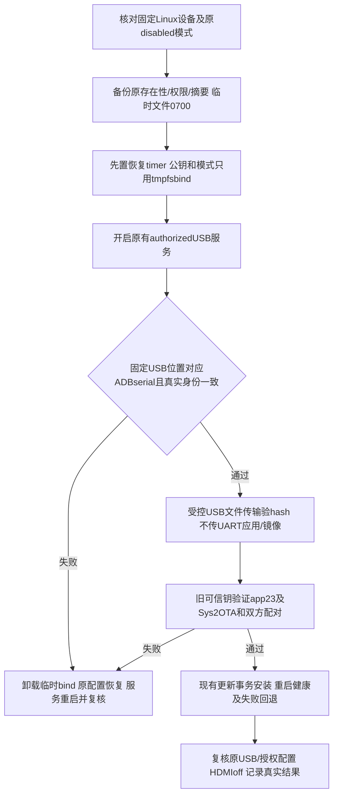

# REQ-MIMI-SYSTEM-051 授权USB维护通道与可信OTA接续

2026-10-15事前，接续SYS048/050。原生FES对新618已失败于RAM握手，partition未写；原rc17已真实恢复，GPT/private与040一致。不能再同条件盲烧。现有USB服务提供authorized模式（ADB_AUTH_ENABLE=1/外部public-key允许表），拟临时使用已有WindowsADB公钥打开受控USB文件传输，然后按现有验签器安装rc23和签名SWUpdateOTA。FES仍failed，OTA即使通过也不得标FES通过或缩减统一镜像交付。

回归不变量：硬件控制仍MCP project4/device4/COM17/固定usb10:1；只使用已提供USB维护功能，不改源代码、报告契约、驱动/Bootloader/immutableCLI。只authorized且认证开启，禁用无认证development；只允许既有Windows当前ADB公钥，不生成/替换私钥、不改签名信任/100ask绑定。不公开密钥/敏感UART。模式和允许表采用/tmp0700文件bind mount覆盖，原文件完整保留，电源/系统重启后bind消失原disabled恢复；原不存在时创建空mountpoint只作临时占位，清理时删自己创建的空文件。必须先armed timer再改变服务，身份不符/权限失败不换用其他设备。只传小型公钥配置命令，禁止应用包/SWU/镜像经UART传输。实际USB数据路径必须限定已验证serial和被选物理位置，不扫描后任选手机/其他板卡。

新rc23/systemrc2/618/cdf产物和原backup不变。实际原mode/keys状态、setup/timer/认证/传输/升级/恢复结果待本批读取；改动后重跑对应HID/启动/健康，不把授权等同安装通过。Windows公钥外部文件仅记录摘要；最终包无这些临时设置。完成候选文档不触发重编；正式Release未验收不上传。
