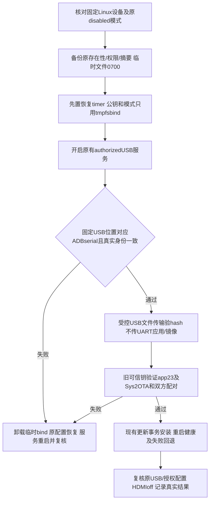

# REQ-MIMI-SYSTEM-051 授权USB维护通道与可信OTA接续

2026-10-15事前，接续SYS048/050。原生FES对新618已失败于RAM握手，partition未写；原rc17已真实恢复，GPT/private与040一致。不能再同条件盲烧。现有USB服务提供authorized模式（ADB_AUTH_ENABLE=1/外部public-key允许表），拟临时使用已有WindowsADB公钥打开受控USB文件传输，然后按现有验签器安装rc23和签名SWUpdateOTA。FES仍failed，OTA即使通过也不得标FES通过或缩减统一镜像交付。

回归不变量：硬件控制仍MCP project4/device4/COM17/固定usb10:1；只使用已提供USB维护功能，不改源代码、报告契约、驱动/Bootloader/immutableCLI。只authorized且认证开启，禁用无认证development；只允许既有Windows当前ADB公钥，不生成/替换私钥、不改签名信任/100ask绑定。不公开密钥/敏感UART。模式和允许表采用/tmp0700文件bind mount覆盖，原文件完整保留，电源/系统重启后bind消失原disabled恢复；原不存在时创建空mountpoint只作临时占位，清理时删自己创建的空文件。必须先armed timer再改变服务，身份不符/权限失败不换用其他设备。只传小型公钥配置命令，禁止应用包/SWU/镜像经UART传输。实际USB数据路径必须限定已验证serial和被选物理位置，不扫描后任选手机/其他板卡。

新rc23/systemrc2/618/cdf产物和原backup不变。实际原mode/keys状态、setup/timer/认证/传输/升级/恢复结果待本批读取；改动后重跑对应HID/启动/健康，不把授权等同安装通过。Windows公钥外部文件仅记录摘要；最终包无这些临时设置。完成候选文档不触发重编；正式Release未验收不上传。

## 2026-10-15 SYSTEM051 实际授权维护/恢复与OTA主机门禁
原actualmode/keys均absent、HIDtest0/idle0；实际initSHA951b5afc1a52c0facd8147609abcdde6dc0379c69da4c835bd722f685cd54b4c与当前source一致，已有授权模式不是未部署stub。默认/mnt/UDISK/adb_keys也空。先armed600s restoretimer后，仅tmpfsbind authorized模式与空allowlist，原不存在处只创建empty mountpoint；adbd有PID和FFSep0/1/2、UDC5100000 configured、onboardVID18d1D00A/HIDMIDtest0。Windows延迟枚举后fixedusb10:1出现ADB interface/composite，serial9c000c81c681882191d与PnP父设备对应；hostexisting F:/ADB server只读列表该serial unauthorized，另外0402101560offline未操作。该事实证明未知key未获连接，尚未knownkey正向认证。
MCPadb_list只见not_found，实际adb_shell固定serial被DEVICE_SCOPE“单板4未绑定ADB”拒绝；workbench保存adbSerial空。因此不能直接让MCP操作它或换用另一设备，也不能将该拒绝当auth测试。已异步请用户在LYNX设备4绑定已确认serial，不改100ask账号/板卡信任身份，等待资源提供；问题pending，不重复提问。
已开始准备现有Windows publickey配置（只公钥SHAab66…，不读/生成私钥），但旧timerPID精确cmdline校验不匹配时guard中止，未kill任何PID、未写入任何publickey。新900s timer先armed，旧timer未取消，失败历史保留。之后实际手工restore0、originalmode/key absence0、HIDENDtest0/桌面health0/idle0全部passed并关闭serial41；再serial42复核原absence后将自己restore脚本原子置noop，两个留存计时器将不再重启USB，无外部PID被杀。未来维护必须新/tmp目录，不能让旧timer调用新会话脚本。临时设置/密钥不进入产物；known-key positive/传输/升级仍not_run，rootFESfailed不清零。
受控systemrc2 OTA清单已使用原releasekey签名，另SWU仍原RSA签名，实际host VerifySystemOTA0验newmanifest/SWU/factory和source/destination配对，trust SHA不变。OTAManifest d635ea79549fb540c15ba3416e703619073f4dae25f65140a837ac2fa40ef339；SWU cdf623…a1d/source d7c8572/预装app23/c22不变。3个真实host拒绝passed：old signedapp17不能Sys2（range[rc1,rc2)）、正确newOTA与old签名factory13 hash不符、4096B截断SWU hash/size拒绝；原archive未变，不把host验证或截断fixture当物理断电。
下一步：用户保存ADBbinding后先读actualscope与同物理位置，再新临时authorized session完成known-key认证和目标身份，使用受控USB传输（禁止UARTpayload）核对hash，先app23兼容Sys1/2实际升级，再签名Sys2OTA；所有真实升级/回退/断电/数据/新LCD/失联矩阵另验。source拆分、Ubuntu真实登录、账号归属/语音/Tuya及最终发布全范围保留，应用/Release仍未上传。证据本output目录，raw/PnP原身份私有目录0700/0600。
