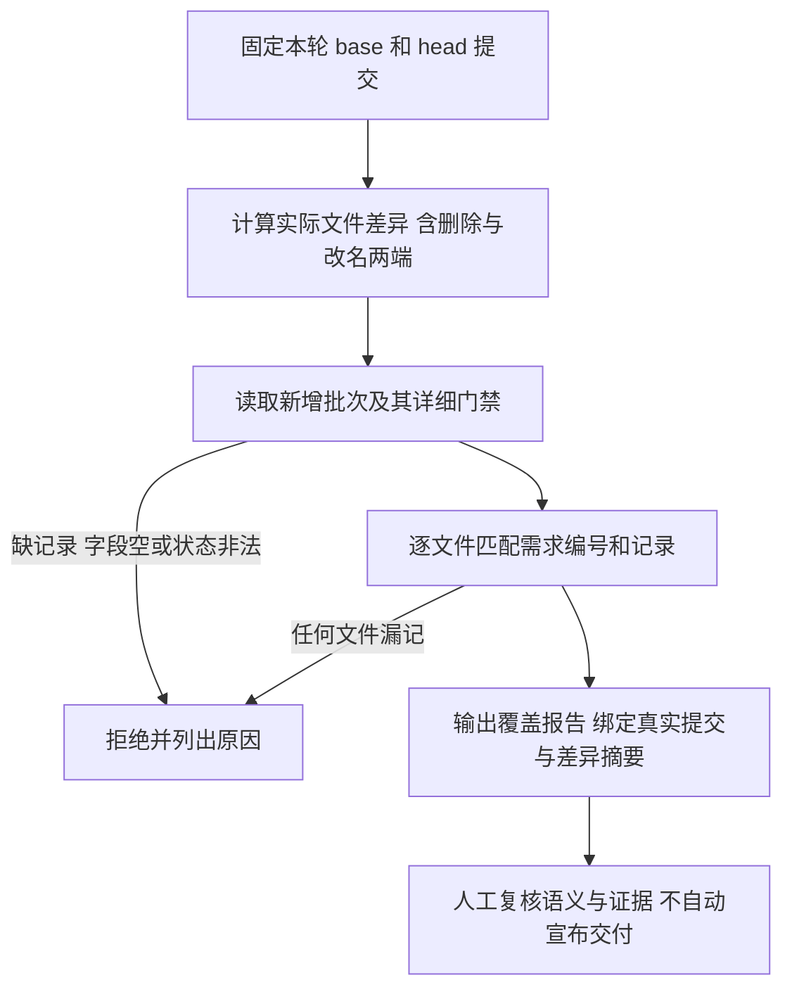

# REQ-MIMI-TRACE-021 变更记录自动覆盖检查

2026-10-14 实施前记录。关联 MIMI-TRACE-001 与用户“所有新增功能和其他变更均要记录上下文”要求。起始源码8b25105，设备仍为rc17；本轮只改开发工具/文档/CI配置，不修改产品二进制、设备或信任。

## 背景与范围
现有门禁靠人工逐批核对，存在修改文件未关联记录的遗漏风险。新增主机检查器，给定已提交的 base/head，按 Git 实际新增、修改、删除、改名两端逐项核对本批新增记录。机器可读批次保存于 docs/change-gates/batches/，与详细中文门禁互相引用；不把文件覆盖率当作业务正确性或验收通过。旧历史不伪造补录，首次使用从上述基准开始。

## 流程与失败分支

## 回归不变量
只读仓库，不执行记录中的命令、不联网、不操作设备；文件路径须为仓库内相对路径，记录不得通过符号链接或路径穿越逃逸；历史批次不得修改或删除，新增批次追加事实。状态仅允许passed/failed/not_run/blocked；非passed须说明原因，passed须有具体证据引用和限定范围。所有改动包括工具、测试、文档和批次自身都须覆盖。删除/改名不能逃过检查，零差异仅说明无变更。没有基准或记录时明确失败，不静默跳过。校验器不能证明描述真实、时序先后或证据内容正确，人工审查继续必要。

## 实现位置
计划 scripts/check_change_gates.py、tests/architecture/test_change_gates.py、.github/workflows/change-gates.yml；docs/CHANGE-GATES.md及本记录、批次JSON。CI只在PR与非首次push提供真实基准时检查；首次公开导入没有可比较的父树，需明确提供审核基准，不能自动将全部历史标通过。远端CI配置未上传/执行前仍not_run。

## 验收条件
- not_run：临时真实Git仓库正向覆盖，遗漏文件、空字段、非法状态、路径逃逸、符号链接、删记录、删文件和改名负向拒绝。
- not_run：对本轮实际提交差异执行检查；对真实差异故意遗漏一项确认拒绝。
- not_run：既有架构回归；本轮不改产品，因此A133重新编译/安装不适用，设备仍对应原rc17证据。
- not_run：远端CI执行、历史全量补录；公开上传门禁不变。

## 证据与接续
证据 output/change-gates-20261014/，实际提交由构建后的进度记录绑定。每批实施后新增批次，再以可信比较基准检查；失败原始日志保留。仅保存增量源码和小型证据。继续Ubuntu Provider/deb、系统真机升级回退断电与长稳，不能以本工具通过替代这些验收。

### 主机实现结果（提交前）
24项覆盖检查器真实临时Git仓库测试及全部74项架构测试passed，原始日志output/change-gates-20261014/architecture.log。首次22项通过后补充布尔schema/非字符串status拒绝，两项一并回归通过。CI配置已在本地加入PR、main push和手动基准入口；首次无父树导入明确拒绝，不伪称历史全覆盖。真实本轮已提交差异检查须在提交后执行，当前not_run；远端CI未上传执行，not_run。

### 已提交真实差异验证（2026-10-14）
实现提交65d065d3e966194e4ec389d7fa06d3aa3c0a67ec；比较基准8b25105dda4ca5d674d30979179ef5832283938e。实际6个变更文件均关联本门禁，自动覆盖检查passed，diff摘要0704d0276dbc54f4818aaf8c028c71d9ad8fd2ae5f928e13b8599f7a15c01bb3。用临时Git索引生成不挂接分支的负向提交，仅删去检查器自身的记录条目，真实检查返回1并准确指出遗漏scripts/check_change_gates.py；原HEAD和工作树未改变，passed。证据actual-coverage.json及actual-omission-rejected.json。
CI YAML解析、只读权限和不保留凭据配置核验passed，远端实际执行仍not_run。此次验证没有产品代码变化，无需把原rc17重新签名/装板；其已记录验收仍只属于fe58653和原包。结果记录作为追加批次20261014-trace-021-evidence.json，同样执行覆盖检查，禁止为记录本身设置免检。历史补录、语义人工复核和产品发布门禁仍独立。
