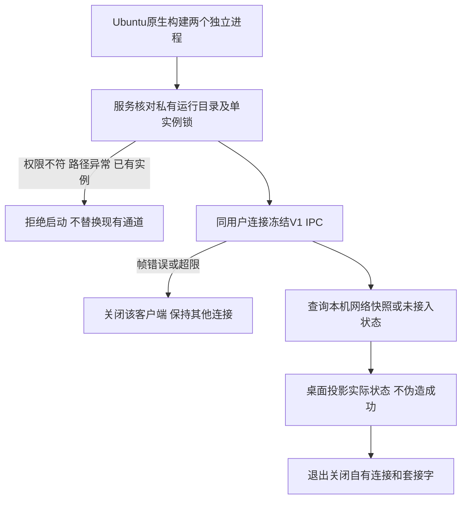

# REQ-MIMI-UBUNTU-022 Ubuntu 独立服务基础

2026-10-14 实施前记录；关联D02、REQ-MIMI-BUILD-017、REQ-MIMI-UI-018、MIMI-UPDATE-001和TRACE-021。基准17b227d；实际板仍rc17/fe58653。本轮仅Ubuntu开发主机，不更新A133或上传。

## 背景与范围
Ubuntu窗口验证当前依赖只收不回的IPC测试夹具，不能用于真实运行。建立独立Ubuntu用户进程，复用冻结V1消息结构提供本机真实网络IPv4快照，对未接入的Wi-Fi控制、蓝牙、传感器、HDMI、板级视频、Tuya语音、100ask私有服务和系统OTA明确返回不可用/错误，不假装硬件就绪。服务不读取设备身份和密钥、不启动命令、不更改网络、时钟、声卡、背光或驱动。这个阶段是可实测服务基础，完整Provider能力/UI投影、V2接入、平台身份、可信SDK和deb升级验收仍分步完成，不将其声明为已交付平台。

## 流程与失败分支

## 回归不变量
平台服务与桌面分别编译，不把平台服务放入纯应用包；A133代码和冻结契约不变。仅相同UID可连接，端点父目录归当前用户且0700、套接字0600；进程锁避免重复服务抢占。拒绝路径符号链接/普通文件，不删除未知文件；使用默认公共/tmp端点时拒绝启动，需显式配置隔离路径。解析限制512字节、有限客户端、超时释放，日志不打印正文/SSID密码等消息载荷。无真实Provider功能的返回不可用只代表诚实拒绝，不代表功能已实现。

## 实现位置
计划services/mimi-ubuntu-provider/{CMakeLists.txt,provider.c,README.md}、tools/sdkbuild/native_ubuntu.py、tests/sdkbuild/test_ubuntu_provider.py及实际窗口验证脚本；来源归属登记docs/update/source-ownership.json。详细改动纳入不可变批次JSON。

## 验收条件与证据
not_run：真实本机网络与不可用状态读取、V1合法/分片/合并及坏帧、超限、重复实例、错误权限/符号链接、连接隔离、退出清理；同用户访问与服务拒绝能力不修改系统。not_run：固定源码原生编译与真实服务连接的SDL窗口、配对不可用、尺寸/关闭、设置保留。not_run：V2/完整能力UI、可信Ubuntu SDK/身份、正式签名deb安装升级回退与数据。证据output/ubuntu-provider-20261014/；每项实际结果后追加，远端CI不执行、不上传。

## 接续
完成服务基础后推进能力UI和Ubuntu平台身份/签名包链；A133系统升级回退断电和长稳仍必需，Tuya云设备待用户提供。仅关键增量源码与证据备份，不复制构建缓存。

### 首轮验证及范围追加
服务初版真实进程测试11/12通过，强杀恢复用例的测试等待误把旧socket文件当就绪，改为核对新进程ready后重跑，12/12通过；21项既有SDK测试合计33通过。74项架构和冻结V1契约检查通过。旧rc17桌面连接新服务的3尺寸窗口/关闭与未选尺寸拒绝通过，但英文配对占位缺字，视觉failed；原图保留在.delivery/ubuntu-provider-window-r1，关联PAIR-020修正ASCII英文占位，中文/页面布局/服务逻辑不改。此共用应用文件改动需要A133交叉编译重验，不把未装板记为通过。原生新源码重新构建和正式窗口验证待提交后执行。

提交前复核：补齐连接上限及父目录符号链接负向用例后，14项真实进程+21项既有SDK测试共35项passed。74项架构、冻结V1检查passed；PAIR-020占位修正12张中英文/深浅主题/3尺寸渲染与交互passed。后提交构建、真实最终窗口和A133交叉编译仍待执行；原始失败日志不删。

### 固定源码编译与实际窗口结果（2026-10-14）
源d1a8ac50fc9fd0749ecf5f01583d30ad42778601，本地rc18；Ubuntu桌面SHA256 b81d85a0d60cb02220a6211712dad66c3052deaa6dd578ff2ee7c4866f4b13c2，独立Provider da5f2b13227ac77a04c114869043f402ea97f58b9bd5736d15ad848fb0edfadf，A133桌面 1abae4491a05b15245cfe483aa6461462894ef69cfb59273d9b394ba6a32a269。两个编译入口从干净相同提交完成，平台服务未进入桌面编译来源；冻结V1契约不变，公开候选审计0发现。14项真实进程/35项SDK合计测试、74项架构、12张配对渲染passed。使用实际Provider启动桌面（独立Xvfb，不是物理屏）：1024x768/480x800/800x480窗口与退出passed，640x480拒绝passed；配对显示服务不可用且禁用刷新，英文占位已正确显示。Provider退出0且自有套接字移除。不同UID真实负向测试使用root客户端，被拒绝而Ubuntu用户仍可读取；测试Provider与最终字节哈希一致。
首轮缺字截图和测试就绪时序失败保留；前序not_run只代表当时计划，以上为追加实测。证据output/ubuntu-provider-20261014/result.json及回执、window-final、render、日志。完整Ubuntu功能/V2能力、可信SDK/平台身份、签名deb安装升级回退/数据仍not_run。只读A133检查发现再次失联，受控恢复另归REQ-MIMI-STABILITY-023，不把该故障归因Ubuntu新代码。A133仍rc17，rc18未签包未装板未上传。
