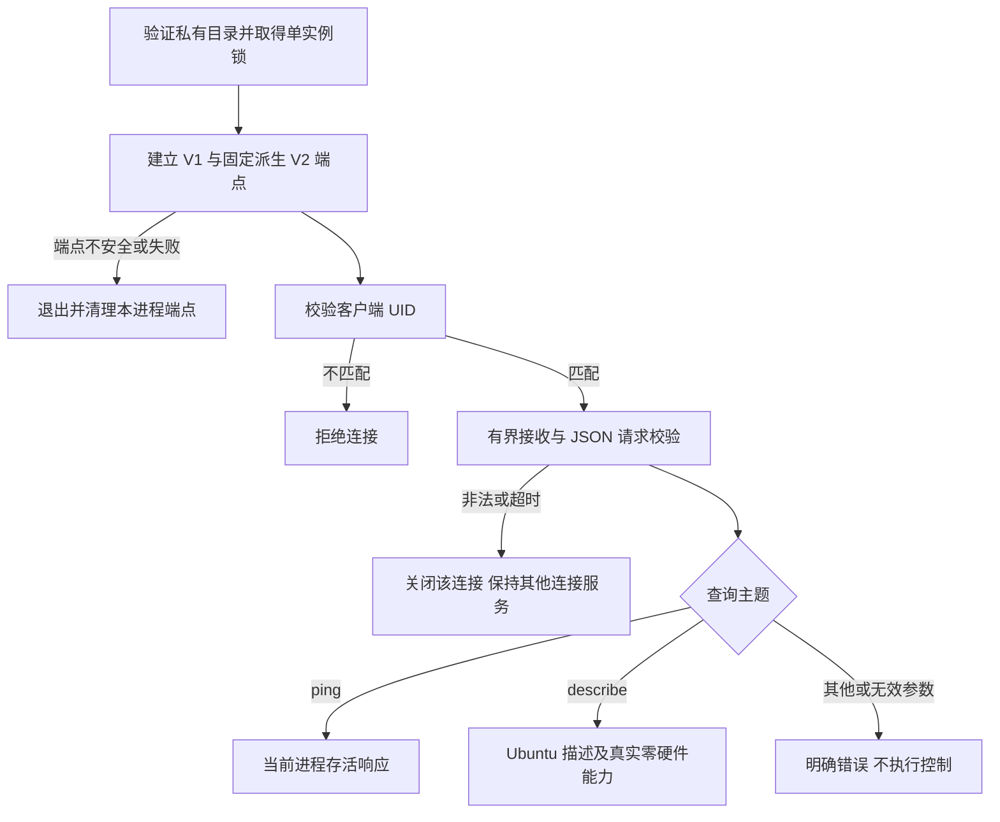

# REQ-MIMI-UBUNTU-024 Ubuntu V2 查询与健康握手

关联 MIMI-UPDATE-001、MIMI-TRACE-001、REQ-MIMI-UBUNTU-022。2026-10-14 实施前记录。

## 背景与范围
Ubuntu 独立服务已提供真实本地网络观测和 V1 不可用状态，但尚无 V2 健康/能力握手。本轮增加独立私有 V2 端点，沿用现有 JSON 帧契约，仅实现 system.ping、platform.describe。描述只代表当前进程能力，不是签名设备身份或安装兼容证明。服务仍独立于纯应用包；不修改 A133、共享协议或桌面 UI。完整 deb、能力 UI 和真实硬件功能后续验收。

## 流程及失败分支

## 回归不变量
V1 编号/结构/语义及 A133 Provider 不变；V2 与 V1 分流，同用户访问，帧上限64KiB、连接数和收发期限有界；不读取或记录秘密载荷，不修改主机设置；未知控制请求不得成功。不能把健康响应当成桌面就绪、云绑定或完整升级健康验收。不得改变当前可信密钥、设备 rc17 或上传候选。

## 实现与验收计划
位置 services/mimi-ubuntu-provider/{provider.c,v2_server.c,v2_server.h,CMakeLists.txt,README.md}；tests/sdkbuild/test_ubuntu_provider_v2.py；docs/update/source-ownership.json；详细结果待追加。
- not_run：实际服务的标准 Python 契约交互、分片/合帧、未知主题/错误参数/非法帧/超时隔离、连接上限、端点冲突/退出/崩溃恢复。
- not_run：原 V1 回归、冻结契约、源码归属、固定源码构建及实际 SDL 桌面连新服务。
- not_run：桌面能力 UI、可信 Ubuntu SDK/身份、deb 安装升级回退数据验收。
- blocked：A133 稳定性及完整系统真机交付，沿用 STABILITY-023，不转移旧产物通过状态。

## 接续
先完成查询实现和真实进程验证，再接会话启动和可信平台安装链。外部证据 output/ubuntu-v2-20261014/，基准0f0e03436724caff420942b353fce01219f46e36；新提交/服务哈希待实际构建后追加。记录先于实现。

## 实施中发现（追加）
首轮 V1 14项 passed；V2 首轮执行误重复收集14项 V1，24项中1项 failed：测试假设V1下一帧必为请求回复，忽略了正常周期快照。修复测试为带明确标志的心跳，并检查最多50帧，消除错误假设；不更改V1发送语义。原失败 output/ubuntu-v2-20261014/v2-tests-r1.log 保留。真实窗口测试同时增加V2查询及双端点清理检查；尚待重新执行。

## 主机实现验证（提交前）
- passed：V1原14项；V2真实服务查询、协议与生命周期首批10项；SDK完整45项，output/ubuntu-v2-20261014/sdk-tests-final.log。追加实际root异UID拒绝和替换路径保留测试，结果另记。
- passed：architecture.log 74项，contracts.log 冻结mimi-ipc-v1.1不变，ownership.log归属检查（物理迁移仍false），public-audit.json零发现。
- 实现采用独立非阻塞收发队列；V2端点固定为V1路径加.v2，同目录同实例锁，收到SIGTERM清理两端点；V1与V2各8连接且异常隔离。Provider0.2.0报告ubuntu-host/host/x86_64，Ports ABI2、capabilities=0，仅有本地网络观测说明；不冒充签名身份或设备完整健康。
- 桌面源码/资源/版本无改动；完整原生构建与实际窗口待提交后执行；A133本批不重新安装、不继承新Provider验证。

追加通过：sdk-tests-final2.log 47项（含12项V2测试、实际root客户端被拒绝而Ubuntu同用户继续服务，以及退出不删除被替换路径）。无skip。
