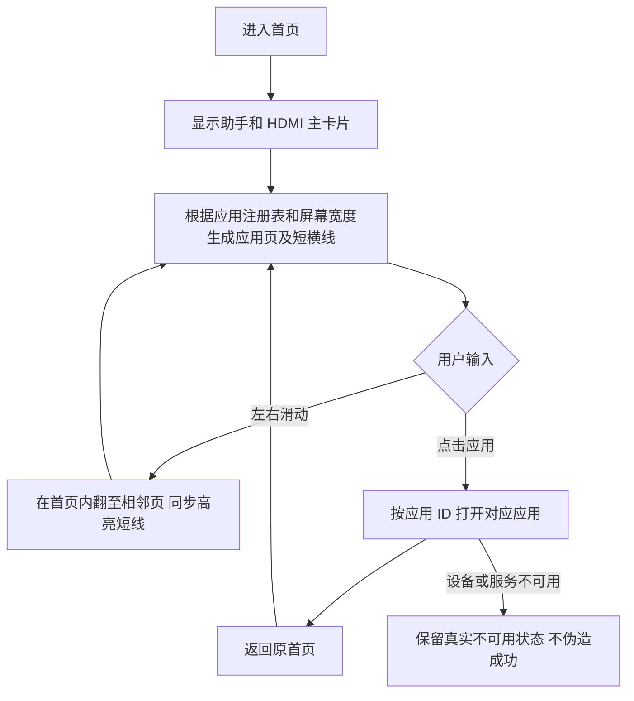

# REQ-MIMI-UI-016 首页图标与内嵌分页

记录类型：2026-10-14 追溯补记，来源为本会话用户标注图、效果图确认和实际验收记录。关联 MIMI-TRACE-001、MIMI-UPDATE-001、D02 及首页标注纠正；不得将补记说成原实施前已存在的记录。

用户要删除红框重复底栏，保留绿框应用区并在其内部左右滑动；使用柔和底色圆角图标，应用名置于下方。去掉滑动说明和数字页码，仅以实际页数的短横线示意，当前页高亮。用户确认效果图后实施。

回归不变量：主卡片保留；重复底栏和小抽屉替代入口不恢复；不跳全屏启动器来代替页内滑动；滑动不误打开软件；图标装饰不抢触摸焦点；键盘导航仍可用；页数随应用注册数量变化；编译配置不进入桌面；HDMI 默认关闭。

实现位置：apps/lv_port_linux/src/ui/desktop_dock.c、desktop_home_tokens.h、tests/architecture/fixtures/native_ui_review.c。公开应用候选位于开发目录 .delivery/application。

## 变更与证据

| 批次 | 固定源码/产物 | 事实 |
| --- | --- | --- |
| rc14 | 8c4f111a6a8dcfb09f4e5d016601799aac3e7e34 | 内嵌应用页已安装；第一次左滑跳到第3页，failed；按预期第2页坐标点击实际打开蓝牙，失败证据保留 |
| rc15 | 3fe8ceb8b772111ed418841a9faaca17d65032d8 | 关闭指针聚焦的自动滚动及惯性；主机通过，真机传输失败，未安装 |
| rc16 | 8529f98a01a65831860a4bc60fe4eb1a83455450 | 用户确认图标方案后实现；签名包安装 committed |

rc16 包 SHA256：76e31edf2fd9a8402af52386191e05bf173f682f927ff4c78186891492ece847。设备 A133 MainBoard V1.2 / ram2g-emmc16g / 1024x768；系统基线 a133-mainboard-v1.2-system-1.0.0-rc.1-inventory-r2。

| 验收条件 | 状态 | 实际范围/证据 |
| --- | --- | --- |
| 多分辨率、语言、主题布局和分页线同步 | passed | 40张主机渲染及运行断言；output/home-icons-20261014-r2 |
| 架构检查、A133编译、可信签名及目标匹配 | passed | 50项检查、整包构建；output/home-icons-20261014/result.json |
| 真机相邻分页及指示同步 | passed | 8次 evdev 触控回放；device-page-sequence.json 和实际截图 |
| 涂鸦智家入口映射 | passed | 正确打开未配置页；不代表真实IoT控制通过 |
| 设置入口验收 | blocked | 点击后采集截图时整机失联，没有足够页面证据 |
| 整机稳定性 | failed | SSH超时、UART命令无输出、ping失败；根因未确定 |
| 冷启动恢复及清理 | passed | rc16 retained、trial=false、ready/idle、ext4错误0、撤销临时SSH及关闭串口 |
| 人手触控和完整数据语义 | not_run | 23项哈希22项不变、Tuya数据库变化，不能代替语义验收 |
| 应用或Release上传 | not_run | 正式发布前置门禁未满足 |

下一步：定位整机失联，重验设置与受影响功能；不得把翻页通过改写为整机稳定性通过。改动图标、注册顺序或事件处理时，沿用本需求追加记录并重跑相关布局/输入检查。全部原始证据由开发目录 output/home-icons-20261014 与 -r2 保存；关键归档 .delivery/critical-source-20261014/evidence-home-icons-rc16-20261014.tar.gz，SHA256 05c1c68cba862fc4853576d51461cf5465c11cb44a94373d0a220a518bf5c955。
