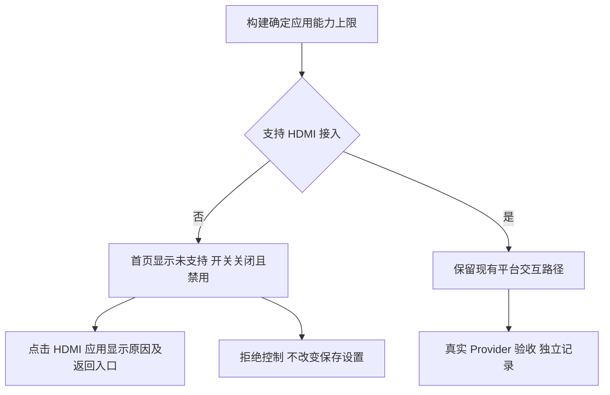

# REQ-MIMI-UI-018 缺失 HDMI 能力时的真实界面

记录日期：2026-10-14；前序：REQ-MIMI-BUILD-017、REQ-MIMI-UI-016；适用 MIMI-TRACE-001 / MIMI-UPDATE-001。状态：实施前记录。

## 背景与范围
Ubuntu 原生窗口首次验证发现没有 HDMI Provider，却显示 Ready、默认打开的直通开关。修复开发主机不支持 HDMI 时的首页、顶栏/控制中心、HDMI 应用入口和控制请求；保留用户批准的图标、内嵌分页和短横线。应用构建能力上限不代表服务在线，也不代表平台验收通过。A133 已有协议/驱动不在本次修改范围；A133 断线后的动态能力探测另行验证。

## 回归不变量
- 未接入能力不能因历史设置、点击、状态帧变成已启用；不能连接 A133 固定控制套接字。
- 禁用分支不写用户设置、不发送 HDMI 开关命令、不启动采集；设置原值保留。
- 不改冻结 IPC、平台服务、设备身份、签名密钥；不引入桌面编译配置页。
- 构建能力为支持不等于在线；本次不宣称解决 A133 静态就绪语义或整机失联。

## 实现位置与验收计划
待修改 apps/lv_port_linux/CMakeLists.txt、src/ui/desktop_capabilities.h、desktop_clock.c、desktop_status_bar.c、ui_i18n.*、src/apps/hdmi_mcp/hdmi_mcp_app.c；tests/sdkbuild/ 的实际 SDL 窗口/输入测试。

| 检查 | 当前结果 |
| --- | --- |
| Ubuntu 首页未支持、开关关闭禁用 | not_run |
| 点击开关/HDMI 入口无控制命令、返回正常 | not_run |
| 多分辨率窗口、关闭、拒绝未编译分辨率 | not_run |
| 主机回归、A133 交叉编译与冻结边界 | not_run |
| A133 新产物实机回归 | not_run |
| Ubuntu 真实 Provider、deb 安装升级 | not_run |

实施基准 0535803ceeaabdce6929a86d2c5ff0d51d294b23，测试目标 Ubuntu 20.04.4 x86_64；证据写 output/ubuntu-hdmi-capability-20261014/，提交/二进制哈希在构建后追加。本轮只改工作源码、不安装板端；关键增量源码和证据归档到 .delivery/critical-source-20261014/。既有失败证据保持，不上传应用/Release。

接续：先修正并验证状态，再推进 Ubuntu 真实服务及 deb；A133 稳定性、系统升级/回退/断电/数据验收仍未完成。

### 开发中检查 1
主机架构 50 项 passed；初次新增渲染测试编译 failed：测试未声明公开开关对象，已补 extern，待重跑。初次编译期间仍有源码修订，不能作为最终产物证据。原始记录 output/ubuntu-hdmi-capability-20261014/renders-no-hdmi/build.log 保留。渲染工具 scripts/render_ui_review.py 新增隔离的无 HDMI 构建目录，避免能力编译标志污染既有渲染缓存。

### 固定源码验证（2026-10-14）
源码 `66cd09008a804946581370bbc5c76727202fab6b`，实际 Ubuntu 桌面 SHA256 `ca176bfeca01655af22f93f604148d8e62af6378f0132def96af639d9b6fa4a4`；A133 桌面 SHA256 `e3d75d59acb1799d7020648639928f1674319e17f263fddde01afb8fca9d1850`，应用 SDK SHA256 `bb78f59b8a4b2128123d5601fc782bc5360c9be567ecd4ad3979f1b000482261`。仅桌面二进制构建，不是签名升级包。

- passed：50 项架构、21 项 SDK/deb 工具回归；冻结边界核对及两平台编译。
- passed：3 分辨率 × 2 语言 × 2 主题 × 3 页面 × 2 能力路径，共 72 张实际 LVGL 渲染及页面导航检查。禁用路径覆盖旧 ON 设置、直接发送点击/值变化事件、意外 active 状态；无命令、无保存、无 agent 套接字连接。控制中心同样禁用。
- passed：Ubuntu 实际 SDL 可执行文件 1024×768、480×800、800×480 窗口及正常关闭，640×480 不在编译列表时拒绝。IPC 仅接收请求的测试桩，不能证明真实 Provider。
- passed（只读抽查）：MCP 固定 A133 通道在线，板卡 uptime 45 分钟、UI activity_ready=true/busy=false，未发现 HDMI 采集进程；串口已关闭、没有临时 SSH 授权。版本路径查询未命中，安装身份未重新核验；此健康抽查不能记作新二进制验收或稳定性通过。
- not_run：新 A133 二进制实机、Ubuntu 真实 Provider、deb 安装/升级；原整机失联问题仍未关闭。

原始证据 `output/ubuntu-hdmi-capability-20261014/result.json`、`unsupported-final/`、`supported-final/`、`window-final/` 与两份构建回执；旧编译失败和旧错误画面证据保留。没有上传应用或 Release。下一步接续 Ubuntu 服务/deb 与真机更新阻塞，不能将本次能力上限判断称为完整动态 Provider 协商。
