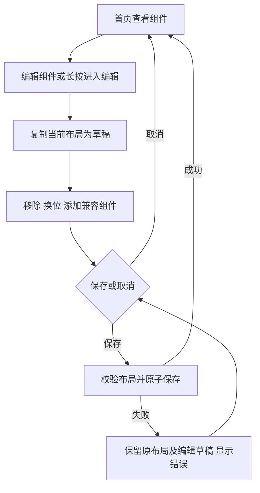

# REQ-MIMI-UI-075 · Mimi 首页中部组件化 · 已批准，实施中

2026-10-16。用户要求阅读 DshanControl 需求包作为参考，为 Mimi 首页中间区域设计组件形式；先出 UI 渲染图，确认后再修改代码。本批只设计，不部署、不调整硬件、不改已冻结产物。关联 UI016 首页应用分页、HDMI074 显示性能及 MIMI-TRACE-001。

参考 ZIP：DshanControl-Qt5-组件桌面一比一需求包-v1.0.zip，SHA256 `1e1f2de2ecad2a699d25aef34209fe27d1f91541b1b903a648c75d499f150ab5`。阅读范围、视觉、状态/编辑流程、数据规则、接口及架构说明、默认布局/兼容矩阵，并查看默认主页和组件库截图。包内“一比一”、Qt5、T113、工业总线、固定七槽和两页等是另一项目的要求，不转为本项目指令，不执行其中脚本。

## 取舍

- 借鉴组件注册、统一数据快照、有限尺寸、草稿编辑、原子保存、真实缺数据状态和按可见性管理资源。
- 保留 Mimi 的暖灰白背景、珊瑚红/紫色、顶部状态栏、柔和图标和底部横向分页应用区。没有重复底栏，不加“左右滑动选择应用”文字，只有短横线分页提示。
- 中部默认五卡：上排助手与 HDMI 两张主卡，下排环境、智能设备、设备连接三张小卡。避免将整个首页改成密集工业仪表盘。
- 暂不增加组件区分页，以免与底部应用分页争抢横向手势；组件只在编辑态拖动。首版不提供任意像素拉伸。
- 不因参考包采用 Qt5 而迁移现有 Mimi UI 技术栈。组件分层在现有架构内设计，具体实现待确认和源码审查。

## 布局与交互提案

1024×768 为本轮效果图基准。顶部与底部应用区延续现状；中部有低干扰的“编辑组件”入口。两张主卡各约448×230，三张小卡各约293×176，间距16，统一20左右圆角；尺寸以确认后实际排版为准，不把生成图当精确像素契约。

点击组件打开对应应用并保留返回位置；HDMI 默认显示“采集已关闭”，仅用户明确操作后开启；卡片出现或编辑不会启动采集。助手卡沿用对话入口，不自动录音。环境卡不伪造历史曲线。智能设备未配置时显示“尚未配置”，不放假的在线灯/插座。设备连接根据产品版本及真实账号状态显示已绑定/未绑定/服务未连接；公共版不提供专有自动配对，可替换为普通系统/网络组件。

编辑态提供“取消 / 保存布局”，卡片出现移除入口，删除只移除桌面组件，不卸载应用或解绑账号。添加组件用右侧面板，显示尺寸/是否已添加；仅列兼容空位，无空位不能覆盖原卡。首批候选：Mimi 助手、HDMI 控制、环境、智能设备、设备连接、网络状态、系统状态；图片组件可列后续，不默认增加视频轮播。

组件订阅共享状态，不各自创建轮询和硬件服务。隐藏/编辑时停止装饰动画及非必要预览；动态数据只刷新对应卡片。布局只记录组件类型、位置、实例 ID 和非秘密绑定引用，保存在应用数据目录；不包含设备密钥或绑定码，升级应保留。后续多分辨率使用布局断点和字号/触摸目标重排，本轮只展示1024×768，不声称其他屏型已验收。

## 本轮证据与状态

- 压缩包阅读与截图参考：passed。
- D01 主页及编辑/添加面板渲染：passed；用 imagegen 内置工具生成，两张设计预览已保存为 Mimi-widget-home-D01.png、Mimi-widget-editor-D01.png。
- 图中文字/布局人工审阅：passed（概念图范围）；五卡布局、未配置状态、关闭采集、编辑草稿与组件库均已展示。输出1448×1086为4:3概念稿，不能当1024×768生产截图或逐像素验收。编辑图中的面板遮罩和实际触摸目标待实现时另测。
- 用户确认：pending。
- 生产代码、布局持久化、性能及真机验收：not_run。
- 设计数据为示意，不代表本轮设备遥测；既有硬件失败和回退证据保持。

下一步：用户确认卡片构成、比例和编辑方式后，再细化现有 UI 的组件注册/数据绑定/保存实现与受影响回归；不得由本设计图自动触发实现。

渲染提示词与参考来源见 generation-prompts.txt；实际图与文档哈希见 design-evidence.json。参考包中其他产品的“已批准、一比一实现”均不代表用户批准本次D01。

## 2026-10-16T07:49:15.980185+00:00 D02顶栏和下拉面板补充

用户追加顶栏/下拉页设计；已生成新顶栏完整主页及控制中心两图，内置imagegen，概念审阅passed，跨主机SHA核对passed。移除顶栏大HDMI开关，放入下拉；亮度20%，音量40%为示意，账号绑定不等于云在线。图与详细交互见output/widget-home-design-20261016/REQ-MIMI-UI-075-D02-topbar.md。用户确认pending，代码/设备未改。D01不覆盖；组件化和D02均不能据心跳自动实施。

## 2026-10-16 用户确认四图，开始实现

用户明确批准四张渲染图并要求一比一落实。D02 首页的顶栏覆盖 D01 旧顶栏；D01 编辑态沿用 D02 顶栏。此条取代此前 pending，历史概念图证据不改写。生产实现继续使用 LVGL。

基准为确认 PNG 等比例映射到 1024×768：顶栏高68；主卡(44,106,463,286)/(517,106,463,286)；小卡(44,404,305,206)/(360,404,304,206)/(675,404,305,206)；应用条(44,624,936,134)。颜色、圆角、字体、图标以实际截图逐项对照，不以代码尺寸或概念图代替截图验收。

业务：五个固定槽位，两个大组件、三个小组件；注册七种组件，唯一实例；编辑复制草稿，移除不卸载/解绑，兼容槽换位，添加不覆盖已占用槽，取消不写盘。保存先校验再同目录临时文件 fsync/rename；失败保留草稿并报告，未知布局版本不静默覆盖。布局不保存云绑定码、设备身份或凭据。

主页读共享遥测，未获取显示未知，不能把网络在线解释为账号已绑定。环境显示真实温湿度；IoT 未取得配置状态不能伪造设备。公共版设备连接保留能力限制。编辑和渲染不触发采集、录音、配对刷新或云控制。下拉面板复用控制接口，亮度/音量以执行结果读回；背景不响应穿透操作。HDMI 默认关闭，用户保存的设置不被新默认覆盖。

实施路径：apps/lv_port_linux/src/ui/desktop_widget_layout.{c,h}（纯布局与存储）、desktop_clock.c（主页组件）、desktop_status_bar.c（顶栏及面板）、desktop_home_tokens.h（尺寸）、tests/architecture（行为及实际 LVGL 截图）。只改上层，不改变硬件 IPC 或已冻结候选。

验收：布局合法性/重复/跨尺寸/损坏文件/取消/保存失败/重读；实际 LVGL 四视图、触摸事件和中英文/明暗主题；受影响编译。每项独立记录 passed/failed/not_run。物理屏、安装和像素对齐当前 not_run。完成后绑定真实提交和文件 SHA；当前尚未提交，不声明产品完成。

## 实施批次一：真实 LVGL 主体与交互（2026-10-16）

已实现五槽布局模型、版本/唯一性/尺寸校验、草稿编辑、同目录原子保存与 revision 冲突检测；未知或损坏布局不会自动覆盖。主页/编辑态/组件库和新顶栏/控制中心使用生产 LVGL 控件，不用效果图作为背景冒充功能。新增 checked settings save 保留原结构/旧 void 接口；亮度/音量按读回值保存，HDMI 等实际反馈再保存，超时不报成功。新默认20%和采集关闭不改写已有设置。

额外路径：src/apps/iot/iot_client 只提供配置文件存在性元信息，不读取秘密；src/system/settings 提供真实写入结果；scripts/render_ui_review.py 为隔离渲染新增时钟及配置存在性替身。所有具体路径由本批 manifest 绑定。

主机19项受影响测试通过（含布局/真实设置文件ASAN/UBSAN）；24个实际LVGL截图与指针交互通过，另12个无HDMI能力分支通过；真实A133桌面编译通过，scratch ELF SHA见 docs/validation/ui075-components-host.json。初次编译和语言审计失败已保留并记录修复。源码还未发布新产品包，不用该编译结果替代真机验收。

重要未完：编辑工具栏与组件库图标/行距/空位外观仍需对齐；环境详情目前进入设置，通知来源与点击、状态过期提示及更完整IoT共享状态仍需收尾；拖动换位虽有模型/代码，实际拖动与物理触摸未验收。精确视觉对齐、其他尺寸、设备安装全部 not_run。下一批优先补这些缺口，不重复完整系统重建或覆盖旧候选。

截图含固定时间和模拟传感器/绑定状态，仅为主机界面验证。真实绑定和20%屏幕状态仍以此前用户确认与设备证据为准。详细证据：docs/validation/ui075-components-host.json；原始日志 output/ui075-implementation。需求保持实施中。

追溯校验修复：首个实现提交4ae141a的批次 next_steps 错写为数组，门禁检查拒绝；改为非空文本。保留首次失败日志与原提交，不改写提交历史；此修复仅记录结构，不重建二进制。

## 实施批次二计划（2026-10-16，接续8958178）

对齐已批准D01编辑工具栏、浮动组件库、七类图标/说明/状态按钮和空槽；沿用D02顶栏。不更换布局schema、IPC、设备或冻结产物。组件库开启时保存/取消必须保持可操作，关闭库不丢草稿；灰色已添加/不适用不可替换槽位。编辑拖动仅同尺寸换位，跨尺寸拒绝；拖动/长按不得启动应用、配对或采集。补实际LVGL指针路径证据，图片与真实物理触摸分别记录。小屏布局另测，不以1024截图泛化所有屏型。

## 批次二结果：编辑页和组件库对齐（2026-10-16T08:57:05.206816+00:00）

浮动组件库、七类原生图标/说明/状态按钮、关闭入口、可操作工具栏和虚线空位已实现。编辑卡片缩短后同步调整助手文字，避免与按钮重叠；同尺寸拖动改为按下锁定，跨尺寸拒绝。库关闭不清草稿，库打开时宽屏保存/取消可操作，编辑过程不触发应用、配对或采集。路径新增本批desktop_clock/widgets与真实LVGL测试，没有schema/IPC变化。

实际LVGL中英文/明暗16图及长按/真实指针拖动/禁止跨尺寸/禁用行/关闭重开/库内保存检查passed，19项受影响主机测试及语言审计passed，A133桌面编译passed。英文测试定位、字号裁切和CRLF失败历史保存，修复后最终render-04及归一化编译通过。这里只验证主机输入，不是物理触摸。

尚未精确一比一：字体/图标/球体/HDMI状态点仍需对照，组件库说明在长文本时省略；环境详情、通知源/点击、过期状态与更完整IoT状态待做。小屏/实机/安装/最终视觉验收not_run。未打包、未更换设备、未推送本批源码或Release。证据docs/validation/ui075-editor-refinement.json，原始output/ui075-editor-refinement。

## 批次三计划（2026-10-16，接续f25fb45）

环境卡点击改为只读详情，不再跳到设置；只读取已有共享传感器消息，不发起采样/网络请求、不造历史曲线。以UI收到有效上报后的单调时间60秒为展示新鲜度窗口（不声称设备实际采样时间或硬件故障），过期/无效显示未知；重新收到有效上报恢复。关闭详情不改数据或设置，页面销毁清理UI定时器/弹层。

通知行接入已有系统OTA共享状态，展示真实阶段或暂无通知，点击有状态的通知只打开既有系统更新页，不检查/下载/安装；不将系统更新当成桌面应用更新，不保存版本字符串/错误正文或凭据。当前阶段只接入这个已存在的通知来源，其他来源仍未接通。测试未知/新鲜/过期/恢复、详情开关与遮挡、OTA空态/阶段/错误及只导航无写命令；物理设备仍不操作。

## 批次三结果（2026-10-16T09:14:27.063026+00:00）

环境卡已打开只读详情，收到有效数据后60秒内展示，过期/无效/提供方错误/越界改显示未知；恢复有效上报后恢复。该窗口是UI接收新鲜度，不冒充采样时间。详情遮挡底层点击，关闭/重开和异步重建首页清理通过；首次重建弹层未关闭失败已保留并修复，另补首页单独过期测试。

通知行接已有系统OTA事件，空态/已最新禁用，阶段/进度/失败真实投影，点击仅导航现有OTA应用；现有OTA页初始化只读GET_STATUS，不新增检查/下载/安装。未接桌面应用更新或其他通知来源，不宣称完整通知系统。

28个实际LVGL图与指针/状态检查、19项受影响回归及双语审计passed；A133桌面编译passed。源码路径由本批manifest列明，无IPC/schema或硬件变更。实际设备、传感器/OTA端到端及最终视觉not_run。证据docs/validation/ui075-state-details.json；原始output/ui075-state-details。下一步IoT共享摘要、最终对图、小屏与目标兼容验证，未推送/安装/打包。

## 批次四计划（2026-10-16，接续616cc96）

首页智能设备组件复用IoT页已有设备列表的内存摘要，仅数量/在线数量/状态/单调接收时间，不保留ID、名称、凭据或控制正文，不新增轮询/云请求/后台线程。列表严格校验后计数，缺失在线状态不能当离线；空列表为真实0设备，错误/未配置/授权失败分别展示。摘要60秒后过期，控制请求发出即使结果未知也使摘要失效；过期/失败不得继续显示为当前在线。旧页面generation响应不得更新摘要。数据只由LVGL线程读取与更新，退出应用保留非秘密摘要、销毁设备列表；首页仅显示，点击进入原IoT页刷新。

验收采用原生产IoT worker及真实解析/主机传输替身：合法/空/重复/缺字段/错误/过期/退出后读取、命令后失效、旧请求不覆盖、首页无额外请求。实云与测试设备仍未提供，保持not_run，不索要密钥、不冒充已验收。

## 批次四结果：IoT 首页摘要（2026-10-16）

首页从现有 IoT 列表响应获取数量/在线数量，不增加云请求；内存只保留枚举、计数和接收时刻。列表要求对象、有效唯一 ID 和布尔 online，空列表可用，非对象/重复/缺少在线状态拒绝。授权失效、未配置、服务失败、60秒过期分别呈现，控制操作立即使摘要过期，页面关闭后迟到响应不能写入。有效刷新可恢复；重建首页不触发网络。

24个受影响主机视图加4个最终摘要视图、19项回归、双语审计和 A133 编译通过。补查发现需显式拒绝非对象数组元素，已加入并验证 [42,null]。未使用真实涂鸦项目/设备，截图数量为测试数据，物理和最终一比一验收未执行。源码/ELF哈希、范围与剩余工作见 docs/validation/ui075-iot-summary.json；原始日志 output/ui075-iot-summary。

## 批次五事前范围：主卡视觉修正与尺寸核查

修正已观察到的助手球体高光矩形裁切、HDMI状态点与文字重叠；状态点只能跟随真实已知启用状态，关闭/未知为灰色，不能用构建支持能力代表正在采集。保留HDMI默认关闭、原操作路径及可信反馈，不增加调用。先做1024主机对图和800x480布局探查；任何溢出保留失败证据，修复后重验。仅上层布局改变；不安装设备、不改签名或冻结产物。

## 批次五结果：视觉缺陷与小屏控制中心（2026-10-16）

球体高光使用中心旋转并限制在球体内；HDMI状态点按实际标签宽度定位，关闭/未知为灰，确认开启才亮。800x480首次探查确认控制中心底部溢出，改为屏内视口和纵向滚动；小屏上滑不会直接关闭，收起按钮可滚动后点击，重开回到顶部。1024版保持布局尺寸。

最终1024的24图/交互、800的16图加最终4图真实指针上滑收起重开、主应用管理导航及19回归、A133编译通过。编辑库初次测试点在屏外，改为先滚动后点；另一断言把已滚出视口的标题要求为可见，已修正为面板可见且滚动量为正。失败日志保留。

字体/图标细节和环境值列间距等最终对图尚未完成；小屏滚动访问不等于所有小屏拖动/硬件控制通过。物理屏、触摸、兼容系统安装均not_run。详见 docs/validation/ui075-visual-polish.json。

## 批次六事前范围：卡片文字与编辑入口对齐

环境数值改为独立的温度/湿度两列并加入分隔线，消除空格排版导致的间距偏差；新标签随主页/编辑重建清理，未知/错误/过期仍无旧数值，详情与采样路径不变。IoT未配置显示“前往配置”，已取得状态显示“查看设备”，都沿用原应用入口；长摘要限制单行避免覆盖描述。编辑入口补线条铅笔图标，不新增入口。按1024双语/双主题实际控件渲染核对，既有状态和编辑回归、A133编译；不改包/设备/凭据。

## 批次六结果及源码同步计划（2026-10-16）

温湿度独立两列、列中线、标题和数值对齐已落实；过期/错误隐藏旧数值，重建释放新增引用。IoT摘要单行限高避免覆盖描述，未配置显示前往配置，其余查看设备，操作仍进入同一IoT应用。编辑入口补线条铅笔。20个真实LVGL视图和既有状态/指针交互、19回归、A133编译通过；未上机，截图为模拟数据。

沿用用户DELIVERY058源码同步授权，本批完成后检查累计UI075变更和门禁，将共享UI源码推送到公共 dshanpi/SmartDesktopMimi 的独立 delivery/component-home-ui075 分支；不修改main、既有标签、冻结镜像/包及Release。远端分支须读回提交一致才记录推送通过；不把分支同步视为实机合格或完整交付。结果另记 output/ui075-card-alignment/source-sync.json，若失败保存错误继续可执行工作。

最终视觉认可、更多小屏拖动/下部控件、真机兼容安装及全目标未完。证据 docs/validation/ui075-card-alignment.json。

## 批次七事前范围：控制中心真实指针命中核查

补充1024与800小屏真实指针点击亮度/音量滑条、静音恢复、HDMI确认及超时、底部通知导航；所有后端为隔离替身，未操作硬件。先滚动控件到可见区域，再按其屏幕坐标输入，不能用直接派发控件事件代替命中验证。保存只在真实反馈后发生，失败不伪装成功。若仅测试/记录变化，不重复A133编译或改包；若发现产品问题再修复并重跑受影响检查。独立开发分支继续同步，不改main/标签/附件。

## 批次七结果（2026-10-16）

1024x768与800x480，双语/双主题共8视图，通过真实指针命中滑条、静音/恢复、HDMI确认后保存及未确认超时、滚动至底部通知并导航。不用控件直接派发事件替代此次命中检查。隔离后端替身，不等于实际硬件操作。没有产品源码变化，复用3551d88对应A133编译，不重新打包。小屏跨视口组件拖动仍未验证；详见docs/validation/ui075-pointer-matrix.json。源码验证增量继续同步同一独立开发分支，main/标签/附件不变。

## 批次八构建失败与兼容核查计划

第一次干净候选构建f914f24在source-ownership门禁失败：UI075批次一新增设置保存结果接口及20%/HDMI关闭默认值，未同步两个shared-frozen文件的审核哈希。编译尚未开始，失败目录和日志保留。修复前检查38e3b50旧版与当前版的设置结构/版本/旧函数签名，并用旧写新读、新写旧读验证实际文件兼容；仅在这些通过后更新settings.c/h两个冻结哈希，保留shared-frozen归属、其他冻结文件及门禁拒绝逻辑。不改SDK/Provider、不认定旧系统IPC兼容，不借更新哈希跳过兼容证明。

兼容核查结果：结构逐字一致、版本8未变、旧void入口保留，旧写新读/新写旧读的亮度/音量/HDMI/语言/主题及蓝牙名测试值通过；只更新两文件冻结哈希，边界归属不变。source ownership重新核查及构建门禁回归通过。下一步使用新提交、新目录重跑干净应用构建；首次失败目录不删除。证据docs/validation/ui075-settings-compat.json。

## 干净候选构建结果（2026-10-16）

固定源码 `127611e912ef8b275c164d6456eba1256619bdc4` 与既有 SDK，第三次完整桌面/Web/来源锁/SBOM 构建通过。首轮冻结设置清单不符、第二轮后台 PATH 缺 npm 均保留；第二次仅桌面成功，不能算完整构建。第三次显式使用主机已有 Node v22.23.3，产品源码未改。逐项复算暂存文件哈希与桌面/来源锁收据一致。

候选桌面 SHA256 `759507e6182ddfe38a7004e1395eec16fb6de8859cf8f925c1db269effe8bcf7`，实际编译1024x768、IPC1.2。800x480属于主机夹具验证，不扩大此二进制支持范围。本批未签名、未生成升级包、未安装设备、未更新旧草稿。文档提交不改变候选源码身份、不重新编译。下一步准备独立版本签名草稿；实体屏/触摸与视觉最终验收仍未完成。详见 `docs/validation/ui075-clean-candidate.json`。

## 交互清单补齐计划（2026-10-16）

候选后续准入检查发现 `ui_catalog.py` 拒绝旧清单。先审核差异：IoT摘要处理、首页组件接入、顶栏下拉绑定与新增desktop_widgets四个交互源。补齐组件草稿/保存失败/长按拖动/环境过期/IoT空与错误/滑条回读/HDMI确认超时/通知只读导航/短屏滚动场景，并关联既有主机证据。清单只表达覆盖要求，物理结果默认not_run；不将mock结果移记真实设备。仅清单工具和元数据变化，不改产品代码、不为文档重编；已完成的127611e候选仍保持原来源且暂不签名发布，后续最终产品变更时统一生成完整候选。

交互清单补齐结果：11应用/59交互源检查passed，新增21场景；四处来源差异已逐项审核，原失败保留。详见`docs/validation/ui075-interaction-catalog.json`。未重编或签名127611e候选，真实与小屏跨视口拖动仍not_run。

## 窄屏跨视口拖动计划（2026-10-16）

先以800×480真实LVGL指针复现：编辑列表中把环境组件拖到视口外的智能设备位置。若现有实现无法到达，窄屏改为普通手势只滚动，长按后进入拖动并在列表上下边缘有限自动滚动；只允许同尺寸交换。抬起、失去按压、取消或重建必须停止滚动并恢复列表，禁止触发背景应用、网络请求或HDMI；默认1024布局/拖动行为保持。绑定旧新对照、双语主题主机交互和受影响编译，真实屏幕不记通过。

小屏拖动结果：旧代码真实指针复现目标不可达；修复后800×480双语/双主题4组完成上下跨视口交换、普通滑动不换位、拖出停止与取消保存核对。1024×768编辑/库/主页12组及19回归通过；无背景应用/配对/HDMI动作。仅主机通过，真实触摸not_run。新产品源码提交后使用既有锁定SDK完整构建一次，旧127611e候选不覆盖。证据`docs/validation/ui075-small-drag.json`。

## rc27受控草稿交付（2026-10-16）

新交互源码 `0e042980195199c8f1b18c7cf834f1ff3ce13866` 的完整桌面/Web构建和三项远端CI通过，沿用原可信钥签名rc27；两项兼容目标接受、十二项不匹配/篡改等拒绝检查通过。全部17附件重新下载，SHA、签名、版本/来源关系和草稿状态复验通过，旧附件库存及main未变。

草稿：https://github.com/dshanpi/SmartDesktopMimi/releases/tag/untagged-a40a9887af954bd13ad3 。包SHA256 `455ac9f1eb28f8e90432f9cea2c179f23e57eb056cf3d19d987e1dc62fdbc445`。未上机、未公开稳定版、不参与自动更新；物理屏/触摸与最终视觉尚未验收，既有系统升级/回退/断电/数据延期保持。1024×768 IPC1.2目标限制保留，800×480仅主机交互证据。详见`docs/validation/ui075-rc27-delivery.json`。本次后续记录提交不改实际构建来源，不重复编译。
