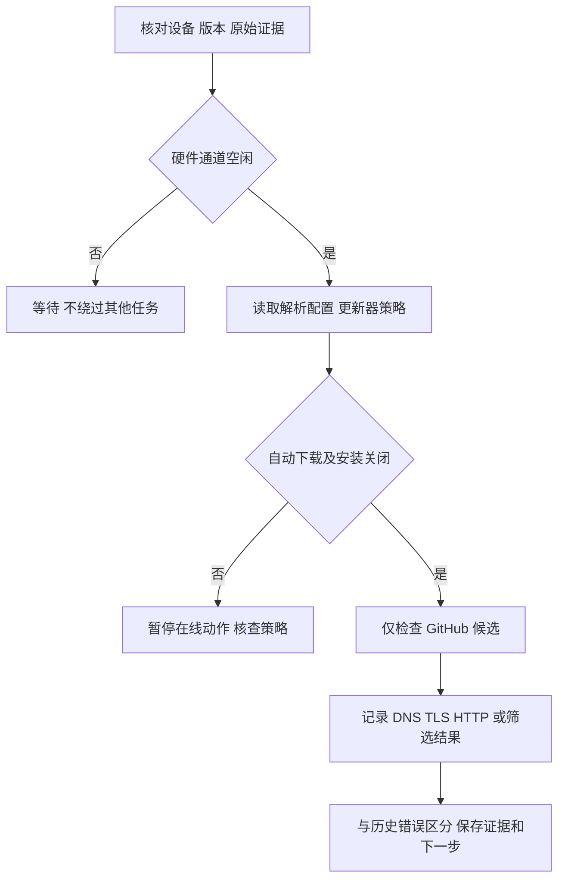

# REQ-MIMI-UPDATE-019 在线更新检查的网络复验

2026-10-14；关联 MIMI-UPDATE-001、MIMI-TRACE-001、REQ-MIMI-UI-018。当前阶段：调查，尚无更新器代码修改。

## 背景与范围
先前 rc14 真机检查 GitHub 报 DNS [::1]:53 不支持地址族，在线发现未完成。当前只核查 rc16 所用系统解析配置及执行检查更新，不下载、不安装、不上传。若无法复现，不虚构修复；若发现具体原因，先追加实施路径和验收，再改动。

回归不变量：不改板卡身份/凭据/绑定；不硬编码公共 DNS 或 IP；不绕过 TLS、签名、版本及硬件配对；自动下载/安装保持关闭；不把网络连通当作候选安装验收；通道 busy 不执行硬件命令。

## 目前事实
- passed（只读）：mimi-update status 确认当前 1.0.8-rc.16，包哈希 76e31edf2fd9a8402af52386191e05bf173f682f927ff4c78186891492ece847，previous rc14，trial=false；auto_download/install_when_idle=false。
- passed（只读）：/etc/resolv.conf 最终指向 /tmp/resolv.conf.d/resolv.conf.auto，现有 nameserver 192.168.1.1，默认路由同地址；不能据历史 [::1] 错误直接断言当前配置仍坏。
- blocked（一次尝试）：准备执行 check 时 MCP 报 busy，已停止本次动作；未发 check、未打开新的串口。
- not_run：本轮在线 check；下载、安装、回退、断电验收。

实现/证据位置：调查 services/mimi-update/update/github.go、cmd/mimi-update/main.go、packaging/aitvbox-mimi-update/files/mimi-update.init；外部日志 output/updater-dns-20261014/before.log。当前源码基准 2541ed95a05214bd914d391a0189cff45cb31454；板端运行历史 rc16，不是该源码构建产物。

下一步：通道空闲后继续仅检查操作，保存真实网络结果；如仍失败按实际阶段修复，不扩大为 DNS/平台权限绕过。

### 网络就绪后复验
证据 output/updater-dns-20261014/check-complete.log / result.json：rc16 上 check退出0，观察到 busy=true/phase=check → busy=false/phase=idle，error空、candidate=null、download_bytes=0；uptime59分钟，包/状态未改变。该次在线候选检查 passed，无可安装候选；未改DNS/TLS或更新器代码。历史DNS失败的根因和冷启动网络切换仍未证实/未验收，不宣称永久修复。中间通道busy均等待，早期未等到命令完整输出的日志不用于结论，完整重测日志为准。
