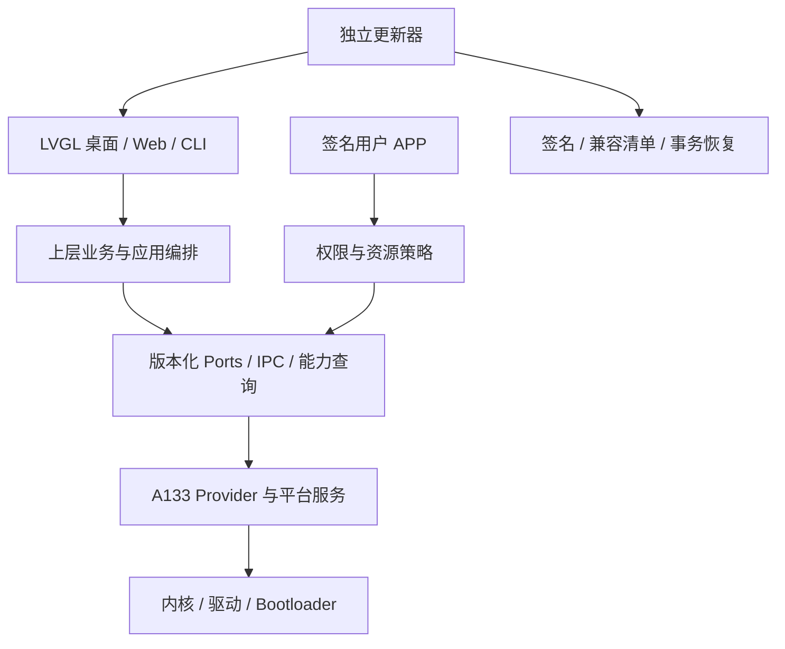

# 理解架构与启动链路

“SDK 是 SDK，产品代码是产品代码”是项目的分层原则。上层桌面通过版本化接口请求能力，平台 Provider 再连接板级服务和驱动。

## 阅读源码的入口

| 目录 | 主要职责 |
| --- | --- |
| `apps/lv_port_linux/` | LVGL 桌面、页面、共享客户端和资源 |
| `apps/ipkvm/` | WebRTC/IPKVM、设备 Web 界面和相关服务 |
| `apps/hdmi_preview/` | HDMI 预览集成 |
| `platform/app-sdk/` | 用户 APP 接口与示例 |
| `services/mimi-update/` | 独立更新器与通用校验 |
| `tools/update/` | SDK 固定、构建、签名候选与发布资料工具 |
| `packaging/` | 系统集成薄包与安装规则 |
| `platforms/` | 平台描述与接入边界 |

`lv_backend` 由平台系统提供，不能因为名字含 lv 就随桌面包一起替换。部分过渡客户端/共享实现固定了哈希，具体迁移边界由源码归属清单控制。

## 普通 Tina 启动链

1. `S25play` 显示早期启动画面。
2. `S95aitvbox-data` 准备 `/overlay` 和数据绑定。
3. `S96bluetooth_init` 初始化蓝牙控制器。
4. `S99aitvbox` 启动平台后端及对应桌面入口。
5. 旧 `aitvbox-start-ui` 等待 `/tmp/lv_port_linux_backend.sock`，完成启动画面到 LVGL 的交接。

## 启用独立更新器的系统

新的系统基线包含更新器、信任、公钥、设备描述和签名出厂应用。启动顺序中有 `S98mimi-update`、`S99aitvbox`、`S99mimi-desktop`。OpenWrt 按文件名字符串排序，不能简单改成 `S100...` 期待最后启动。

桌面选择、验签和启动在同一更新事务约束内进行。健康检查不仅判断 PID 存在，还需要桌面就绪、主循环响应、后端握手和关键状态可读。系统健康确认等待桌面时不能一直占住桌面启动也需要的锁。

## 三类资源所有权

- **HDMI**：统一采集与按需取帧，不让多个程序同时抢视频设备。
- **HID**：当前控制者独占；退出、错误和急停释放按键。
- **WS2812**：`service_led` 管理设备，其他服务请求/释放状态，不各自直写节点。

这些规则影响后端、Web、用户 APP 和 AI 任务，不能只修一个 UI 按钮而忽略资源释放。

## 接口版本不是应用版本

应用 v1.x、系统 v1.x、IPC 1.x 和 Provider 版本各有语义。新的包必须满足同一个完整目标条目，不能把“aarch64”“A133”或版本号相近当作兼容依据。新增能力通过查询与错误状态表达，不能在 UI 里硬编码 SoC 分支。

原始图集：[9 张源码与调用架构图](https://github.com/dshanpi/SmartDesktopMimi/blob/75500c76e389971bfb3bd0a45ac4bed74e1f8cfa/docs/architecture-diagrams/README.md)。规范：[分层与更新](https://github.com/dshanpi/SmartDesktopMimi/blob/75500c76e389971bfb3bd0a45ac4bed74e1f8cfa/docs/application-update-policy.md)、[源码归属](https://github.com/dshanpi/SmartDesktopMimi/blob/75500c76e389971bfb3bd0a45ac4bed74e1f8cfa/docs/update/SOURCE-OWNERSHIP.md)。
