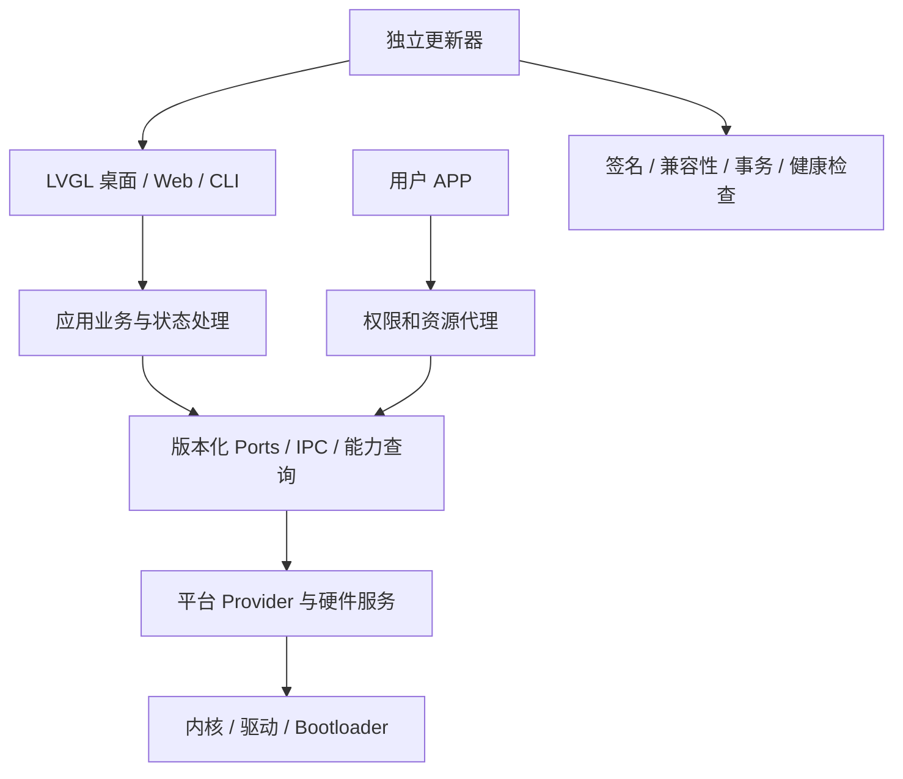

# 理解系统分层与启动顺序

本章帮助开发者确定修改位置，并根据启动阶段定位问题。先了解桌面、平台服务、硬件适配和更新器的职责，再进入具体源码。

## 按调用关系识别组件

上层以接口查询能力并发出业务请求，Provider 将请求转换为目标平台操作。桌面统一源码不意味着不同平台可以共用未经验证的二进制包。

## 按任务阅读源码

| 需要修改或排查 | 先阅读 | 核对边界 |
| --- | --- | --- |
| 首页、设置、应用页面 | `apps/lv_port_linux/` | UI 状态与后端权威结果是否一致 |
| 浏览器视频和设备管理 | `apps/ipkvm/` | 登录、媒体与输入控制分别处理 |
| HDMI 预览 | `apps/hdmi_preview/` | 与已有采集资源统一管理 |
| 用户扩展应用 | `platform/app-sdk/` | 权限、目标 ABI 和短动作协议 |
| 桌面更新事务 | `services/mimi-update/` | 签名、匹配、锁、回退与数据 |
| 构建和发布工具 | `tools/update/` | 固定来源和最终产物一致 |
| 系统集成 | `packaging/`、`platforms/` | 平台服务、板级身份和包归属 |

平台系统提供的 `lv_backend` 不能仅按名称认定为桌面的一部分。冻结接口及过渡客户端的归属由源码清单限定，修改前完成[归属检查](source-map.md)。

## 检查普通 Tina 启动链

历史基线的关键顺序为：

1. `S25play` 显示启动画面。
2. `S95aitvbox-data` 准备持久目录和绑定挂载。
3. `S96bluetooth_init` 准备蓝牙控制器。
4. `S99aitvbox` 启动平台后端及对应桌面入口。
5. 旧 `aitvbox-start-ui` 等待 `/tmp/lv_port_linux_backend.sock`，再完成 UI 交接。

启动图持续不退出时，先检查后端启动与 socket；桌面出现后无响应时，再区分 UI 主循环、后端请求与显示/输入。具体采集命令见[故障排查](troubleshooting.md)。

## 检查独立更新基线的启动

启用独立更新器的系统还包含可信公钥、设备描述、签名出厂应用及独立桌面启动入口。相关 init 项包括 `S98mimi-update`、`S99aitvbox`、`S99mimi-desktop`。

维护启动脚本时：

1. 核对实际 init 文件名及执行顺序。OpenWrt 按文件名字符串排序，`S100` 不代表一定在 `S99` 后面。
2. 核对更新器选择和验签的应用是否为本次预期版本。
3. 核对桌面启动与系统健康检查的事务锁依赖。
4. 检查桌面就绪、主循环推进、后端握手与状态查询。

PID 存在只是一个检查点。健康提交还需要证明进程能够处理请求。

## 保持共享资源的单一管理入口

| 资源 | 修改时检查 |
| --- | --- |
| HDMI | 使用现有采集与按需取帧接口，检查会话退出后释放 |
| HID 键鼠 | 核对当前控制者，错误、退出和急停均释放按键 |
| WS2812 状态灯 | 由 `service_led` 管理，其他服务请求和释放状态 |

修改 UI 开关后，需检查实际服务是否完成对应动作；多个程序直接操作同一硬件会使状态和所有权难以确认。

## 核对接口与版本兼容

应用版本、系统版本、IPC 契约和 Provider 版本分别记录。包的完整目标条目应同时匹配产品、板型/修订、ABI、接口与运行依赖。

新增能力时优先通过能力查询与明确错误反馈接入；破坏性接口变更需更新契约和兼容验证。完成架构判断后，进入[源码与平台适配](source-map.md)。

## 查阅依据

[分层和接口约束](https://github.com/dshanpi/SmartDesktopMimi/blob/75500c76e389971bfb3bd0a45ac4bed74e1f8cfa/docs/application-update-policy.md) · [源码归属清单](https://github.com/dshanpi/SmartDesktopMimi/blob/75500c76e389971bfb3bd0a45ac4bed74e1f8cfa/docs/update/SOURCE-OWNERSHIP.md) · [详细架构图集](https://github.com/dshanpi/SmartDesktopMimi/blob/75500c76e389971bfb3bd0a45ac4bed74e1f8cfa/docs/architecture-diagrams/README.md)
