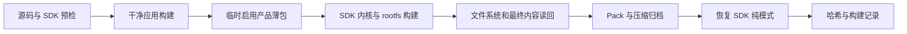

# 构建 A133 系统镜像

完整镜像构建需要合法 Tina SDK、已固定的板级 overlay、工具链、启动链输入、平台组件和授权依赖。公开产品仓库不能单独重建完整系统。

## 1. 准备 SDK 与目标

将 SDK 放在产品源码之外，按该 SDK 的手册准备工具链、staging 和明确的构建目标。项目参考配置使用 A133 / B6 / UART0 / OpenWrt / arm64；B6 仍不是 PCB 身份。

已有受控恢复 SDK 应先核对组件、有效配置、输出路径和黄金启动输入。不要为了“重新生成”而随意全量重编 Boot0/U-Boot，也不要只运行 `pack` 复用未知 rootfs。

## 2. 选择公共产品版本

普通公开构建显式使用 public，并提供本次系统版本与固定 overlay 仓库。替换所有示例路径和 `REPLACE_WITH_REVIEWED_SYSTEM_VERSION`；版本必须是已确定的合法 SemVer：

```sh
export MIMI_SYSTEM_VERSION=REPLACE_WITH_REVIEWED_SYSTEM_VERSION
export MIMI_HARDWARE_SOURCE_ROOT=/absolute/path/to/reviewed-hardware-overlay
export MIMI_PRODUCT_EDITION=public
export AITVBOX_ENABLE_100ASK_CLOUD=OFF
unset MIMI_PRIVATE_PRODUCT_ROOT AITVBOX_100ASK_SDK_ROOT

./scripts/auto_build_package.sh --check-only \
  --sdk-root /absolute/path/to/TinaSDK
```

私有功能由授权的固定组件显式组合，见[产品来源边界](source-map.md)。不因为本机存在一个私有目录就自动启用，不从历史 SDK 副本兜底。

## 3. 理解标准流水线



产品包含平台、桌面、IPKVM、USB HID、更新器等薄包。构建前包索引检查可提前发现缺项/重名；构建后必须核对实际 rootfs 的内容、权限和信任，而不是只看 Make 退出码。

## 4. 执行构建

完成上面的环境设置后，无 OTA 的普通入口：

```sh
./scripts/auto_build_package.sh --sdk-root /absolute/path/to/TinaSDK
```

`auto_build_package.sh` 从环境继承 `MIMI_SYSTEM_VERSION`，不接受 `--system-version` 参数；直接调用 `build_release.sh` 才使用该参数。应用更新基线及 OTA 还需要额外输入。先查看当前源码帮助：

```sh
./scripts/build_release.sh --help
./scripts/auto_build_package.sh --help
```

需要独立更新基线时按[发布执行手册](https://github.com/dshanpi/SmartDesktopMimi/blob/75500c76e389971bfb3bd0a45ac4bed74e1f8cfa/docs/update/RELEASE-RUNBOOK.md)准备签名出厂应用、可信公钥与兼容描述，再使用 `--application-updates`。需要签名 A/B OTA 时准备受控 `MIMI_SWU_SIGNING_KEY`、`MIMI_SWU_PUBLIC_KEY`、`MIMI_SYSTEM_VERSION`、固定 `SOURCE_DATE_EPOCH`，然后选择 `--with-ota` 路径。

签名私钥和口令文件位于源码、SDK 和产物树之外，沿用现有产品密钥。早期手册中将私钥放入 `secrets/` 并临时注入 SDK 的说明已被新版外部签名规则取代。

## 5. 检查最终输出

一般输出位于 `build/releases/<版本-提交-时间>/`：

```text
BUILD-COMPLETE
BUILD-MANIFEST.txt
SHA256SUMS
firmware/SmartDesktopMimi-SystemImage-v<系统版本>.img.gz
logs/
metadata/
```

启用 OTA 时还应有该次归档的签名 SWU。早期版本使用 `a133_linux_b6_uart0.img` 内部原始名，不能据此重命名或覆盖已发布历史附件。

进入本次输出目录后：

```sh
test -f BUILD-COMPLETE
test ! -e BUILD-INCOMPLETE
sha256sum -c SHA256SUMS
```

核对系统版本、预装应用版本/源码/包哈希、SDK 来源、内核与模块、启动链、压缩和原始镜像摘要。外部封存记录与最终 rootfs 读回应一致。

## 6. 常见失败与恢复

空间不足、SDK 路径迁移、工具链位数、旧包缓存、启动输入不符、rootfs 文件系统错误都应在对应步骤停止。保留 `BUILD-INCOMPLETE` 和日志；修复输入后产生新候选，不能删掉失败标记假装完成。

构建结束会恢复 SDK 纯模式，因此后续 `out/` 不一定仍是产品交付镜像。只从该次已验证发布目录取最终产物。构建成功后继续[实机验收](validation.md)，再谈产品发布。

本次文档工作没有可用的原 SDK 主机，因此此章按源码与既有记录核对命令和流程，没有重新编译或烧录系统。
