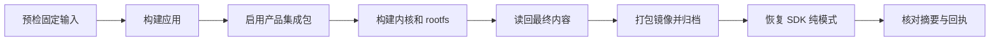

# 构建并核验 A133 系统镜像

本章面向具备合法 Tina SDK 的系统维护者，说明输入固定、预检、完整构建和产物读回。公开仓库只提供产品源码及集成入口，完整系统还需要板级与授权依赖。

## 准备完整构建输入

| 输入 | 检查内容 |
| --- | --- |
| 产品源码 | 本次完整提交、公共/私有版本选择 |
| Tina SDK | 受控来源、工具链、staging、有效 `.config` |
| 板级 overlay | 固定提交与实际补丁内容 |
| 目标配置 | SoC、构建目标、启动方式、存储与分区 |
| 系统版本 | 本次已确定的合法 SemVer |
| 可选应用更新基线 | 签名出厂应用、公钥、设备与兼容描述 |
| 可选系统 OTA | A/B 条件、现有签名体系、固定时间基准 |

参考 SDK 目标为 A133 / B6 / UART0 / OpenWrt / arm64。实物 PCB 身份仍单独登记。复用受控恢复 SDK 时，先核对黄金启动输入和配置，再决定是否重建 Boot0/U-Boot。

## 设置公共产品环境

以下在 **Ubuntu 构建主机、产品源码根目录**执行。所有占位值需替换为已审核输入：

```sh
export MIMI_SYSTEM_VERSION=REPLACE_WITH_REVIEWED_SYSTEM_VERSION
export MIMI_HARDWARE_SOURCE_ROOT=/absolute/path/to/reviewed-hardware-overlay
export MIMI_PRODUCT_EDITION=public
export AITVBOX_ENABLE_100ASK_CLOUD=OFF
unset MIMI_PRIVATE_PRODUCT_ROOT AITVBOX_100ASK_SDK_ROOT

./scripts/auto_build_package.sh --check-only \
  --sdk-root /absolute/path/to/TinaSDK
```

**检查结果：** 预检成功退出，并确认使用预期 SDK、目标和来源。缺少库、工具、配置或空间时，补齐对应输入后重新预检。

系统构建至少预留 15 GiB，建议 30 GiB 以上；完整 SDK 空间另计。私有构建按授权来源锁显式配置，参见[源码边界](source-map.md)。

## 执行普通完整构建

保持上述环境设置，执行：

```sh
./scripts/auto_build_package.sh --sdk-root /absolute/path/to/TinaSDK
```

包装脚本从环境继承 `MIMI_SYSTEM_VERSION`。它不接受 `--system-version`；直接调用 `build_release.sh` 时才使用该参数。



流程需要实际重建并核对系统内容。仅运行 `pack` 会复用现有输出，不能替代完整构建和输入确认。

## 准备应用更新或系统 OTA 基线

先查看当前脚本帮助：

```sh
./scripts/build_release.sh --help
./scripts/auto_build_package.sh --help
```

- 需要独立应用更新时，先按发布手册准备签名出厂应用、可信公钥、设备描述和兼容记录，再使用 `--application-updates` 路径。
- 需要系统 OTA 时，先确认 A/B 分区、启动与回退条件，准备受控 `MIMI_SWU_SIGNING_KEY`、`MIMI_SWU_PUBLIC_KEY`、系统版本和固定 `SOURCE_DATE_EPOCH`，再使用 `--with-ota` 路径。

生产签名沿用现有产品密钥，私钥与口令文件位于源码、SDK 和产物树之外。缺少输入时先补齐，不能将普通镜像标记为已具备对应升级能力。

## 核对归档产物

标准归档通常位于 `build/releases/<版本-提交-时间>/`：

```text
BUILD-COMPLETE
BUILD-MANIFEST.txt
SHA256SUMS
firmware/SmartDesktopMimi-SystemImage-v<系统版本>.img.gz
logs/
metadata/
```

进入本次实际输出目录后执行：

```sh
test -f BUILD-COMPLETE
test ! -e BUILD-INCOMPLETE
sha256sum -c SHA256SUMS
```

随后核对：

1. 系统版本与本次配置一致。
2. 预装应用版本、来源提交及签名包摘要一致。
3. SDK、overlay、工具链、内核和模块来源可追溯。
4. 启动链、分区、rootfs 最终内容与声明相符。
5. 压缩镜像和原始镜像摘要已记录；启用 OTA 时有对应签名 SWU。

## 处理失败并进入设备验收

保留 `BUILD-INCOMPLETE`、错误日志和输入状态。空间不足、旧缓存、SDK 路径、启动输入或 rootfs 校验失败，应修复原因后生成新候选。

构建完成会恢复 SDK 纯模式，因此后续 SDK `out/` 不能默认视为本次交付镜像。始终从已验证归档目录取产物。

通过主机构建后，按[安装检查](install.md)和[验收矩阵](validation.md)完成实机操作，再进入[产品发布](release.md)。本轮教程修订未重新构建或烧录产品系统。

## 查阅依据

[自动构建入口](https://github.com/dshanpi/SmartDesktopMimi/blob/75500c76e389971bfb3bd0a45ac4bed74e1f8cfa/scripts/auto_build_package.sh) · [发布构建脚本](https://github.com/dshanpi/SmartDesktopMimi/blob/75500c76e389971bfb3bd0a45ac4bed74e1f8cfa/scripts/build_release.sh) · [受控发布输入](https://github.com/dshanpi/SmartDesktopMimi/blob/75500c76e389971bfb3bd0a45ac4bed74e1f8cfa/docs/update/RELEASE-RUNBOOK.md)
