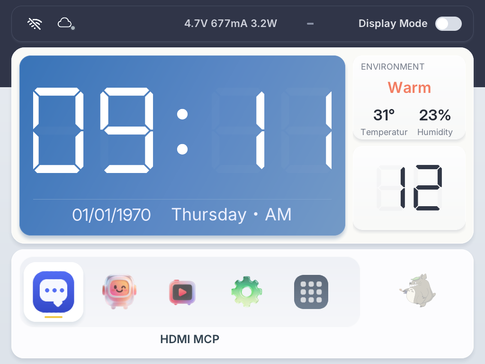
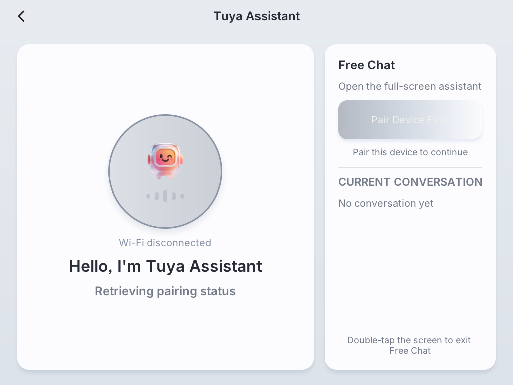

# 界面截图与证据来源

下面使用仓库已有图片，保留原始比例，不用新设计图冒充设备运行结果。图片用于理解界面，不能作为当前候选已安装的证明。

## 旧版 A133 实机界面

来源目录 `docs/debug-evidence/a133-en-us-20260906/`，仓库注明为 A133 framebuffer 取证；画面为 1024×768。它们反映 2026-09-06 的旧界面，并不对应 rc33/rc10。

### 桌面首页

### 应用列表

### AI 对话

### 蓝牙音频

### 系统更新

## 新版页面证据去哪里看

开发分支保存了组件布局、1024/800 等尺寸、双语/主题、状态与输入回放的记录。10 月 28 日第二批记录提到 55 种状态、440 张截图，并区分新旧证据来源；该记录仍明确新产物没有完成实机安装。

- [页面补全主机验证](https://github.com/dshanpi/SmartDesktopMimi/blob/75500c76e389971bfb3bd0a45ac4bed74e1f8cfa/docs/validation/quality076-pages-completion-20261028.json)
- [完整构建与图库范围](https://github.com/dshanpi/SmartDesktopMimi/blob/75500c76e389971bfb3bd0a45ac4bed74e1f8cfa/docs/validation/quality076-pages-completion-build-20261028.json)
- [早期实机图片说明](https://github.com/dshanpi/SmartDesktopMimi/blob/75500c76e389971bfb3bd0a45ac4bed74e1f8cfa/docs/debug-evidence/README.md)
- [原始架构图集](https://github.com/dshanpi/SmartDesktopMimi/blob/75500c76e389971bfb3bd0a45ac4bed74e1f8cfa/docs/architecture-diagrams/README.md)

没有把开发机私有路径中的图片自动复制到网站；只有仓库已经公开、来源明确的图片参与本次站点构建。

## 新增截图时的记录要求

填写截图时间、源码/固件版本、设备或模拟环境、分辨率、语言、主题、操作步骤和原始文件 SHA-256。说明它证明哪一个界面状态，哪些真实输入/升级行为没有测。设计图明确标“设计”，主机图明确标“主机渲染”，实体画面明确标“实机”。

站点构建复制上述公开图片到自身静态资源目录，并记录来源哈希；无需访问私有 SDK 或原开发虚拟机。
