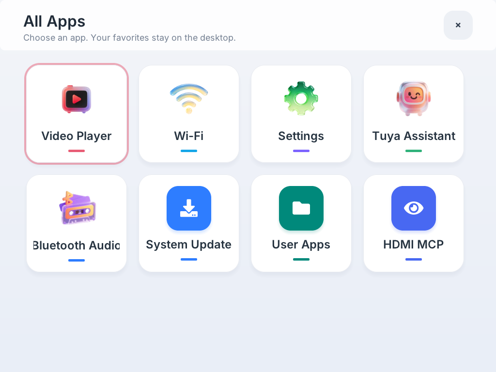
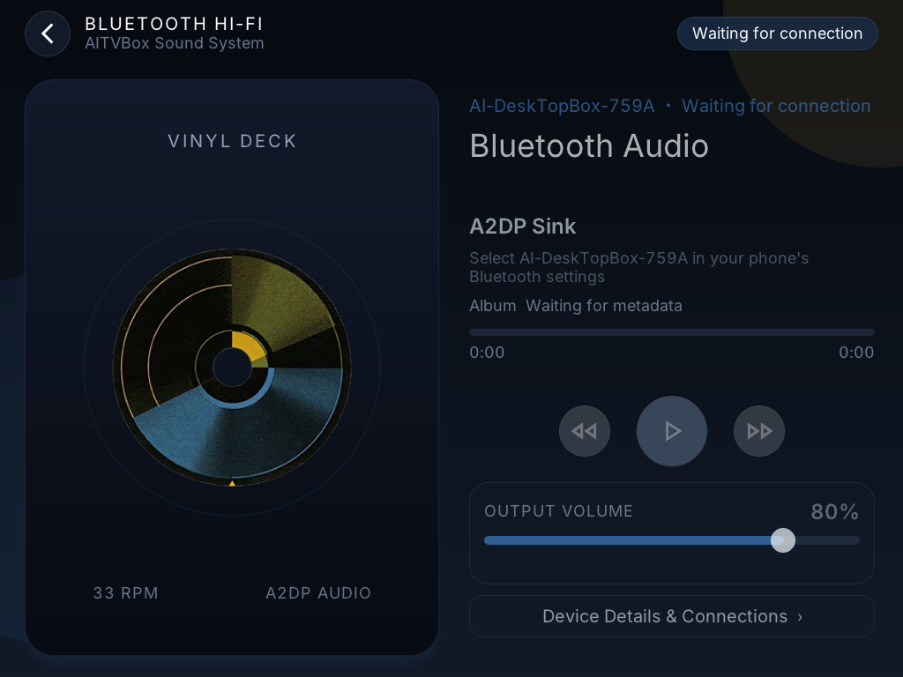
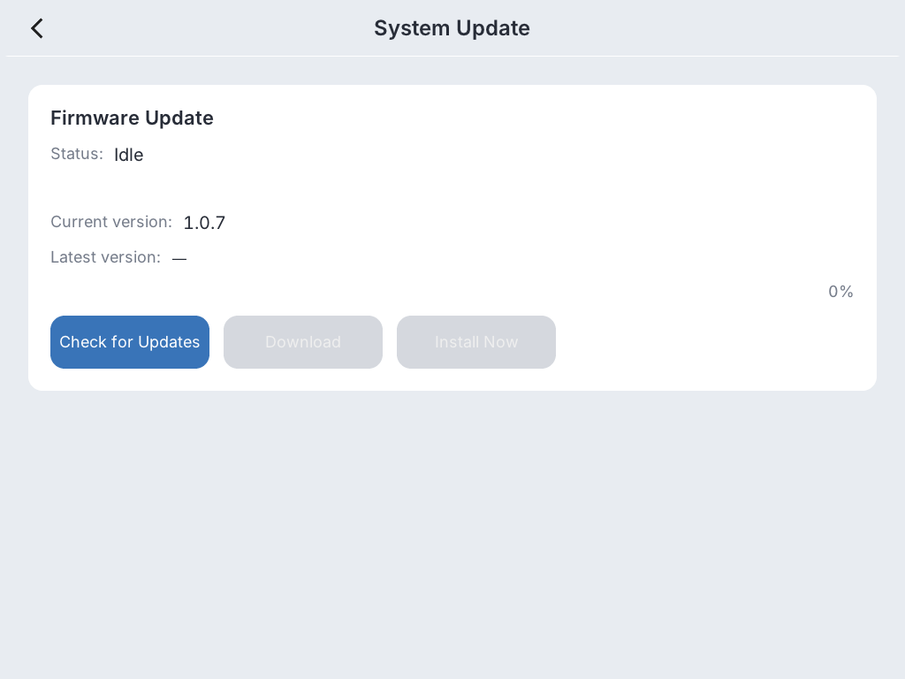

# 对照界面示例与截图来源

本章汇总已公开的界面图片，用于识别功能区域。图片来自 2026-09-06 A133 实机 framebuffer 记录，分辨率 1024×768，均为旧版界面；当前设备入口与布局以实际固件为准。

## 识别桌面与应用入口

图中展示旧版桌面状态区域和应用入口。固定开发快照已改为首页内横向分页应用区，操作顺序见[桌面教程](desktop.md)。

图中展示旧版应用列表；当前“用户应用”专门显示已安装 `.aitapp`，安装流程见[APP 教程](user-app.md)。

## 查看语音与音频状态示例

语音对话应结合聆听、回复和退出结果检查，步骤见[涂鸦助手](ai-iot.md)。此图不代表当前候选的对话验收。

蓝牙页面信息应与手机媒体输出和实际声音对应，步骤见[蓝牙音频](bluetooth.md)。

## 查看更新页面示例

更新时按[更新教程](ota.md)核对类型、候选条件和安装结果；单张页面图不证明升级或回退完成。

## 查询新版页面记录

2026-10-28 的主机记录覆盖组件布局、多尺寸、语言、主题及状态回放，并保留 55 种状态、440 张截图的范围说明。这些材料与新产物实机安装分开记录。

新增截图时，附时间、版本/提交、主机或设备环境、分辨率、语言、主题、触发步骤和文件摘要。示意图标注为示意，主机渲染与实机截图分别标明。

本站只使用已有公开且来源明确的图片，原图保留相对路径，便于源码归档后阅读。

## 查阅依据

[原始截图说明](https://github.com/dshanpi/SmartDesktopMimi/blob/75500c76e389971bfb3bd0a45ac4bed74e1f8cfa/docs/debug-evidence/README.md) · [新版页面主机检查](https://github.com/dshanpi/SmartDesktopMimi/blob/75500c76e389971bfb3bd0a45ac4bed74e1f8cfa/docs/validation/quality076-pages-completion-20261028.json) · [构建与图库范围](https://github.com/dshanpi/SmartDesktopMimi/blob/75500c76e389971bfb3bd0a45ac4bed74e1f8cfa/docs/validation/quality076-pages-completion-build-20261028.json)
