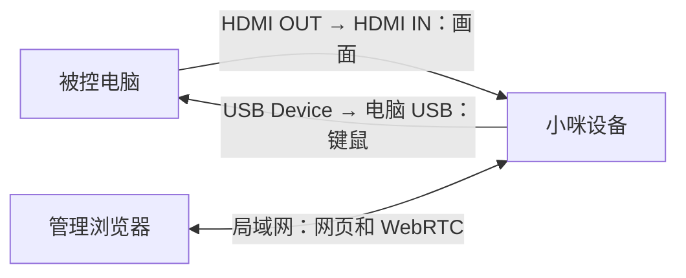

# 准备设备并连接硬件

本章用于连接已配套的 A133 主板、显示与触摸，并为浏览器控制电脑准备信号线路。接口位置、供电参数和排线方向以实物 PCB 对应的硬件资料为准。

## 核对设备和配件

先读取主板上的型号与修订标记。项目已登记参考板为 **A133 MainBoard V1.2**；SDK 中的 **B6** 是构建目标名称，不能代替实物板号。

| 配件 | 用途 | 连接前确认 |
| --- | --- | --- |
| 主板、配套屏幕与触摸组件 | 显示桌面并接收触摸 | 屏幕型号、排线接口与固件匹配 |
| 配套供电设备 | 为主板供电 | 接口、电压和额定参数符合板卡说明 |
| 管理电脑与浏览器 | 访问设备网页 | 支持 WebRTC，能够访问设备所在网络 |
| HDMI 线 | 输入被控电脑画面 | 从电脑 HDMI OUT 接到板端 HDMI IN |
| USB 数据线 | 向被控电脑提供 HID 键鼠 | 使用板端 Device/OTG 接口，线缆支持数据传输 |
| 授权串口或 ADB，按需准备 | 故障诊断 | 串口电平与接线遵循硬件资料；ADB 目标可识别 |

设备尚未安装系统时，先完成[镜像与安装前检查](install.md)。已有正常系统时，无需为了使用 IPKVM 重新烧录。

## 连接显示并启动设备

1. 在断电状态下，按板卡手册连接显示和触摸排线，确认方向与锁扣。
2. 接入规定的供电接口，启动设备。
3. 等待桌面出现，点击一个应用并返回首页。
4. 若屏幕无显示，通过现有调试入口保留启动输出，按[启动故障排查](troubleshooting.md)处理。

**检查结果：** 桌面出现且实际触摸有响应。仅背光亮起或停留在启动图，不算桌面启动完成。

## 连接 IPKVM 的三条链路



1. 在设备上[连接 Wi-Fi](network.md)，记录板端 IP。
2. 将被控电脑 HDMI OUT 连接到小咪 HDMI IN。
3. 将小咪 USB Device/OTG 连接到同一台被控电脑。
4. 在被控电脑检查是否出现标准 USB 键盘、鼠标设备。
5. 在管理浏览器打开板端 IP，继续[IPKVM 登录与测试](ipkvm.md)。

HDMI 和 USB 分别负责画面与输入。出现画面但不能操作时，先检查 USB 数据线、接口和控制权；网页打不开时，先检查 IP 与网络。

## 核对调试目标

使用 ADB 时，在 **Ubuntu 开发主机**执行：

```sh
adb devices -l
```

输出中的设备状态应为 `device`。将目标序列号记为 `DEVICE_SERIAL`，后续命令显式使用 `adb -s DEVICE_SERIAL`。`unauthorized` 表示尚未完成授权，`offline` 表示连接未就绪；两者都应先处理连接。

在**板端 shell**执行以下只读检查：

```sh
uname -a
cat /etc/aitvbox-version
ip addr
ls -l /dev/hidg0
```

`/dev/hidg0` 是使用 USB HID 时的检查点，不作为仅使用触屏桌面的前置条件。版本文件缺失时记录该事实，并查该交付版本的身份/更新清单。

## 结束测试并释放资源

退出 IPKVM 会话，在设备正常控制入口关闭无需使用的 HDMI 采集。再次检查设备状态，确认没有遗留 AI 控制任务。日常维护保持 HDMI 按需开启。

完成本章后，应明确四项信息：实物板号、配套固件、板端 IP，以及 HDMI/USB 各自连接到哪台电脑。下一步完成[首次启动检查](quickstart.md)。

## 查阅依据

[IPKVM 接线与服务](https://github.com/dshanpi/SmartDesktopMimi/blob/75500c76e389971bfb3bd0a45ac4bed74e1f8cfa/docs/ipkvm-user-guide.md) · [设备与平台边界](https://github.com/dshanpi/SmartDesktopMimi/blob/75500c76e389971bfb3bd0a45ac4bed74e1f8cfa/docs/application-update-policy.md)
