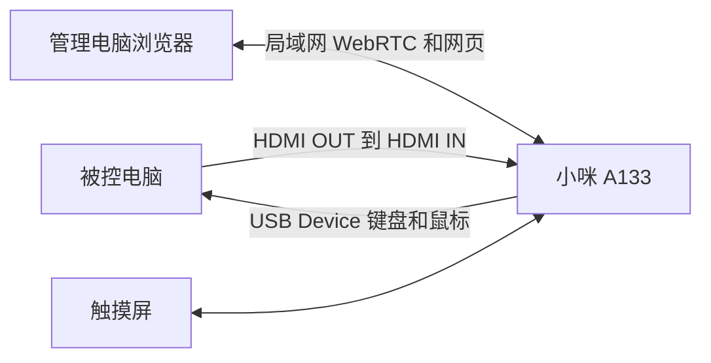

# 硬件准备与连接

本章用于确认连接关系。针脚、电压、供电规格和接口位置应以你手上 PCB 修订对应的硬件资料为准；软件仓库的 B6 名称不能替代实物板号。

## 准备清单

| 物品 | 用途 | 先检查什么 |
| --- | --- | --- |
| A133 配套主板、显示屏和触摸 | 运行小咪桌面 | PCB 修订、排线方向、配套系统 |
| 合适的供电设备 | 稳定运行 | 使用板卡文档规定的接口与参数 |
| 管理电脑 | 浏览器、源码与调试 | Chrome/Edge 等支持 WebRTC 的浏览器 |
| 局域网 | 访问 IPKVM 和网络服务 | 管理电脑能访问板端 IP |
| HDMI 线 | 输入被控电脑画面 | 电脑 OUT → 板端 IN |
| 支持数据的 USB 线 | HID 键鼠或授权调试 | 板端 Device/OTG → 被控电脑 |
| 已授权串口/ADB（可选） | 排错与设备登记 | 固定设备身份；串口电平遵循板卡资料 |

## 三条线路各负责什么



HDMI 只传入画面，不会自动带来键鼠控制。USB 线负责 HID 枚举；只能充电的线可能让设备亮灯，却没有键盘鼠标。管理电脑与被控电脑可以是同一台，也可以是两台。

## 连接顺序

1. 先核对 PCB、配套系统和显示屏；没有镜像时先读[固件获取与安装](install.md)。
2. 按硬件手册连接显示、触摸和供电，启动到桌面。
3. 配置局域网，记下**板端** IP。
4. 需要 IPKVM 时再接 HDMI 和 USB Device；先确认被控系统枚举出 HID。
5. 打开浏览器连接板端地址，按 [IPKVM 教程](ipkvm.md)逐项验证。
6. 验证结束关闭会话，并在桌面关闭 HDMI 采集，确认资源已释放。

正常日常开发保持 HDMI 关闭；它会占用采集、编码和功耗资源。屏幕不显示预览不等于采集服务已经停止，要结合设备状态检查。

## 从设备读取基本信息

以下在**板端已授权 shell**执行，不在 Ubuntu 文档主机执行：

```sh
uname -a
cat /etc/aitvbox-version
ip addr
ls -l /dev/hidg0
ps | grep -E 'lv_backend|lvglsim|hdmi_preview|aitvbox-kvm-video'
```

`/etc/aitvbox-version` 是固件版本信息之一；采用独立更新框架的系统还要读取更新状态页和实际应用清单，不能用单个文件代替完整应用/系统身份。

## 连接失败时

- 屏幕黑但串口有输出：保留启动日志，检查显示初始化和 UI 交接，见[排错](troubleshooting.md)。
- 有画面无输入：先查 USB Device 接线、`/dev/hidg0` 和 HID 枚举。
- 浏览器打不开：先查板端 IP、网段和服务监听，不先改 HDMI 参数。
- 多块板同时连接：记录每块板的 serial/USB 位置，调试命令显式指定目标，避免刷写目标混淆。

扩展平台的名称出现在目录中，只说明已有接口或骨架；T527、RK3576 需要各自适配与实机验证。
