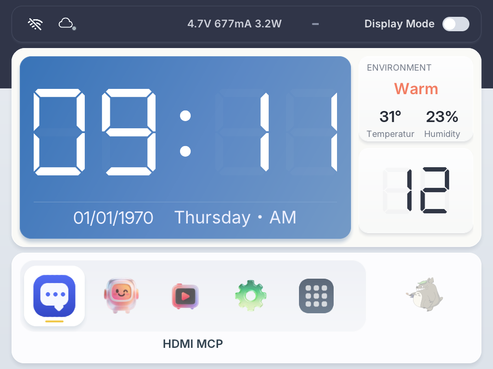

# 认识智能桌面小咪

**从打开桌面，到开发自己的应用。** SmartDesktopMimi（智能桌面小咪）是一套以全志 A133 / Tina Linux 为首个目标的触屏桌面系统，连接本机应用、网络与音频、HDMI 画面、浏览器键鼠控制，以及受控的软件更新。

本教程按“先理解版本 → 使用现有设备 → 开发应用 → 构建与维护系统”编排。每一章都给出前提、操作步骤、预期结果和失败时的检查方向。

*上图是仓库保存的 2026-09-06 A133 实机界面，用于认识产品；不是当前开发候选的装板截图。新版布局与图片来源见[界面与证据](gallery.md)。*

## 从适合你的入口开始

| 你的目标 | 推荐学习路线 | 需要的条件 |
| --- | --- | --- |
| 使用已经安装系统的小咪 | [首次启动](quickstart.md) → [桌面操作](desktop.md) → [网络与音频](network.md) | 配套设备、已安装的可用系统 |
| 看电脑画面并操作键鼠 | [硬件连接](hardware.md) → [IPKVM](ipkvm.md) → [AI 与 MCP](mcp.md) | HDMI 输入、USB Device、局域网 |
| 写一个自己的小应用 | [开发环境](environment.md) → [用户 APP 实战](user-app.md) | Ubuntu、Python、OpenSSL；Native 应用另需匹配 SDK |
| 修改桌面程序 | [架构](architecture.md) → [独立应用构建](build-app.md) → [验证](validation.md) | 完整应用 SDK 与固定来源 |
| 制作系统镜像 | [源码归属](source-map.md) → [系统构建](build-system.md) → [更新与发布](release.md) | 合法 Tina SDK、板级输入和授权组件 |
| 维护这份教程 | [文档站维护](site.md) | Node.js 22.12+，GitHub Pages 权限 |

## 先分清三个“应用”概念

- **桌面主程序**：LVGL 桌面、内置页面和共享资源，通过独立桌面应用发布线更新。
- **用户 APP**：安装到“用户应用”的扩展包，后缀为 `.aitapp`，有自己的发布者和权限。
- **系统镜像**：内核、驱动、平台服务、更新器和出厂桌面基线，属于系统发布线。

`.aitapp` 不能替代桌面升级包；桌面升级包不能夹带内核和驱动；系统 `.img.gz` 也不能直接交给 `.aitapp` 安装器。

## 本教程使用哪一份源码

核对日期：**2026-11-12**。操作与实现说明参考公开开发分支 `checkpoint/takeover-20261022` 的固定提交 `75500c76e389971bfb3bd0a45ac4bed74e1f8cfa`。文档站在 `main` 维护，两个分支的产品代码没有因此合并。

:::caution[当前交付状态]
该开发快照记录：应用 rc33 / 系统 rc10 尚未完成装板和全部验收，自动发布在上传前被阻止。请先阅读[版本与已知限制](version-status.md)。文档站上线只表示教程可访问，不表示这些候选固件已成为稳定版。
:::

公共版本提供共享桌面和通用能力；涂鸦设备授权、100ask 一机一码及自动配对属于私有接入。完整 Tina SDK 与受限输入需要单独取得。具体区别见[源码与产品边界](source-map.md)。

## 学习后的检查点

完成基础路线后，你应能说明设备运行哪个版本、找到网络地址、正常打开并退出应用、区分 HDMI 画面和 USB 输入通道、识别更新包类型，并收集一份不含密钥的故障记录。

原始资料：[项目仓库](https://github.com/dshanpi/SmartDesktopMimi) · [产品方案资料包](https://github.com/dshanpi/SmartDesktopMimi/blob/75500c76e389971bfb3bd0a45ac4bed74e1f8cfa/docs/solution/README.md) · [完整工程约束](https://github.com/dshanpi/SmartDesktopMimi/blob/75500c76e389971bfb3bd0a45ac4bed74e1f8cfa/AGENTS.md)。
