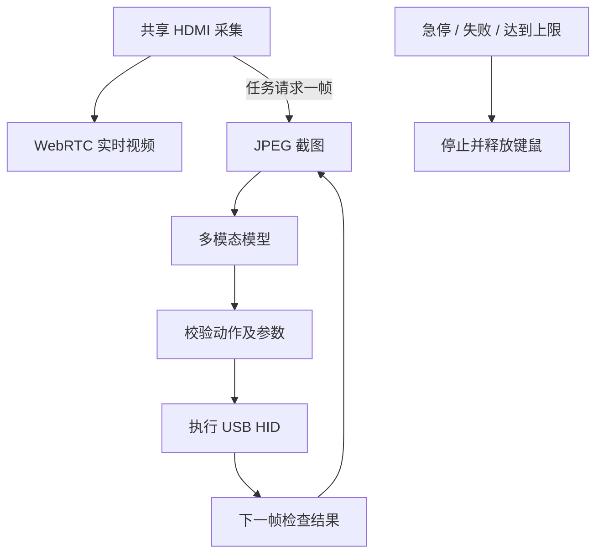

# 配置 AI 控制并接入 MCP

本章提供两条操作路径：在设备网页配置 AI 任务，或让外部 MCP Host 调用板端工具。开始前必须完成[IPKVM 视频与手动键鼠检查](ipkvm.md)。

## 选择接入方式

| 方式 | 配置位置 | 适合的任务 |
| --- | --- | --- |
| 浏览器 AI 任务 | IPKVM 的 AI/HDMI MCP 工作区 | 在网页填写模型与任务，由设备执行 |
| 外部 MCP Host | 支持命令型 MCP Server 的宿主 | 宿主发现工具并按需调用截图、输入、急停 |

两种方式都操作当前 HDMI 来源的电脑。先确认被控电脑显示测试窗口，并准备随时停止任务。

## 配置网页 AI 模型

1. 登录设备 IPKVM，进入 AI/HDMI MCP 工作区；栏目名称按固件版本显示。
2. 填写 HTTPS Base URL 或完整 `chat/completions` 端点。
3. 填写支持图片输入、文本/JSON 动作输出的模型名称与 API key。
4. 保存配置，确认页面反馈成功或显示已配置。

模型的实际协议应与客户端兼容。Embedding 模型只返回向量，不能用作电脑操作的视觉生成模型。

API key 在设备保护文件中保存，例如 `/overlay/aitvbox/secrets/model-api-key`，权限为 `0600`。状态接口仅应显示是否配置；分享截图时遮盖输入内容。

## 执行短任务并检查停止

1. 在被控电脑打开空白文本编辑器。
2. 输入一个限定范围的任务，例如在当前编辑器输入测试词。
3. 设置合适的步数上限并启动一次任务。开发快照默认 20 步，服务端硬上限 30 步。
4. 观察截图、动作与画面变化是否对应目标窗口。
5. 任务结束后核对文本与输入释放；需要中止时使用**急停**。
6. 停止后测试一个手动普通按键，确认控制权已恢复。

当前开发实现通过共享采集按需获取图片，运行 AI 时应保持 WebRTC 直播。若使用旧固件，其直播切换行为应以该固件版本说明为准。



## 在开发主机发现 MCP 工具

`aitvbox-mcpd` 使用 **stdio JSON-RPC**，并非公网 HTTP 服务。以下在**Ubuntu 开发主机、固定产品源码根目录**执行；先在 `adb devices -l` 中确认并替换 `DEVICE_SERIAL`。

```sh
python3 tools/mcp/aitvbox_mcp_client.py --transport adb --serial DEVICE_SERIAL tools
python3 tools/mcp/aitvbox_mcp_client.py --transport adb --serial DEVICE_SERIAL capabilities
```

先确认工具列表和硬件能力返回成功，再获取截图：

```sh
python3 tools/mcp/aitvbox_mcp_client.py --transport adb --serial DEVICE_SERIAL capture --output screen.jpg
```

**检查结果：** 命令退出码为 0，图片可打开且内容属于目标 HDMI 画面。截图可能含工作内容，应保存在受控目录。

停止测试并释放输入：

```sh
python3 tools/mcp/aitvbox_mcp_client.py --transport adb --serial DEVICE_SERIAL stop
```

## 配置外部 MCP Host

支持命令型配置的 Host 可使用以下结构，替换真实设备序列号：

```json
{
  "mcpServers": {
    "mimi": {
      "command": "adb",
      "args": ["-s", "DEVICE_SERIAL", "shell", "/usr/bin/aitvbox-mcpd"]
    }
  }
}
```

加载后先执行工具发现与能力查询，再确认截图。ADB 需预先授权；使用 SSH 的 Host 应具备非交互认证，沿用设备访问控制。

| 工具 | 参数 | 检查重点 |
| --- | --- | --- |
| `hardware.capabilities` | `{}` | 目标实际支持哪些能力 |
| `computer.capture` | `{}` | HDMI 画面是否正确 |
| `computer.key` | `keycode`、`modifier` | USB HID Usage；范围分别为 0–101、0–255 |
| `computer.mouse` | `dx`、`dy`、`buttons`、`wheel` | 位移/滚轮 -127–127，按钮掩码 0–7 |
| `safety.stop` | `{}` | 任务终止及键鼠释放 |

## 处理连接和任务失败

工具发现卡住时，先检查 ADB 授权、目标序列号与服务路径。能截图不能输入时，检查 USB 枚举与当前控制权。模型失败时，核对 HTTPS、模型能力与响应结构，并保留脱敏错误。

需要从板端检查或急停时，在**板端 shell**执行：

```sh
aitvbox-agentctl status
aitvbox-agentctl stop
```

停止后仍存在持续按键或控制权未释放时，保存状态并停止后续输入测试，按[故障排查](troubleshooting.md)处理。

## 查阅依据

[MCP 协议与工具](https://github.com/dshanpi/SmartDesktopMimi/blob/75500c76e389971bfb3bd0a45ac4bed74e1f8cfa/docs/mcp-user-guide.md) · [当前采集与控制状态](https://github.com/dshanpi/SmartDesktopMimi/blob/75500c76e389971bfb3bd0a45ac4bed74e1f8cfa/CURRENT_PROGRESS.md)
