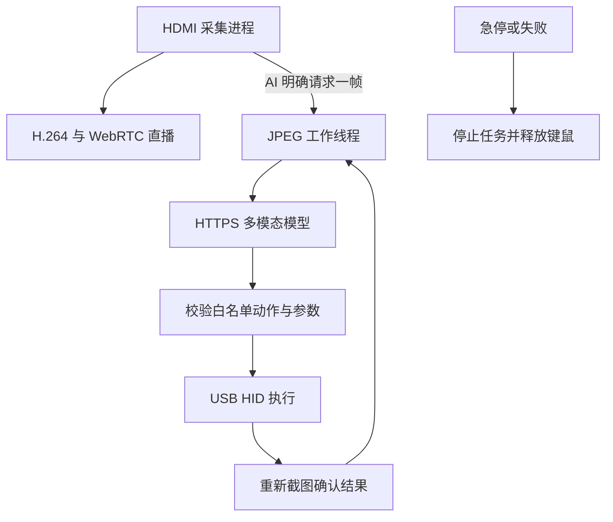

# AI 电脑控制与 MCP

小咪有两种模型接入方式：浏览器配置板端 AI 任务，或让外部 MCP Host 调用板端工具。先把 [IPKVM](ipkvm.md) 的视频与 HID 单独跑通，再接入模型。

## 浏览器 AI 任务

1. 登录设备 IPKVM，打开“AI HDMI MCP”工作区；不同固件的栏目位置可能不同。
2. 配置支持图片输入和文本/JSON 动作输出的多模态生成模型。
3. 填写 HTTPS Base URL 或完整 `chat/completions` endpoint、模型名和 API key。
4. 先执行一个短任务，例如在已打开的空白文本编辑器输入测试词。
5. 观察任务、截图、决策、HID 执行与结果；随时使用“急停”。

API key 运行时写到板端保护文件（如 `/overlay/aitvbox/secrets/model-api-key`），权限 `0600`，状态接口只应返回“是否配置”，不回传密钥正文。文档示例不需要真实 key。

Embedding 模型只生成向量，不能代替能输出动作的视觉生成模型。模型名称包含 vision 也不保证协议兼容，要验证图片输入、响应结构和上下文限制。

## 一次任务的数据流



模型不是按直播帧率不停接收画面。当前开发实现从共享采集路径按需复制一帧，浏览器直播应继续；出现直播中断时记录版本和采集进程状态，不以旧文档中的停播行为替代本版本验收。

默认任务上限 20 步、服务端硬上限 30 步。当前可见 HDMI 帧是目标，不根据操作系统“主屏/副屏”的文字猜测。模型输出仍需通过参数和可见性约束。

## 外部 MCP 工具

`aitvbox-mcpd` 是 stdio JSON-RPC Server，不是公网 HTTP 服务。可通过 ADB、SSH 或本机命令接入。

| 工具 | 输入 | 用途 |
| --- | --- | --- |
| `hardware.capabilities` | `{}` | 查询实际能力 |
| `computer.capture` | `{}` | 获取 HDMI JPEG |
| `computer.key` | `keycode`、`modifier` | 一个 HID 按键并释放 |
| `computer.mouse` | `dx`、`dy`、`buttons`、`wheel` | 相对鼠标动作 |
| `safety.stop` | `{}` | 急停与释放 |

键码范围 `0..101`，modifier `0..255`，相对位移/滚轮 `-127..127`，按钮掩码 `0..7`。这些是 USB HID Usage，不是随意的字符编码。

## 从开发机验证

```sh
python3 tools/mcp/aitvbox_mcp_client.py --transport adb --serial DEVICE_SERIAL tools
python3 tools/mcp/aitvbox_mcp_client.py --transport adb --serial DEVICE_SERIAL capabilities
python3 tools/mcp/aitvbox_mcp_client.py --transport adb --serial DEVICE_SERIAL capture --output screen.jpg
python3 tools/mcp/aitvbox_mcp_client.py --transport adb --serial DEVICE_SERIAL stop
```

先执行能力发现和截图，确认目标正确；输入类测试只在专门的测试窗口执行。截图可能包含电脑隐私，保存在受控位置。

命令型 MCP Host 配置示例：

```json
{
  "mcpServers": {
    "mimi": {
      "command": "adb",
      "args": ["-s", "DEVICE_SERIAL", "shell", "/usr/bin/aitvbox-mcpd"]
    }
  }
}
```

ADB 必须提前授权；SSH 传输需要已配置的非交互认证。不要为接入 MCP 而把设备改成免认证开发模式。

## 常见失败

- 工具列表为空/命令卡住：核对 ADB 授权和 serial。
- 能截图但不能输入：检查 HID 枚举与当前控制权。
- 模型报错：检查 HTTPS、模型能力、返回格式；查看脱敏错误。
- 停止后按键不释放：执行 `aitvbox-agentctl stop`，记录状态并停止继续输入测试。

完整协议和排错命令见[原始 MCP 手册](https://github.com/dshanpi/SmartDesktopMimi/blob/75500c76e389971bfb3bd0a45ac4bed74e1f8cfa/docs/mcp-user-guide.md)。
