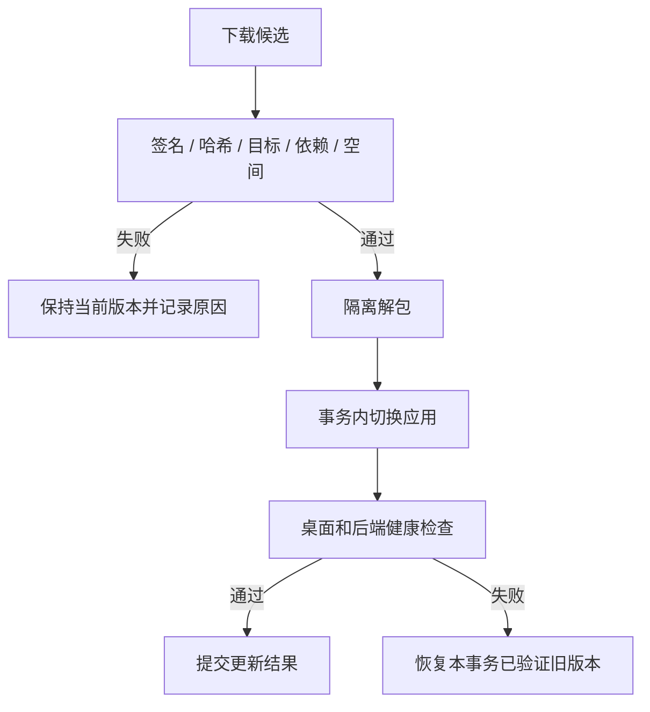

# 检查并执行应用或系统更新

本章适用于已具备相应更新基线的设备。操作前明确更新对象，备份数据并核对候选兼容性；更新后读回版本、功能和数据。

## 选择正确更新入口

| 要更新的内容 | 包与入口 | 必要条件 |
| --- | --- | --- |
| 用户 APP | `.aitapp`，Applications | 可信发布者、APP 目标和版本策略 |
| 桌面及内置页面 | 独立应用更新候选 | 更新器、公钥、完整设备身份与系统依赖 |
| 内核、驱动、平台服务 | 系统 OTA 或配套完整镜像 | 系统信任、分区/启动条件和应用配对 |

首刷或从不具备更新基线的旧系统迁移，按[安装与恢复流程](install.md)处理。普通单槽固件不能直接使用任意 `.swu`。

## 记录当前状态并备份

1. 记录设备板型/修订、产品版本、系统版本和实际运行应用版本。
2. 记录候选来源、文件类型和 SHA-256。
3. 按[数据备份](settings-data.md)准备可校验、可恢复的数据副本。
4. 检查存储空间和网络，结束语音、电脑控制等正在进行的任务。
5. 阅读该候选说明中的前置版本、数据迁移和回退条件。

数据迁移不可逆且缺少恢复方法时，暂停更新。当前开发候选可用性集中在[版本状态](version-status.md)。

## 检查候选并启动更新

1. 打开对应更新页面，执行一次检查。
2. 核对候选是应用还是系统、属于哪个通道、适用哪些目标。
3. 等待下载与完整性、签名、兼容性检查。
4. 页面允许安装且条件满足时，按提示确认。
5. 等待切换或重启完成，避免重复提交同一任务。

**继续条件：** 签名、产品、板型/修订、ABI、接口、系统依赖和更新器版本均满足。被拒绝时按页面给出的实际值和要求值处理。

无可用候选时，先确认是否存在兼容且已发布的目标版本。GitHub 的 latest 标记不会替代设备兼容判断。

## 理解桌面更新的处理阶段

应用更新只替换其允许的桌面与资源内容。平台服务、内核和设备身份由系统管理。

## 检查系统 A/B 与应用配对

系统 OTA 将内容写入目标槽位，由启动机制选择系统，并在启动后完成健康确认。执行前核对分区、Bootloader、bootcount/回退机制、验证公钥和更新器。

应用和系统更新共用互斥事务。系统回退时，持久分区中的当前应用也必须兼容旧系统；必要时使用已验证的配对应用。验证升级方向后，还应执行相应回退方向。

## 更新后读回结果

1. 打开版本页面，分别核对实际系统和应用版本。
2. 完成桌面进入、触摸导航、设置保存与后端状态检查。
3. 连接原 Wi-Fi、蓝牙并验证所需服务。
4. 打开原用户 APP，核对数据与云端归属。
5. 保存本次事务、包摘要、目标设备和各项结果。

回退发生时记录实际回退版本与原因。旧版本恢复成功后，新候选仍需修复并重新验证。

## 处理常见拒绝或失败

| 原因 | 处理方式 |
| --- | --- |
| 目标、ABI 或接口不匹配 | 获取适配当前完整目标的候选或先满足系统基线 |
| 签名或摘要错误 | 重新获取可信来源附件，核对信任与完整性 |
| 身份缺失 | 由管理员按受控登记流程处理 |
| 空间不足或下载中断 | 保留当前版本，释放合适空间或恢复网络后重试 |
| 健康检查失败 | 保留事务与日志，确认回退结果后定位原因 |
| 数据迁移条件不足 | 补齐备份和恢复方案后再进行 |

详细记录方式见[验证与验收](validation.md)。

## 查阅依据

[更新规范](https://github.com/dshanpi/SmartDesktopMimi/blob/75500c76e389971bfb3bd0a45ac4bed74e1f8cfa/docs/application-update-policy.md) · [独立更新实现](https://github.com/dshanpi/SmartDesktopMimi/blob/75500c76e389971bfb3bd0a45ac4bed74e1f8cfa/docs/update/IMPLEMENTATION.md) · [系统 A/B OTA](https://github.com/dshanpi/SmartDesktopMimi/blob/75500c76e389971bfb3bd0a45ac4bed74e1f8cfa/docs/ota.md)
