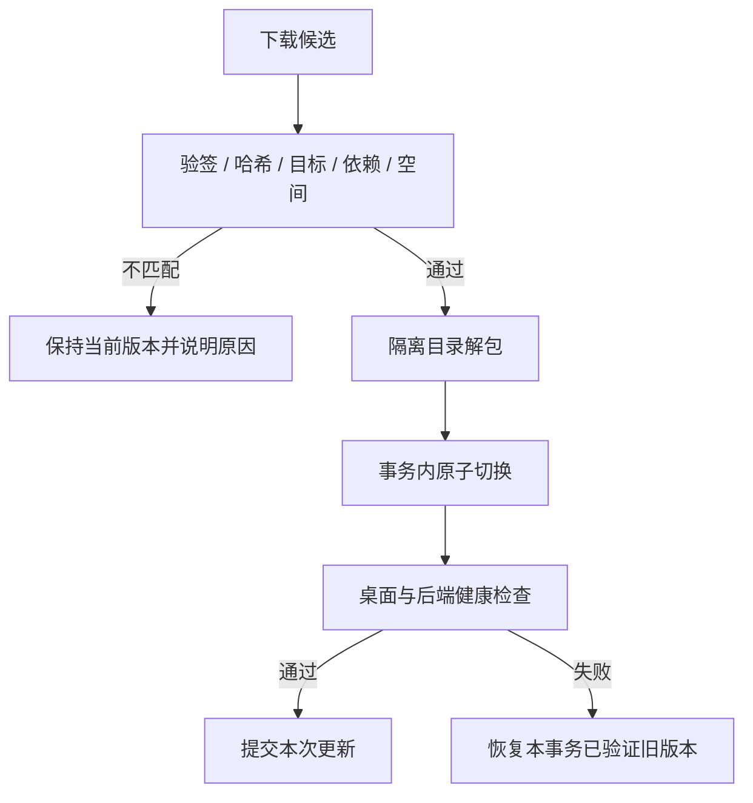

# 桌面更新与系统 A/B OTA

小咪的桌面应用和系统分别更新。安装时必须同时满足信任、目标、版本和数据兼容，不能只比较一个版本字符串。

## 选择正确更新路径

| 你要修改的内容 | 对应路径 | 需要核对 |
| --- | --- | --- |
| 用户 APP 的 UI/业务 | `.aitapp` 安装器 | 发布者公钥、APP ID、版本、权限 |
| LVGL 桌面及其资源 | 独立应用更新器 | 应用签名、完整目标、系统/接口依赖 |
| 内核、驱动、平台服务 | 系统镜像 / 系统 OTA | 启动链、分区、系统签名、出厂应用配对 |

## 普通用户更新步骤

1. 记录当前应用/系统版本，并确认数据备份与恢复条件。
2. 在更新页面检查候选；查看发布类型、通道和兼容结果。
3. 候选下载后等待完整性与签名检查。
4. 在没有语音、电脑控制或其他关键任务时，按页面提示确认安装。
5. 重启或切换后核对版本、桌面健康、网络与用户数据。
6. 失败时保留事务/错误记录，按受控回退流程处理，不反复安装同一个失败包。

没有可用更新可能是没有兼容且已验收的 stable 候选，不一定是服务器异常。GitHub 的 latest 标记不等于设备可以安装。

## 独立桌面更新事务

应用包不能覆盖内核、平台服务、共享厂商库或设备身份。身份缺失、错误板型、未知清单字段或 ABI 不匹配时应在生效之前拒绝，不能退化成通配匹配。

## 系统 A/B 的含义

系统 OTA 写入目标槽位，依赖 Bootloader 的选择、bootcount/回退策略及启动后健康提交。只有已经具备匹配分区、启动机制、验证公钥与更新器的系统，才能使用对应 `.swu`。

普通单槽固件不因下载一个 `.swu` 就自动变成 A/B。构建时需要明确 OTA 配置；独立应用更新基线也不自动等于系统 OTA 基线。

## 两条更新线的互锁

应用更新和系统 OTA 共用事务互斥。系统回退时，持久分区中的新应用可能不兼容旧 Provider，因此必须检查反向配对，必要时选择已验证的兼容应用。只验证“新应用配旧系统”还不够。

数据迁移要支持约定的回退。不可逆迁移缺少恢复方案时停止更新；不能通过删除用户数据让健康检查通过。

## 当前验收边界

在本教程固定快照里，rc33/rc10 没有完成真实升级、回退与断电验收，并有系统来源记录冲突。工具实现和主机测试不能替代这些检查。普通使用者不要把工程候选当成稳定自动更新包。

依据：[统一更新规范](https://github.com/dshanpi/SmartDesktopMimi/blob/75500c76e389971bfb3bd0a45ac4bed74e1f8cfa/docs/application-update-policy.md)、[更新器实现](https://github.com/dshanpi/SmartDesktopMimi/blob/75500c76e389971bfb3bd0a45ac4bed74e1f8cfa/docs/update/IMPLEMENTATION.md)、[系统 OTA 机制](https://github.com/dshanpi/SmartDesktopMimi/blob/75500c76e389971bfb3bd0a45ac4bed74e1f8cfa/docs/ota.md)。
