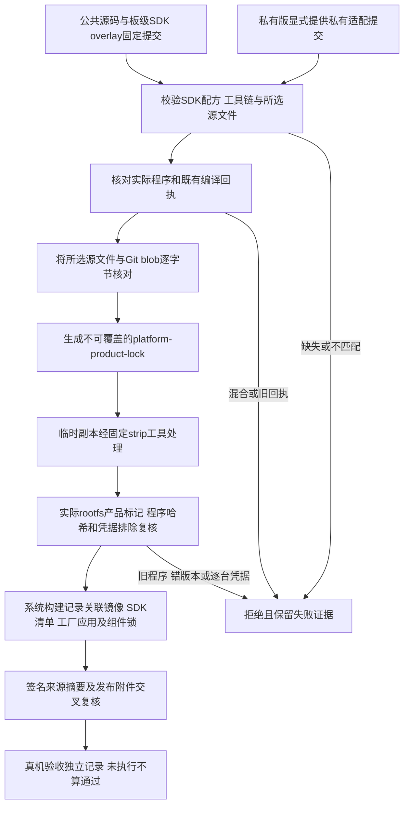

# 产品来源锁与共享应用升级

对应 REQ-MIMI-EDITION-067，接续 PRIVATE065/066。公共桌面和更新包仍只有一份；此处不增加桌面设置页。



## 组件锁保存什么

`platform-product-lock.json` 固定公共、板级 SDK，以及私有版才有的产品私有仓库提交；同时核对所选源码与对应 Git blob 的内容、模式和大小。SDK 配方、源码图、编译器、构建器、strip 工具和 SDK manifest 均记录摘要。锁不包含源码正文、凭据或开发主机绝对路径。

公共锁不引用 `SmartDesktopMimi-Private`。板级 SDK 两版都引用用户指定的 `100askTeam/A133-AIDesktop-Tina5`。私有锁显式绑定 100ask/Tuya 的适配和来源锁，不从旧 SDK 副本回退。

原始程序和安装到 rootfs 的程序分别记哈希。OpenWrt 会剥离 ELF 符号，不能将两者混为一个哈希；派生安装哈希只处理临时副本，原程序保持不变。固件构建在修改 SDK 前核对锁与当前程序/回执，构建后再核对实际解出的 rootfs，防止旧软件包缓存混入。

这个锁只证明所选源码与既有程序回执的关联，**不宣称程序是在当前文档提交上重新编译的**，也不替代完整 SDK 输入锁、镜像、工厂应用、启动链和实机验收。这样文档变更不需要重编未变化的程序。旧组件锁与原 rc2/rc23 仍保持原关联。

## 构建入口

沿用 [公共/私有构建选择](PRODUCT-EDITIONS.md)，再提供标准 SDK overlay 的 Git 仓库路径：

```sh
export MIMI_HARDWARE_SOURCE_ROOT=/absolute/A133-AIDesktop-Tina5
./scripts/build_release.sh --check-only --system-version X.Y.Z /absolute/TinaSDK
```

实际完整构建会先做来源检查，再编译应用、生成组件锁、构建系统并归档 rootfs 回读与组件锁。源码必须已提交；旧 `--allow-dirty` 不能绕过组件锁要求。更新器、签名基线、工具和构建空间仍遵守原发布门禁。

独立检查既有程序可用 `scripts/lock_product_sources.py`，要求显式给出版本、SDK、overlay 仓库、程序目录和新输出路径；私有版额外提供私有产品与外置 100ask SDK。输出已存在时拒绝覆盖。系统记录器将组件锁、产品版本选择及 rootfs 回读摘要纳入 `system-build.json`；发布门禁再与签名的构建来源摘要交叉核对。

## 共享应用升级保留边界

同一个测试签名清单和应用包分别用于公共、私有平台能力集合。主机测试经过真实签名校验、文件系统安装、提交、健康失败回退及六个事务故障点恢复，核对平台程序、模拟设备身份/绑定/授权、网络与应用数据的内容、权限、UID/GID、inode 和修改时间。公共配置不会因升级创建私有路径。签名包试图覆盖平台或凭据路径时，在停止应用前拒绝。

本轮私有保护对象使用了已编译 A133 程序的真实字节，但没有运行这些程序；启动与健康使用测试 Hooks，身份和凭据都是合成标记。它是主机事务验证，不是云授权、实机升级或真实断电证据。

## 当前验收范围

已生成两版实际组件锁；公共核对 10 个共享源和 68 个 SDK 源/记录，私有核对 9 个共享源、67 个 SDK 源/记录和 6 个私有源/锁。两版实际程序经过固定工具剥离，分别在最小 ext4、SquashFS 主机夹具中构造、提取并复核，旧程序被拒绝。这些夹具没有完整系统运行依赖，不是交付镜像。

完整新系统镜像、97 组件及补充输入的最终关联、产品版本在系统 OTA/回退中的匹配、真实升级保留与原功能矩阵仍须后续完成。A133 安装、失联及断电验收按用户要求等待新 SDK 环境；不因此把旧草稿改为稳定发布。
